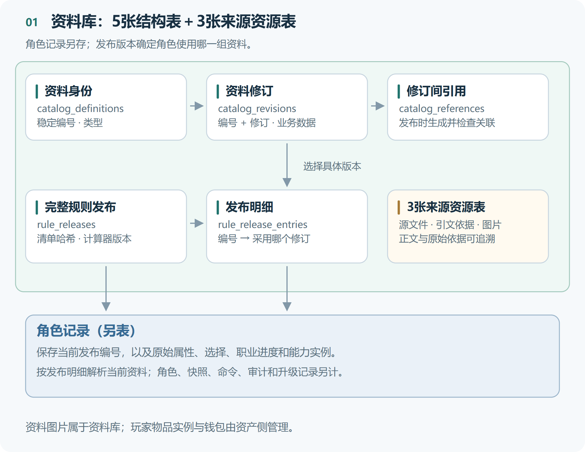
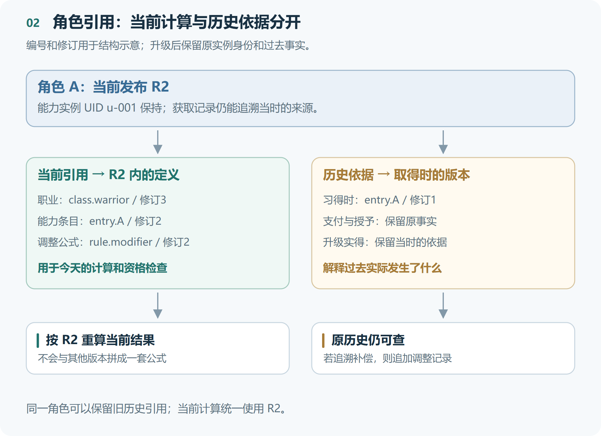
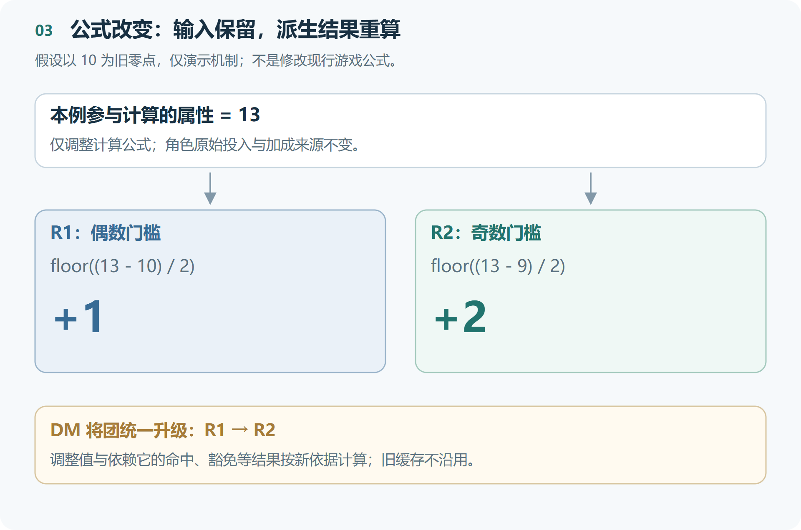
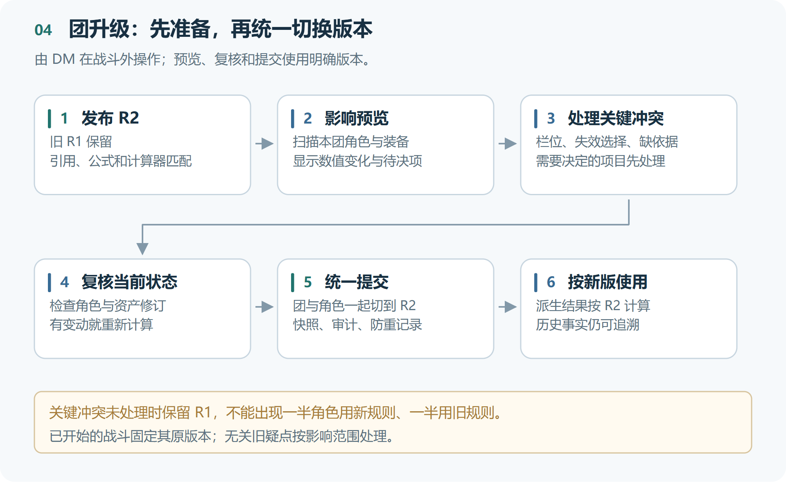

# Snode 资料库与角色关联及规则升级方案

**图文审阅版 · 2026-10-06 · 设计候选**

这份文档回答三个问题：资料库具体怎样存，角色怎样引用资料，以及平衡调整后如何让已有角色正确使用新规则。

**建议采用“版本化资料＋角色原始事实＋统一计算＋明确升级”的结构。** 已发布内容保留旧版本；角色在升级操作中切换当前规则并重新计算，历史事实仍可追溯。

**已确认：由DM在战斗外统一升级本团；未入团角色由本人升级。** 下文的8张资料表、字段和事务约束是具体设计建议，尚未实施。过去收益是否追溯调整仍需确定默认政策。

## 1. 资料库先采用8张表

规范资料放在目标项目的PostgreSQL中。编号、版本和主要关联使用关系字段；不同类型的业务内容使用有明确结构的JSONB。

**图1：5张核心结构表，加3张来源与资源表；角色记录另存。**

| 表 | 主要内容 | 关键约束 |
| --- | --- | --- |
| `catalog_definitions` | 稳定编号、资料类型，如职业、技能、领域 | 编号不因改名而改变 |
| `catalog_revisions` | 名称、别名、结构版本、业务内容、正文引用 | 编号＋修订号唯一；发布后不可变 |
| `catalog_references` | 某资料修订引用哪些其他修订 | 从规范数据生成；引用目标必须存在 |
| `rule_releases` | 一次完整发布的编号、清单哈希和计算器版本 | 已发布版本不可覆盖 |
| `rule_release_entries` | 本次发布具体采用哪些资料修订 | 每个发布中，同一资料编号只选一个修订 |
| `source_documents` | 原始文件、来源版本、文件哈希和存储位置 | 来源文件可追溯 |
| `source_evidence` | 原文位置、核对和勘误依据 | 能查到具体依据 |
| `catalog_media` | 资料图片等资源的哈希、位置、类型和尺寸 | 同一内容按哈希识别 |

原JSON可以继续作为整理和导入来源；数据库中的规范发布版本用于读取。搜索索引和网页资料包由同一发布版本生成，避免各自修改。

关键键关系建议明确为：资料修订使用编号＋修订号；发布明细使用发布编号＋资料编号，并引用具体资料修订。角色记录引用发布编号；关系字段与文档内版本由同一服务保存维护。

关联表也由同一次发布过程生成并校验，不再人工维护第二套关系。发布时检查完整引用闭包：被引用的定义修改后，其依赖条目需要同步生成新修订，确保本次发布内的引用一致。

这8张是资料库的起始设计。角色、快照、命令、审计及升级记录另计；账号、团和资产与3.2共同设计。资料图片与玩家库存物品也分别管理。

## 2. 职业定义有哪些字段

职业共用身份和修订表，在业务层提供“职业视图”。以下是逻辑字段；具体SQL及JSONB命名在共享Schema中确定。

| 字段 | 含义 |
| --- | --- |
| `definition_id`、`revision` | 职业稳定编号与具体修订 |
| `name`、`aliases` | 名称及别名 |
| `key_attribute_choices` | 可选关键属性 |
| `progression_rule_ref` | 首级、升级收益等成长规则 |
| `ability_list_refs` | 关联的技能、天赋等列表 |
| `initial_grant_refs` | 初始特性、专长、熟练及能力授予 |
| `choice_refs` | 建卡和成长需完成的选择 |
| `advancement_refs` | 进阶候选及途径 |
| `compatible_main_classes` | 作为子职业时的兼职条件 |
| `content_refs` | 完整正文和图表 |
| `schema_version` | 业务数据采用的结构版本 |

例如，战士定义描述战士怎样成长；某角色的战士等级、已选关键属性、实际能力和当前生命值放在角色记录中。

种族、领域、物品等沿用共同的编号与版本机制，各自有明确的业务结构。JSONB字段必须经过类型和语义校验，不能随意增加键值。

## 3. 角色绑定完整规则发布版本

资料修订与规则发布是两层不同的版本。

| 层次 | 示例 | 含义 |
| --- | --- | --- |
| 资料修订 | 战士定义修订3 | 某一份资料的具体内容 |
| 规则发布 | R2 | 一组确定的资料修订和计算器版本 |
| 角色修订 | 角色A的第12次保存 | 并发检查和保存历史 |
| 存档结构版本 | schema_version 1 | 角色文档使用什么字段结构 |

R2可以继续使用未改变的职业修订，同时采用新的技能和公式修订；不要求所有资料一起升修订号。

角色主表建议为 `characters`，保存角色编号、拥有者、修订、当前规则发布编号和完整角色文档（JSONB）；团与时间线由服务维护。职业进度和能力实例放在文档中，不为每个玩家新增表。

另有快照、命令、审计和规则升级记录；已有共享表可以复用。

角色保存当前规则发布版本、原始属性与选择、职业进度、能力实例及获取来源、当前资源和历史事实。当前计算引用必须属于该发布版本，不能分别取各份资料的latest。

| 角色中的关联 | 对应资料 |
| --- | --- |
| 当前规则版本 | 一条规则发布记录 |
| 职业进度中的职业引用 | 职业编号＋具体修订 |
| 已学能力中的来源条目引用 | 能力条目编号＋修订，再关联技能正文和来源 |
| 获取与支付记录的历史引用 | 当时已发布的资料修订 |

**图2：角色升级到R2后，现行计算使用R2；过去如何获得能力仍可引用R1。**

两类引用各有职责：

- **当前引用**：当前职业、技能、持续加成等按哪个定义计算。
- **历史引用**：当时按什么规则学习、支付或获得升级收益。

升级时调整当前绑定，保留能力实例编号和获取来源。历史记录中的旧引用不整体替换；它们解释当时发生了什么。

跨职业技能关联真实来源条目，分别保留来源、阶位、成长依据、关键属性和占栏规则。同名或显示在同一面板，不意味着这些依据相同。

## 4. 用调整值变化说明重算

下面只说明机制，**不是修改现行游戏公式**。假设参与计算的属性仍为13，本次只改公式：

~~~text
R1：调整值 = floor((属性值 - 10) / 2)
R2：调整值 = floor((属性值 - 9) / 2)
~~~

**图3：保留同一输入，切换公式；调整值及依赖它的结果一起变化。**

| 属性 | R1结果 | R2结果 |
| --- | ---: | ---: |
| 12 | +1 | +1 |
| 13 | +1 | +2 |
| 14 | +2 | +2 |

资料库要保存能执行的受控表达式或版本化计算函数，不能仅保存“一句话公式”。计算器版本也纳入发布清单和哈希；改代码实现时同样需要新发布。

调整值、命中、防御等可缓存，但不能成为另一份独立可编辑的原始数据。缓存至少绑定角色修订、规则发布及相关资产修订。版本变化后按新依据重算，不能继续使用旧缓存。

前后端使用同一规则版本，服务器负责最终校验。旧版本计算器不再可用时明确报错，不能偷偷套用新版。

## 5. 不同变化，采用不同处理方法

| 改动 | 建议处理 |
| --- | --- |
| 调整值、命中等纯公式 | 保留输入，按新版本重算 |
| 种族、装备、被动能力的持续加成 | 保留来源和选择，按新定义计算当前效果 |
| 过去升级所得、已支付费用和已领取奖励 | 保留原事实；是否追溯调整由迁移政策规定 |
| 技能删除或拆分、栏位减少、选项失效 | 生成影响方案，处理需要玩家或DM决定的项目 |
| 历史档案缺少必要计算依据 | 保留原值和待核对问题，不伪造新结果 |

现有模型要补充“持续按定义生效”与“当时获得的固定收益”的区别。只存来源编号，却继续读旧存档里写死的加成，仍然无法跟随规则更新。

**历史事实和当前效果分开。** 若某次更新要求追溯补偿，则追加调整记录和依据，不改掉当年的支付、收益或领取记录，也不重复发奖励。

生命上限变化后的当前生命处理要有明确政策，不能默认回满。装备计算使用同一规则上下文；物品归属、数量、随机实得属性和交易历史仍由资产侧维护，不能通过规则升级随意改写。

游戏规则版本与数据结构版本也分别维护：调整公式通常只需新规则发布和重算；改变存档字段时另做结构迁移。

## 6. DM怎样统一升级本团

**图4：先准备与解决冲突，再统一切换；升级完成前仍使用旧版。**

1. **发布R2。** 保留R1，验证引用、类型、公式与计算器的兼容性。
2. **生成团内影响预览。** 查看每个角色的属性变化、失效选择、栏位和装备影响。
3. **处理待决项。** 纯计算变化生成结果；必须作出的选择先完成。无关的旧疑点不扩大成全团阻塞。
4. **复核当前状态。** 检查团、角色及受影响资产修订，确认未进入战斗；预览后发生变化则重新计算。
5. **统一提交。** 一次事务更新团版本与角色当前记录，并保存快照、审计及升级结果。
6. **按新版使用。** 新版派生值生效，旧记录仍可查询。

关键冲突未处理时，本团继续使用R1。若数据跨数据库保存，先解决耐久协调与失败恢复，不能靠前端连续请求声称一起成功。

需要保留待核对的事实时，明确受影响范围；当前计算不能回退到另一个版本来凑结果。未来战斗开始时固定本场规则版本，进行中的战斗不会因发布新版改变公式。

未入团角色由本人升级；加入团时检查与该团版本的一致性。

## 7. 用这些检查保证一致

| 检查点 | 要保证什么 |
| --- | --- |
| 发布 | 编号、修订、引用闭包、正文资源和计算器匹配；已发布内容不可覆盖 |
| 保存 | 完整角色结构合法；当前引用属于当前发布，历史引用有依据 |
| 服务提交 | 权限、角色版本和资产版本重查，文档与关系字段一起维护 |
| 计算 | 同一角色事实、规则和资产输入产生一致结果 |
| 重试与缓存 | 同一升级不重复执行；缓存不混用版本 |
| 验证 | 覆盖公式变化、持续加成、历史收益、失效技能和并发修改 |

SQL关系字段可以用唯一约束和外键校验；JSONB中的业务引用仍需要服务在发布、保存和升级时完整检查。不能只因为JSON能入库，就认为角色合法。

目前完成的是设计讨论，尚未创建这些业务表或实现自动规则升级。本方案与[一期迁移总体方案](https://lcnnkviu5vj0.feishu.cn/docx/RHBcdisuGop0SzxZfarcJhuxnLc)配合阅读。

## 8. 本次评审需要落定的事项

- [ ] 8张资料表与角色、资产的职责划分是否采用。
- [ ] 职业及其他资料的结构、主外键和发布校验怎样固化。
- [ ] 持续加成、历史实得收益和人工记录怎样标记。
- [ ] 当前资源、技能失效、栏位冲突等迁移政策怎样处理。
- [ ] 团升级事务、幂等记录及同版本计算的验证怎样实施。

**仍待确认：过去已获得的成长收益是否默认保留。** 建议默认保留；发布者若声明追溯调整，再提供明确迁移与调整记录。这是建议，不作为已经确认的规则。

参考：PostgreSQL的[JSONB说明](https://www.postgresql.org/docs/current/datatype-json.html)与[约束说明](https://www.postgresql.org/docs/current/ddl-constraints.html)。具体表名、字段和Schema以双方共同评审结果为准。
