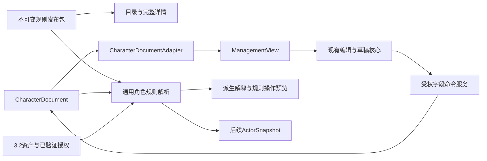
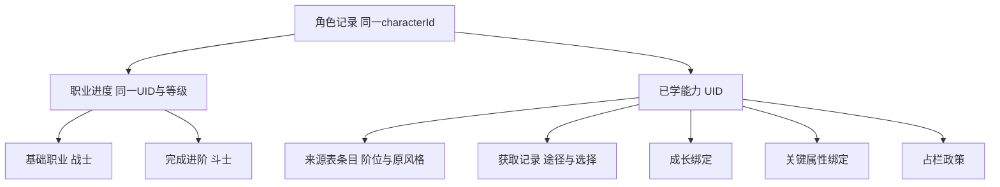

# T06_字段与接口候选_20261005

> 打包阅读副本。原始材料：[T06_字段与接口候选_20261005.json](../01_计划与设计材料/T06_字段与接口候选_20261005.json)。原JSON字节保持不变；正文中的已打包链接改为相对路径。

编写日期：2026年10月5日。状态：T06设计候选v0.2.0，已完成字段与引用关系、候选接口、保存边界和现有管理核心衔接的收敛。文档内类型草案通过目标仓库现有TypeScript 7.0.2的noEmit检查；尚未实现运行时Schema、规则计算、角色API或数据库迁移，也未完成T07代表资料验证。

本方案承接[分步执行计划](https://chatgpt.com/space/page_8d2acb837bbc819196ddbbcc1ab5efe7)、[总体结构草案](资料与领域框架调查_原阶段记录.md)和[T05已确认规则](T05_审查依据摘要_20261004.md)。建议用一份通用CharacterDocument保存角色游戏事实，以只读管理投影适配现有编辑器；职业、技能、领域、进阶和单位都通过有版本的定义引用。正式公共ABI与数据库结构仍需和3.2共同评审。

## 本轮基线与已确认范围

后台Git SSH于本轮验证远端main仍为929cd8c4ac48d8aa268608411c77e95753bd0655。本机D:/Download/Snode在codex/character-management-implementation0分支，有23项既有未提交修改；候选角色管理核心和网页已存在。本轮只读这些文件，不覆盖、提交或发布它们。

| 层面 | 已核对事实 | 处理方式 |
| --- | --- | --- |
| 远端main | 工程基础；contracts仅健康／就绪响应，db仅users，API仅health／ready | 继续使用已有工程，业务契约和迁移尚待建设 |
| 本机候选核心 | ManagementView、编辑命令、草稿、回执、快照、冲突及本机预览 | 可复用编辑协议，按候选状态评审，不冒称已合并或云端已完成 |
| 适配器边界 | CharacterDocumentAdapter<T>由模型工作线提供完整文档，投影与白名单修改独立 | 接入通用模型，避免再建一套只含面板数字的生产角色表 |
| 一期开发文档 | 3.1资料／建卡／管理与3.2登录／云保存／团权限／基础经济协作 | 3.1承担对应API；资产与授权不复制第二套权威 |
| 游戏规则 | 以主规则和T01至T05确认记录为依据 | 未定部分登记来源，不把草案编译通过当规则正确 |

本轮用户另确认：同一角色在同一时间线只能加入一个团；一期不支持跨时间线复用角色。因此一期角色记录不分叉为多团或平行线副本，团关联在服务层检查唯一性与时间线一致。角色尚未关联团可保留未关联状态；这不是自动允许转团。退出、转团、团关闭后的处置由3.2流程另行约定。角色所有者、权限、时间线和团绑定都不能由普通角色编辑命令随意改写。

## 四层数据与依赖

资料定义、角色持久事实、界面投影和未来战斗运行状态分别保存。资料包不可变，角色引用其中精确修订；面板读取投影，战斗以后从角色与资产事实生成独立快照，不直接修改目录或共享角色对象。



| 模块 | 定稿方向 | 边界 |
| --- | --- | --- |
| packages/model | 纯类型与结构校验，定义引用、角色、来源和快照形状 | 无React、Fastify、数据库、catalog或HTTP反向依赖 |
| packages/catalog | 发布包读取、完整正文、精确引用、筛选索引和旧引用映射 | 不修改人物、余额或学习状态 |
| packages/rules | 角色派生、获得与成长解析、受控操作计划 | 接收只读目录与可信上下文，不弹窗或直接写数据库 |
| packages/contracts | 请求、响应、命令、投影与错误DTO | 引用model，规则公式不写在HTTP类型里 |
| apps/api | 登录授权衔接、目录／角色路由和事务编排 | 校验命令并调用规则；不信任客户端算好的奖励 |
| packages/db | 权威当前记录、快照、回执和已协作的关系 | 采用共享Drizzle入口，新增迁移不覆盖历史迁移 |
| apps/web | 建卡、资料、选择、面板与草稿恢复 | 读取服务结果；复用候选编辑核心和同一详情组件 |
| 后续combat | 行动、回合、反应与战斗状态 | 本期仅预留快照桥接，不在T06冻结完整战斗执行接口 |

model、catalog、rules是建议的包分工，当前尚未创建。不要把领域计算一股脑放进contracts，也不要让model引用HTTP命令造成依赖环。

## 身份与版本字段

- **definitionRef.id/revision**：string＋正整数。资料稳定身份与不可变修订；名称、职业显示名或排序不充当ID。
- **ruleset.id/manifestHash**：发布ID＋内容哈希。锁定整套定义、正文、资源和裁定；不保存可变的latest。
- **schemaVersion**：正整数。数据结构版本；与游戏规则更新、角色并发修订分开。
- **characterId/revision**：实例ID／服务修订。角色ID不随进阶改名；revision由服务端提交生成。
- **timelineId/campaignAssignmentId**：服务元数据，可未关联。一期不跨时间线复用，一个角色在所属线只关联一个团；不由角色JSON赋予权限。

定义引用用id与revision；角色再固定ruleset.id与manifestHash，解析器检查该修订确实属于所选发布包。schemaVersion描述数据形状，characterRevision描述服务提交，二者不会随职业阶位相互换算。

```typescript
interface DefinitionRef { readonly id: string; readonly revision: number }
interface RuleReleaseRef { readonly id: string; readonly manifestHash: string }

type Recorded<T> =
  | { readonly state: "known"; readonly value: T; readonly evidenceRefs: readonly string[] }
  | { readonly state: "unrecorded" }
  | { readonly state: "unresolved"; readonly inputFactId: string; readonly issueRefs: readonly string[] };
```

0是已知数值，unrecorded是未填写，unresolved有原始输入或规则疑点。例：FP=0不能变成缺失；HP=-4不能夹为0；职业等级未读出不能填1。管理投影中的null表示未记录／未可靠解析，详细原因由规则投影或问题说明提供。清空输入是明确操作，不隐式切换“记录值／按规则计算”模式。

## 资料定义与正文结构

| 字段或记录 | 数据形状 | 要求 |
| --- | --- | --- |
| DefinitionRecord.kind/payload | 受控类别／对应数据 | 职业、种族、能力、领域等是定义记录；新增职业无需程序子类。 |
| contentRefs/tagRefs/relatedRefs | 精确DefRef数组 | 完整正文、关键词和关系；不能用检索摘要替代正文。 |
| SourceEvidence | 来源、哈希、定位、复核状态 | 原文与用户补充分别定位；已确认语义不代表程序已实现。 |
| InlineRun/TableCell | 文本、颜色、合并行列 | 保留圆点字体颜色、表格底色和合并信息；语义标识与展示RGB不同。 |
| AbilityEntry.ability/sourceList/sourceClass | 精确引用 | 保存实际来源职业／领域；同名定义继续共存于资料库。 |
| AbilityEntry.tier/styles/sameNameGroup | 阶位事实／原风格／规则组 | 实际来源阶位用于精锐；同名组用于学习限制，不用于替代来源身份。 |
| ClassDefinition/DomainDefinition | 规则、选择、表与绑定 | 领域属于职业关系，不生成牧师子类；模式资料独立标识。 |
| EntityTemplate.nativeAbilityRefs/challengeLevel | 固有能力／有理数 | 固有动作不是玩家职业技能；挑战等级允许1/4、1/2。 |

AbilityDefinition保存效果与完整详情，AbilityEntry保存哪张表以哪个职业、阶位和途径提供它。相同效果可以共用定义，但来源条目不合并；同名技能不能重复学习，并不意味着资料库只剩一个同名条目。

ContentDocument保存有顺序的段落、表格、图片与关联定义。段落保留原文，表格保留合并行列、底色与圆点颜色，资产按内容哈希引用；本机绝对路径只在来源清单出现，发布内容不能依赖D盘。召唤技能的详情必须能引用单位模板及其所有固有动作；学习页、已学面板和职业树都使用同一完整详情组件。结构化摘要只用于索引或计算，不能替代剩余原文。

## 角色根记录与职业关系

| 字段或记录 | 数据形状 | 要求 |
| --- | --- | --- |
| profile.displayName/story | 文本 | 直接适配现有管理投影；其他资料按注册字段逐步接入。 |
| race/background/choices | 定义选择与ChoiceRecord | 选择结果保留来源；换选通过重建计划检查依赖，不残留旧奖励。 |
| progressions.uid/role/baseClass | 实例ID／main-sub-gift／已知或未定定义 | 同一角色使用通用结构；附赠实例允许结构表达，数量规则仍待确认。 |
| progressions.level/keyAttribute | Recorded<number/DefRef> | 未知与0分开；不把缺失职业等级填1。 |
| advancement/chosenPathwayRefs | 完成进阶／候选途径引用 | 斗士7级仍继承战士7级；每份进度一个完成进阶，三条候选信息单独存。 |
| domains.ownerProgressionId/deity/domain | 绑定与选择 | 神祇、领域和所属职业引用独立，保留具体选择。 |
| mainUnlockedTiers | 主职业已开事实 | 子职业与通用树读取此集合；不因子升级自动新增主未开阶。 |
| features/recipes/knowledge/mechanisms | 独立持有或授予记录 | 专长、职业专精、图纸、语言及机制有获取关系，不能都塞进技能名字数组。 |

CharacterDocument是角色游戏事实，CharacterRecord是服务当前记录的封装。所有者和授权在服务数据中；timelineId与campaignAssignmentId由服务决定，普通角色JSON不会赋予玩家或DM权限。资料未完成或导入待核的记录可以有结构合法的未知事实，但自动建卡／成长必须另外满足规则条件。有效生命周期不等于游戏规则已全部校验。

进阶保留同一职业进度UID。战士7级完成斗士进阶后显示斗士7级，baseClass仍为战士，level仍7；不创建第二份等级、额外职业数量或首级奖励。领域记录引用所属进度，新增神祇或领域主要新增定义与绑定，不新增牧师程序类。



主职业维护实际已开阶位集合，所有子职业与通用树派生读取；牧师所选领域同步所属职业。主开六阶、子牧师1级时，子有六阶资格，但职业等级仍1，能力成长与具体前置条件照常检查。主达到开启门槛不等于已经付费开阶；子升级不能按旧表给主集合增开尚未开启的阶位。该政策使用F54补确认，旧升级表条款保留为被覆盖来源。

## 获取记录与技能实例

| 字段或记录 | 数据形状 | 要求 |
| --- | --- | --- |
| LearnedAbility.uid/entry/acquisitionId | 实例ID／Recorded<EntryRef>／获取ID | 确定来源时精确引用；历史未识别时保留证据和问题，不造假ID。 |
| AcquisitionRecord.route/rule | 途径与政策引用 | 区分初始、学习、专长、背景、战斗心得、镜子大师和人工来源。 |
| acquiredDefinition/selectedEntry/grantorRecordId | 定义、来源条目、授予记录 | 职业专精不强求有职业技能表条目；授予者有自己的持有记录。 |
| choiceRecordIds/paymentIds/operationId | 选择、支付、提交关系 | 费用和奖励能追溯，不仅保留最后数值。 |
| acquisitionOrder/styleParticipation | 学习次序／是否影响顺位 | 建卡起始与跨职不定顺位，战斗心得确定；原风格始终保留。 |
| placement/growth/keyAttribute | 三个独立绑定 | 专家放副列表仍随主成长；开阶共享不替换子职业成长等级。 |
| slot/useStatus/issueRefs | 占用政策、取得合法性与问题 | 免栏不等于无阶位；条件锁定不等于不可移除或战斗中可用。 |
| learningRestrictions.sameNameGroup | 角色内永久禁学 | 正式遗忘不返SP，不能换来源再学同名；目录和原UID仍保留。 |

取得来源、放置列表、成长依据、关键属性依据、占栏、风格参与各自保存。普通获取政策可由定义给出默认值，获取记录保存实际途径和选择，不在页面按技能名重新猜。

例：主游荡者8级、子法师3级，经魔法专家取得法师来源魔法飞弹并放子列表。来源仍为法师实际条目，成长跟主8，专家授予免费免栏，跨职业获取不定风格顺位；关键属性按已确认的对应职业绑定解析。不能因为放子列表就把成长改成3。镜子大师也按本人主职业成长，但前置／额外豁免不免色彩标识，对立学派仍检查。

风格原字段与职业顺位区别保存。顺位按有效学习先后，建卡起始和跨职业获取不参与，战斗心得参与。当前原始记录没有可靠学习时间时，用未定顺序和导入原风格保留事实，不按数组顺序或技能数量伪造历史。遗忘后顺位怎样变化仍是既有边界。

F52所列五类初始／专长／背景授予免费且免栏，不能扩大为所有一阶或所有grant免费。F53每阶天赋全角色共享，默认5项加明文额外槽，免栏记录不挤占容量。主技能、子技能、专业图纸池与法师／智慧领域受限额外槽分别表达；受限槽有允许标签，不把职业槽增量翻倍。

技能同名查重和永久遗忘禁令在一个角色内跨来源检查，正式删除不返技能点。实际变更仍按UID，禁止按名称删除首个匹配项。明文“已经拥有则增强”是原实例增强，不是另学第二个同名技能。职业专精／机制重复授予、战斗心得追加免栏等未答部分保留政策问题，不自动套用普通学习禁令。

## 数值与成长事实

| 字段或记录 | 数据形状 | 要求 |
| --- | --- | --- |
| attributeFacts/proficiencyGrants | 来源分解的永久和临时事实 | 普通熟练、武器资格、额外武器和豁免分别处理；奥秘授予一个子项。 |
| hpGrowth.historyStatus/awards | 完整性与逐次收益 | 首级HP按永久体质调整，已领取升级HP冻结；缺历史不反算。 |
| GrowthAward.hpGain/fpGain/rule/operationId | 实际奖励与依据 | 记录用于核对和幂等；不因此把HP政策推广到FP关键属性。 |
| statOwnership.maxHp/maxFp | derived或recorded | 固定导入值与规则值独立；清空记录不自动改模式或补0。 |
| resources.hpCurrent/fpCurrent | Recorded<number> | 允许记录负HP及FP=0；手工录入不是自动伤害／治疗流程。 |
| xpAvailable/skillPointsAvailable | 余额事实 | 余额与成长级别、累计获奖及使用次数不同。 |
| learningSession.playSessionId/colorMarkRefs | 本场学习资格 | 下一次游玩开始到期；消耗和替代未定，不沿用旧彩色费用转换。 |
| manualPools/manualStatuses | 带UID与来源的手工记录 | 护盾、临时资源与状态不压成无来源总和；本期不假装已有战斗结算。 |
| RequirementFactRecord.approval/value/scopeId | 前置事实与确认状态 | 自述、确认与争议分开；叙事条件不能仅凭次数自动判通过。 |
| LegacyInputFact/issueRefs | 原值、定位与未定问题 | 未知资料保留原文，阻塞具体自动操作而非所有编辑和阅读。 |

最大生命解释为已确认政策下的首级收益、已领取升级HP合计与其它明确HP加成。永久体质变化只调整首级，既得升级增益不变；原例7级战士48→49。临时体质不增加最大HP，除非有独立明文效果。GrowthAward保留实际增量、规则和提交身份，历史不完整时保持原固定最大值，不能由当前体质重建从前每级收益。未来新升级的体质时点尚留既有确认边界，FP政策不从HP推导。

当前HP／FP与最大值分开，手工状态和来源池独立。管理界面的set-number是记录某个当前值，不是调用伤害、治疗或死亡裁决执行器；最大值变化也不在未定政策下自动改当前值。临时生命取最高、护盾来源独立等T04规则，要求保留来源记录而非将全部压成一个相加数字；未确认的压制来源回退等结算仍不执行。

临时属性和临时熟练均保留作用域／到期引用，不能永久混入基础值；无法解释的期限继续人工记录，不按墙上时钟猜成游戏回合结束。临时属性不满足属性前置，临时熟练的资格政策不因此一并推定。

派生值从永久事实、有效效果和可信资产投影计算，输出ready、needs-decision或unsupported，并附依据。武器命中要有实际武器与其属性、资格／额外熟练上下文；法术命中要有该能力关键属性绑定。角色不保存一个适用于所有攻击的万能最终命中。

技能点容量先覆盖F51已确认的主／副场景：1＋有无子职业＋主是否进阶＋子是否进阶。五种例子为1、2、2、3、4；附赠数量仍待定。本场色彩资格带游玩场次，在下一次游玩开始到期；不按回合或战斗结束清除，消耗／替代政策仍待答。F50奇械师新学习费用按用户要求等待新版表，不做猜测转换。

## 资产与战斗桥接

| 字段或记录 | 数据形状 | 要求 |
| --- | --- | --- |
| equippedAssetLinks.assetInstanceId | 3.2资产引用 | 角色只引用装备状态，不再保存第二套权威钱包和库存。 |
| expectedAssetRevision | 已知资产修订或未提供 | 需要资产参与的操作检查相应事实；缺服务不伪装成无装备或0货币。 |
| ManagementView | 既有只读编辑投影 | 只包含注册资料和数值；不是CharacterDocument，也不是生产存储结构。 |
| RuleView/DerivedNumber | ready或需裁定／未支持 | 派生结果带依据，攻击命中按武器／能力上下文，不存一个万能最终命中。 |
| DerivedActorSnapshot.source/resolvedValues | 实例及来源修订快照 | 玩家与单位都可准备快照；不含回合队列或动作预算的完整执行状态。 |

钱包、库存、物品实例、交易价格与流水由3.2权威服务维护。角色配装保存资产实例引用和装备状态；规则计算需要可信的物品定义与当前资产修订。完整导出和历史展示可以拼接资产投影，但不能把读取的副本当作可写钱包。服务未准备好时标明未接入，不伪造0货币或无装备。

EntityTemplate是不可变模板，PersistentUnitRecord是坐骑／伙伴等需要长期记录的单位，ActorSnapshot是某次解析后给战斗用的输入。同模板召唤两次生成不同actorId和状态，不能共用模板对象的HP。单位固有动作直接引用能力，不强行归到玩家职业或猜成一阶。挑战等级允许分数。

快照固定规则包、来源角色／单位修订、解析结果、能力来源与成长上下文、涉及的资产修订。它不等于完整CombatState；调度、反应队列、时间区间、动作预算及状态生命周期待逐职业审查和后续战斗建设。以后写回角色需要明确变更命令和修订校验，不能把战斗对象整体覆盖角色文档。

## 接入现有角色管理核心

现有CharacterDocumentAdapter<T>保留三个职责：validateDocument、toManagementView、applyRegisteredEdits。T06建议以CharacterDocument实例化泛型，由模型／规则提供方实现具体适配；现有编辑、草稿、冲突与回执状态机继续复用。

| 现有对象 | 接入方法 |
| --- | --- |
| ManagementView | 继续只读投影profile与注册numericFields；不增加未经版本约定的字段 |
| ProjectionMetadata | 从权威记录取得角色ID、修订和生命周期，和文档身份核对一致 |
| ProjectionPolicy | 由3.2已验证权限生成，不能来自角色JSON中的editable或contextKey |
| UpdateManagementCommand | 保留commandId、characterId、expectedRevision、submittedDraftVersion和明确edits |
| applyRegisteredEdits | 只改白名单事实，构建新文档；规则与资产操作不塞进普通set-number |
| SaveTicket／草稿检查点 | 保留提交时输入、命令和草稿版本；保存后的新输入仍是未提交草稿 |
| 本机CharacterService | 读、提交、历史、草稿端口可适配真实服务；本机IndexedDB不是云保存 |
| 匿名create() | 本机空档案行为不当作合规建卡；正式创建走BuildSelection及服务提交 |

候选核心数值字段是可注册的字符串引用。当前夹具使用temporaryHp／shield／exhaustion，本机UI使用hp.temporary／shield.manual／exhaustion.manual；这不证明运行错误，但说明正式字段ABI尚未统一。建议按受控注册表映射，不将fieldRef当任意JSON路径或允许客户端借此修改所有者、团、规则包、库存。

hp.current和fp.current映射到角色当前值事实；hp.temporary等手工汇总编辑只能映射明确的手工池记录，不能无声覆盖技能生成的多个来源。需要改变固定值／派生模式、永久属性来源、结构化状态或配装时，另用已批准的类型化操作，不偷偷扩展普通数值编辑语义。

原验证器对白名单、未知字段、回执匹配已严格检查，因此正式新增字段需版本约定。现有数据预算是软件传输预算，不是游戏上限。类型兼容检查只证明这些候选形状可组合，未实现上述字段映射、生产授权或事务。

## 候选接口清单

以下接口均为设计提案，现有API仍只有health和ready。正式路径和DTO经双方评审后才进入packages/contracts；本轮没有添加路由。

| 方法与路径 | 主要输入或输出 | 边界 |
| --- | --- | --- |
| GET /api/catalog/releases/:releaseId | 发布清单与定义／资源修订 | 锁定manifestHash；真实API尚未实现 |
| GET /api/catalog/definitions | release、kind、text、sourceList、tier、cursor | 游标绑定发布版本与筛选；种类和页大小受控 |
| GET /api/catalog/definitions/:id/revisions/:revision | 完整正文、来源与关联模板 | 必须属于请求发布包；不能按名称取首条 |
| POST /api/character-builds/preview | BuildSelection＋draftVersion | 无持久化，返回必要选择和规则问题 |
| POST /api/characters | CreateFromBuildCommand | 正式建卡、创建和初始资产同一受控流程；不沿用匿名create() |
| GET /api/characters/:id/management | ManagementView v1候选 | 沿用现有编辑器形状，权限由服务生成 |
| GET /api/characters/:id/rules-view | 角色修订＋派生解释 | 与管理投影分开，未知不补0 |
| POST /api/characters/:id/management-commands | 现有UpdateManagementCommand形状 | 只编辑受权注册字段，不能上传全角色覆盖 |
| POST /api/characters/:id/rules-preview | 类型化RuleOperation | 预览绑定基线；结果不作为客户端权威patch |
| POST /api/characters/:id/rules-commands | RuleOperationCommand | 服务重算费用、前置、占栏和奖励，原子提交 |
| GET /api/characters/:id/commands/:commandId | 同一命令结果 | 超时后核实原命令，不换新编号补发 |
| GET /api/characters/:id/history | 获准的历史快照 | 历史只读，不用通用PUT回滚 |
| GET /api/characters/:id/abilities/:uid/detail | 同包完整详情＋能力上下文 | 学习页、已学和职业树复用详情组件 |
| TBD 云草稿、团关联、资产、迁移接口 | 与3.2共同细化 | 不在本轮捏造已上线端点 |

目录游标绑定发布和筛选；定义详情要求精确修订属于该包，搜索与详情读同一清单。角色预览只生成计划，提交时服务重新检查最新修订、规则包、前置事实、资源、选择和占栏；不信任预览带回来的nextDocument或奖励金额。

管理命令沿用现有形状；规则操作使用同样四个命令头字段及类型化operation。RuleCommitReceipt可用外层包装保留原CommitReceipt，不能往严格v1回执中随意塞规则说明导致验证失败。创建前尚无角色修订，CreateFromBuildCommand另有构建选择和命令身份，不能假造expectedRevision=0绕过现有正修订约定。

## 提交事务与失败处理

建议角色正式保存按以下次序实现；仍是共同约定候选，不是已上线事务：

1. 3.2验证请求身份、目标角色、所属时间线／团及对象和字段权限。URL、命令角色ID和已加载记录一致，客户端contextKey不能认证。
2. 在授权范围核查同一commandId是否已处理。相同内容重放原回执；相同编号不同内容拒绝。已经成功的重试不因随后新修订而重复执行或退回普通冲突。
3. 没有既有结果时，锁定当前记录并检查expectedRevision；规则操作检查发布包及相关资产／前置事实版本。
4. 重新解析规则与编辑计划。需要裁定、必要选择或尚未支持的分支返回明确结果，不扣费或留下半次升级。
5. 在共享事务内写当前文档、新修订、不可变快照、操作审计、领取事实和命令回执。涉及资产时与3.2账本协同，不能先发技能再另起不可靠扣费。
6. 回执对应commandId和submittedDraftVersion。界面核对后更新基线，提交期间的新输入继续保留为草稿。
7. 超时不等于失败，保留在途命令并核实原结果；不自动换新编号补发。版本冲突保留旧输入并明确合并，不能静默覆盖。

草稿后台保留与正式保存是不同职责。现有版本保护、墓碑、恢复副本和在途核实可复用，云端容量、保留期限、账号切换及服务撤权仍需生产设计。历史快照首先只读；记录回滚或游戏内撤销必须另定义受权命令，不能通用上传旧快照恢复已花资产或绕过永久遗忘。

## 数据库存储与权威归属

建议先用可版本迁移的角色文档JSONB，搭配少量必须关系约束的元数据，不立即把每个技能效果拆成生产表。下列表名与列是讨论方向，Drizzle迁移本轮未生成。

| 存储对象 | 建议保存 | 权威与校验 |
| --- | --- | --- |
| rule_releases | 发布ID、清单哈希、schema及不可变发布登记 | 3.1生成规范包，服务读取；不开放原地覆盖 |
| characters | characterId、owner、revision、lifecycle、规则包引用、文档 | owner等服务元数据与文档身份／版本一致，不由普通客户端覆盖 |
| character_snapshots | characterId＋revision、文档、提交依据 | 不可变；资产历史使用相关流水／修订引用，不能另建可写账本 |
| character_commands | 受权主体＋目标＋commandId、内容指纹、结果 | 同一事务记录幂等结果；创建命令在角色ID生成前另有主体作用域 |
| operation_audit | 提交身份、原因、来源、变更及领取关系 | 满足追溯，不要求为了审计重建完整事件溯源系统 |
| campaign_character_assignments | 团、时间线、角色与关联修订 | 一期每角色一条受控团关联，并检查时间线一致；不实现跨线复用 |
| wallets／inventory／asset_ledger | 货币、库存、实例与经济流水 | 3.2设计和维护；角色文档引用或消费投影 |
| cloud_drafts | 用户／会话／角色／草稿及版本检查点 | 如纳入云端，沿用条件写入与丢弃保护，具体预算另定 |

游戏收益事实如GrowthAward保留在角色文档供解析，外部审计记录服务操作；两者用operationId关联，不成为两套独立可编辑的余额。规则结构升级与规则包升级是不同迁移，均需要前后版本、差异及审查记录。进行中的后续战斗保持原快照版本。

## 与3.2共同评审的事项

| 编号 | 事项 | 现状与建议 |
| --- | --- | --- |
| S01 | 正式公共ABI与字段注册表 | 继续复用ManagementView v1和命令头，确认hp.temporary等正式fieldRef；严格校验器不接受随意新增字段。 |
| S02 | 登录与字段权限 | 3.2提供已验证身份与对象／字段授权；DM只修改本团获准状态，不能凭editable或contextKey授权。 |
| S03 | 当前记录、快照与命令回执事务 | 共享数据库事务提交当前记录、不可变快照、审计和幂等回执；超时核实原命令。 |
| S04 | 初始物资及带资产的角色操作 | 3.1输出可信规则计划，3.2持有库存／钱包权威；初始化、配装与变动的事务共同设计。 |
| S05 | 云草稿与跨设备恢复 | 保留现有draft/session版本保护；云草稿预算、期限与身份切换由生产服务约定，不能把本机存储当云端。 |
| S06 | 角色、时间线和团关系 | 用户已确认一期不跨线复用；同线单团。服务端校验时间线一致和唯一关联，转团／团关闭后的处置不自动假设。 |
| S07 | 规则包更新与裁定权限 | 升级规则版本通过差异预览与专门提交；DM裁定需来源和适用范围，不以客户端任意公式为规则。 |

S06的一期产品范围已经得到用户确认；尚待约定的是服务端ID、关联约束和退出／关闭流程。其余是技术协作待评审，不能称为双方已经接受的公共ABI。本轮未向开发者、群或外部系统发送消息。

## 未定规则如何进入模型

沿用现有问题编号与来源，字段支持unknown或pending，不为每项疑点新造一种人物类型。F50待奇械师新表；F49标识消耗／替代、F51附赠容量、F52战斗心得追加占栏、F55删除后顺位、F47机制重复、F48后续新升级体质时点及T04其它边界仍登记。召唤宝石兽也继续待定。

这些疑点会阻塞相关自动操作，不阻塞完整资料阅读、来源关系、管理资料编辑和其它已确认分支。Schema结构能保存pending，不意味着规范自动计算发布可以跳过必要语义核对。裁定来自经服务授权的来源记录，不来自任意客户端公式或布尔confirmed标记。

## 下一步验证与扩展

T07将使用少量真实资料做结构、引用、版本和完整详情验证，先覆盖战士、牧师及领域、跨职业专家与镜子大师、同名禁学、单位模板与重复召唤。案例分别记录事实来源与构造条件，不能把文档中的示意ID当成已经发布的目录ID。后续战斗机制仍从战士开始审查，不在T07自动建设整个引擎。

| 变化 | 使用本结构的方式 |
| --- | --- |
| 新角色 | 同一CharacterDocument形状、新characterId与获取UID；无新class代码 |
| 新职业 | 新ClassDefinition、选择与成长引用；已有机制内主要增数据 |
| 新阶位 | 注册TierDefinition与政策，界面排序读order，不固定一至九枚举 |
| 新神祇／领域 | 新定义、模式、绑定和能力表；牧师角色结构不变 |
| 新机制 | 注册受控片段Schema、解析器与对应验证；不能承诺所有新效果零代码 |
| 规则修订 | 新定义修订与发布包，差异预览后迁移；不原地改旧角色含义 |
| 未识别旧数据 | 保留原值、定位、UID和问题；导入流程T13再完成真实往返 |

## 本轮交付和验证记录

本轮形成44项核心字段说明、13条具体候选接口路径及1组待定接口范围、7项协作评审事项及分层类型草案。所有新文件在旧项目docs/migration与本轮临时目录，目标仓库及旧项目业务代码、原规则文档没有修改。临时脚本与草案按项目规范在收尾归档，正式摘要保留在docs/migration。

类型检查使用目标仓库已装TypeScript 7.0.2、严格模式、exactOptionalPropertyTypes、noUncheckedIndexedAccess及noEmit，通过现有CharacterDocumentAdapter与管理命令头的编译衔接。该检查没有验证运行时Schema、字段映射、真正规则结果、权限、数据库事务或全部职业；T07和后续业务验收分别进行。

来源：D:/Download/Snode的README、docs/development.md、packages/contracts/src/index.ts、packages/db/src/schema.ts、apps/api/src/app.ts，以及docs/proposals/character-management的候选说明与契约／适配器／验证器、网页local-service和editor-runtime；《Snode 一期开发文档》body[19–35、37–49]；T04／T05本地确认摘要及本轮用户时间线答复。远端仓库固定为[已核对main提交](https://github.com/Usokyun/Snode/tree/929cd8c4ac48d8aa268608411c77e95753bd0655)，本机候选文件的哈希与未提交状态另存，不能通过该链接冒称已发布。

收尾来源补记：旧仓库在本轮期间从cc8e34d推进到695508df57779d86afe7b6728db2995f7a7794f8（v1.0.8042移动端更新），同时含反馈汇总提交。本轮已读取的规则与角色模块哈希未变，目标仓库929cd8c及23项未提交候选改动未变；新移动端改动不属于本轮验收，不回退或覆盖。
