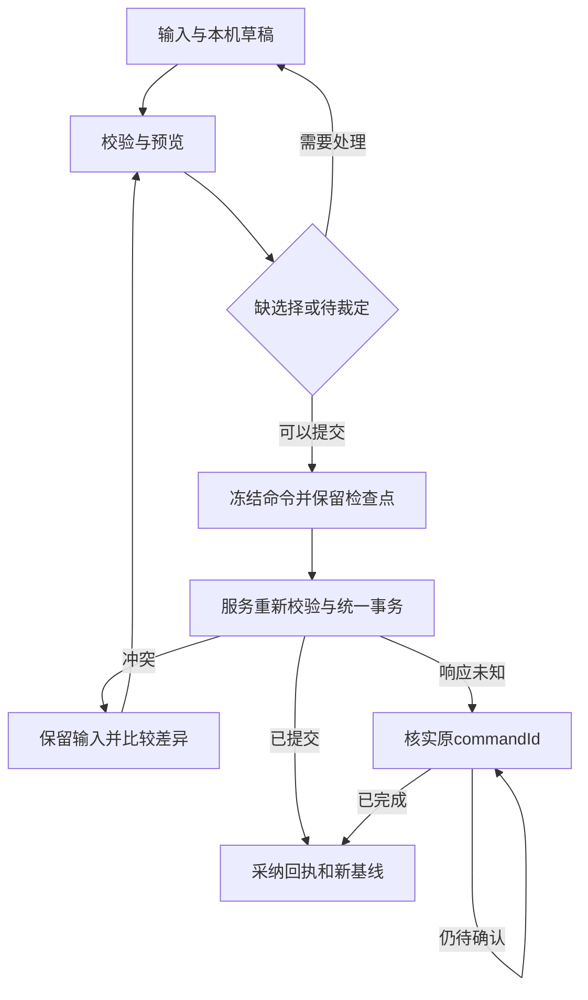

# 建卡成长导入操作流程与最小契约_20261006_v1

> 打包阅读副本。原始材料：[建卡成长导入操作流程与最小契约_20261006_v1.json](../01_计划与设计材料/建卡成长导入操作流程与最小契约_20261006_v1.json)。原JSON字节保持不变；正文中的已打包链接改为相对路径。

日期：2026年10月6日；版本：v1，操作流程与最小契约候选。本页细化[迁移接入与交付边界](迁移接入与交付边界_20261006_v1.md)，面向3.1与3.2共同评审，明确玩家操作、数据输入、服务提交及失败恢复。角色领域仍以T07的v0.2.2为依据；本轮只设计，不修改代码、模型原件或正式共享包。

用户本轮确认：历史技能来源尚未识别时，允许保存为“待核对角色”，完整保留原文、现有数值及问题，随后补全。受影响的学习、成长先阻止自动执行；保存成功不等于已完成规则校验。已发布资料公开、正式记录及历史先接云、未保存草稿留本机和一期单线单团继续沿用。 用户补确认正式角色可先不入团保存，由本人管理；首次入团绑定时间线与团后不跨线复用，未入团状态与待核对状态分别处理。

技术契约与页面布局是建议，正式Schema、权限和事务仍需双方评审。本页补齐迁移操作层，不展开技能效果或完整战斗执行。

## 页面和入口

| 页面 | 玩家可做什么 | 读取与产出 |
| --- | --- | --- |
| V01 公开资料库 | 浏览、搜索、筛选和完整详情；职业／领域／阶位列表来自目录 | 公开release、精确DefinitionRef和查询条件；完整正文、升级表、随机表及所有关联单位；无角色写入；B1／B5 |
| V02 角色列表 | 已授权角色与本机建卡草稿分区；显示待核对及保存状态 | 登录身份、角色摘要、本机草稿；新建、导入、继续本机草稿、打开正式角色；不把草稿计为云角色；B2 |
| V03 建卡向导 | 八个选择节点与最终预览；回退修正和本机恢复 | 规则包与用户选择；建卡草稿、缺口、可信预览和正式创建命令；B3／B5 |
| V04 角色工作区 | 资料／故事、当前数值、成长／能力、装备／物资、手工状态、历史 | 同角色版本的管理及规则投影、带版本的资产投影；登记字段编辑或专门规则／资产命令；详情共用完整正文组件；B2／B4／B5 |
| V05 成长与能力操作 | 升级、兼职、开阶、进阶、学习、授予、替换／遗忘及补选 | 角色最新基线、目标进度／能力UID、选择内容；费用、收益、栏位和永久限制预览；确认后一次提交；B4／B5 |
| V06 导入与待核对问题 | 选文件／角色／工作表／槽位、来源映射、差异、资产说明和补全 | 受限历史输入、显式来源选择、目标策略；待核对或已校验角色；原文及问题保留；资产结果另有明确状态；B5 |
| V07 保存冲突与历史恢复 | 保留输入、比较三方差异、核实原命令、历史差异预览 | 原基线、已提交输入、服务最新版本／历史快照；重新预览的新命令或核实结果；恢复不重发资产；B2／B4 |

资料、学习页、主职业树及已学能力详情使用同一精确引用和完整正文组件。页面展示来源职业、阶位、风格与获取途径，玩家补选同名技能时可以据此判断；不把技术修订号、事务或commandId当成普通操作步骤。

建议首轮私有建卡与角色操作在登录后进行；公开资料页提供进入建卡的入口。身份来自服务端，现有匿名本机预览继续作为独立演示，不自动升级为玩家的云端合法角色。DM可见字段与动作以3.2授权为准，不直接复用拥有者的全量投影。

## 角色记录和编辑状态

| 状态类别 | 含义 | 保存和操作边界 |
| --- | --- | --- |
| 建卡未完成 | 八步选择仍在本机；可有空值、无效输入或缺少选择 | 没有正式characterId；首次云端创建必须通过该组合的建卡校验 |
| 正式记录有本机修改 | 服务器有正式基线，本机还有未提交输入 | 跨设备读取的是已保存版本；本机草稿并非云端修订 |
| 正式待核对角色 | 经授权导入的结构可保存，但仍有未知来源、历史收益或条件事实 | 保留Recorded.unresolved、LegacyInputFact和问题；按依赖阻止自动操作，允许授权资料维护 |
| 规则校验通过的记录 | 当前支持范围内的必要选择和规则检查通过 | 不表示所有技能可以自动战斗；操作时仍检查当前版本、条件和资产 |
| 已归档角色 | 服务lifecycle为archived | 与待核对不同；允许哪些读取／恢复由3.2生命周期权限决定 |

编辑器使用独立的输入／校验、提交和本机保留状态，沿用现有commitState与retentionState的分离。输入是否合法、云端是否已提交、本机是否已保留不能用同一个“已保存”标记表示。RecordAssessment及可用操作由服务重新计算，不信任上传文件的“已验证”字段，也不把待核对塞进现有active／archived枚举。

新建向导用buildDraftId和editorSessionId区分多份草稿，不以共用的“new”角色ID套用现有编辑器。成长、装备和导入有独立OperationDraft内容，只复用检查点、回执关联、冲突及条件写入协议；不把复杂选择强塞到现有RawInputs的文本／数值字典里。

## 建卡向导和正式创建

保留已有总计划的八个节点，节点提供的数据来自规范定义与规则，牧师领域、不同关键属性和特殊专长通过选择组展开，不新增职业专用向导或人物class。

| 节点 | 输入 | 预览结果 |
| --- | --- | --- |
| W01 职业 | 主职业、关键属性及该职业必需的神祇／领域等选择 | 职业进度草稿和可用选择；不创建云角色 |
| W02 起始特性 | 专长、起始特性、免费授予及需补选的能力 | 具体选择及获取计划；费用和占栏分开 |
| W03 种族 | 种族、体型及分支 | 种族事实、必需子选择和规则依据 |
| W04 属性 | 八项属性、购点分配与合法选择 | 原始分配、来源加成及派生预览；不只存最终数值 |
| W05 熟练项 | 职业／种族／特性提供的熟练选择 | 有来源的熟练授予；上限和武器资格叠加按确认规则 |
| W06 个性背景 | 个性、背景、语言等必需分支；名称及故事 | 背景选择、授予与资料；叙事输入不能自证前置满足 |
| W07 装备 | 起始装备组、必需替代和货币选择 | 起始资产意图、装备引用计划及3.2事务要求 |
| W08 确认角色 | 全部选择和固定规则包 | 属性、HP／FP、栏位、能力、资产和未完成项；用户确认后正式创建 |

上游选项变化时重新评估下游选择。仍合法的选择保留；失效项显示原因并移入本机待处理区，用户可以修正或确认清除，不能将其继续带进提交。切换前后的派生结果分开，不把先前职业的免费奖励累加到新职业；清除影响要能看到，但永久放弃技能规则只用于正式角色操作，不用于建卡草稿回退。

新选择提交必须包含定义及具体值：例如选择武器专精类别或熟练子项，不能只发送本机生成的选择ID。ChoiceSubmission使用稳定clientChoiceKey关联界面，服务验证ChoiceValue的类型、数量、范围、互斥和引用后产生正式ChoiceRecord。服务把这些记录提供给领域规则解析，RuleOperation内部仍可使用正式choiceRecordIds；回执提供必要的临时键到正式UID映射。

最终确认先请求服务预览，展示属性、HP／FP、资源、能力、栏位、起始资产与未完成项。纯预览不扣费、不发奖励；若起始规则需要随机值，须使用一次记录的已授权结果，重新预览不重新投掷。这是随机事实的接入建议，具体起始随机规则仍按已确认建卡来源实现。

用户点击创建后冻结本次选择及命令，先保留本机检查点，再发送一次正式创建。服务重新校验绑定规则包，生成角色、选择／获取／收益记录和起始资产，统一事务保存历史及幂等结果。创建命令没有旧角色expectedRevision，也不使用0模拟更新；新characterId以服务回执为准。

重复点击或网络重发沿用原commandId，同一创建只产生一个角色及一份起始资产。回执到达期间玩家的新编辑继续作为新草稿，不覆盖或丢弃。创建无效显示具体节点，确定失败保留输入；结果未知先核实原命令，不能换新ID再创建。

## 成长学习和授予流程

所有操作先读取正式基线、固定规则包及相关资产版本，选目标和补选，再预览费用、收益、栏位、来源及不可逆限制，最后一次提交。页面不直接写等级、已学技能数组、经验或技能点余额。

| 操作 | 关键输入和预览 | 提交责任 |
| --- | --- | --- |
| O03 职业成长 | progressionId或职业定义、目标操作、选择内容；升级／兼职／开阶／进阶费用、冻结收益、触发授予 | 扣费＋进度＋收益／授予记录＋快照＋回执；足够资源、合法成长、奖励决策完整；未定费用不猜为0 |
| O04 学习／替换／遗忘／授予 | 精确entry或已有abilityId、获取途径、选择与授予决策；来源、成长绑定、免费／占栏、永久禁学及联动 | 能力／获取／选择／费用／限制一起变化＋快照＋回执；条件、标识、栏位和禁学检查；受影响的未知事实先处理 |
| O05 装备／卸下／消耗 | assetInstanceId、动作、资产修订和必需选择；当前归属、数量、槽位及派生变化 | 资产关系／数量与角色引用同事务；当前资产权威与授权；不按快照或物品名字匹配 |
| O06 池／状态人工维护 | poolUid或statusUid、来源、数值或层数、说明；来源记录差异及汇总影响 | 具体来源记录＋审计＋快照＋回执；字段／实例授权；合计值不可反写覆盖其他来源 |

职业成长保留baseClass、进度UID及主／子／附赠角色：进阶后的展示名称不替换成长身份。共享开阶按已确认主职业阶位处理；兼职首次收益、后续升级量、永久属性与临时属性由确认规则解析，历史收益记录用于防重复，不在读取角色时重新发放。

学习从所选AbilityEntry解析来源职业、所在表、阶位、风格、获取规则，再分别绑定成长、关键属性和栏位。跨职业授予不强行归入主职业；免费与占栏独立，天赋共享槽位和永久同名禁学按确认规则执行。前置、颜色标识及学派互斥检查不能因某条获取途径忽略前置而一并跳过。

升级触发自动授予时，预览返回稳定授予offer及需决策项。槽位足够可以接受；不足时按F60提示替换现有能力或放弃新技能。GrantDecision包含offer、接受／放弃／替换及要替换的abilityId，服务按当前成长事实重算offer。放弃现有与放弃新授予分别写对应永久禁学记录；不得只删一个显示条目，重试不能再次授予。

授予计划还要区分FeatureHolding、RecipeHolding、KnowledgeGrant、MechanismAccessGrant和SlotBonusGrant等持有类型，界面展示其实际收益；图纸、特性或栏位奖励不能全部塞进abilities数组，再套用普通技能占栏规则。

当前仍未确定的替换／放弃费用在相关预览标needs-decision，不能默认为免费。必须完成的授予选择属于同一次成长计划，先把等级保存、之后再补栏位会留下不完整状态，因此整体确认后提交；如果某授予规则明确允许延后，才使用经评审的待领取政策。

池和状态通过来源UID编辑或移除，预览列出被改的记录。临时生命和临时疲劳多种效益取最高的已确认规则由汇总投影处理；不把汇总值写回所有来源。当前HP／FP和手工状态是一期资料维护入口，战斗行动、死亡裁决和效果时长由人工维护，后续战斗再接独立执行器。

## 导入待核对角色和来源补全

流程为选择文件、识别格式、显式选择角色／工作表／槽位、捕获历史事实、关联定义与来源、服务转换预览、确认权限与目标、提交、读取及导出核对。多表和多槽位先列候选，不自动取首表或把全部槽位建成不同角色。

首轮建议本机解析历史格式，提交受限ImportCandidate事实给服务；原文件本机保留，不提供云草稿或跨设备文件恢复。服务重新校验结构、映射、来源选择、目标和迁移权限，生成CharacterDocument，不接受一份标成“可信”的任意角色JSON。文件hash只是来源及去重线索，不证明文件真实性或资产授权；若实际采用服务端准备文件，则另定私有上传、保留期与过期重建接口，不能当成已交付云草稿。

| 问题类型 | 保存政策 | 处理方式 |
| --- | --- | --- |
| 文件损坏、未知不支持格式、结构无法解读 | 阻止导入提交 | 保留本机原件与错误定位；不能用残缺读取结果报成功 |
| 多个角色／表／槽位或目标策略未选 | 阻止该次提交 | 用户选定要处理的记录；同名不是身份依据 |
| 未知技能、同名来源缺失、历史收益不全 | 用户已确认：允许保存待核对记录 | 保留原文、数值、UID、locator、候选映射和issue；依赖它的自动操作暂受阻 |
| 文件含owner、团、系统修订或已验证声明 | 不按文件声明恢复服务身份 | 由当前登录与服务关系决定；同线单团，不跨线复用 |
| 文件声称的库存／货币未获迁移授权 | 不能写入权威资产 | 可保留原始声称作为待处理资料；角色与资产迁入结果分别说明，不能报完整资产迁入 |
| 重复文件或此前已导入 | 先提示已有结果与目标 | 核对来源、账户、所选记录、规则和目标；更新现角色检查revision，显式复制用新身份策略 |

待核对记录不重放建卡、升级或学习。缺少购买／成长依据时保存Recorded.unresolved或记录事实，不能猜成免费、一级、一阶或零收益。依赖未知事实的派生值标needs-decision，不用其覆盖现有已记录数值；无法排除影响的成长操作保守阻止，其他无关资料维护继续可用。

来源补选按issueId和实例UID定位，展示同名候选的职业、阶位、风格及完整内容。服务将补全应用到对应能力、获取、成长／关键属性、栏位和风格关系，原能力UID保持；不是删除后新学，也不重新收费或发放奖励。补全导致栏位超额、永久禁学冲突或派生变化时先预览并要求合法处理，不能为匹配来源自动删除另一能力。

建议角色文档内能力、选择及获取记录的UID在角色范围内唯一，完整实例引用包含characterId＋uid；正常保存和同角色新版JSON往返保持UID。显式复制新角色时生成独立身份及映射，内部引用一起转换，源UID留作证据。独立持久单位仍使用其unitId，作用域另由单位服务约定。上述角色UID作用域是共同契约建议，未改T07原模型；无UID的旧格式首次分配并记录映射，不用名字或数组顺序反复生成。

更新已有云角色必须由用户选择已授权目标并给expectedRevision，文件内characterId不能自动触发覆盖。同文件hash不等于同目标或同导入意图：重试原命令幂等，改映射／改目标是新命令，服务器仍检查重复奖励与资产迁入记录。新版JSON保存问题与原始事实，XLSX只保证约定模板及保留元数据范围，未知内容不能因无定义引用而丢弃。

## 保存冲突历史和本机恢复

输入或基线变化即使上次预览仍显示成功，也要重新评估。预览记录输入指纹、规则包、characterRevision和相关assetRevisions；提交时再次验证。服务命令终态是已提交、明确拒绝或冲突，“未知”是客户端尚不能确认的传输／恢复状态，不是假定服务回滚。

未知结果时可以继续编辑并保留本机草稿，但暂不发送依赖该结果的新命令；查询原commandId。not-seen只表示当前未见结果，不足以证明此前未提交；需依据服务一致性和执行状态决定等待或重发同一命令，不能自动换新commandId。

冲突比较原基线、本机修改和服务最新值。没有交叉影响时给出合并建议，有冲突时逐项选择并重新预览，不自动提交；规则学习和资产变动不使用普通字段的最后写入覆盖。改expectedRevision、选择或payload后是新命令；同键异payload始终拒绝。权限改变后重新取得可用操作，前端editable和contextKey不能授权。

本机检查点按账户、草稿／编辑会话和版本条件写入，保留完整原始输入、冻结命令及冲突基线。复制恢复先持久化新副本，再确认旧副本已复制；清理使用墓碑或等价版本保护，迟到写入不复活已清理草稿。登录切换后隔离草稿与缓存，旧请求回执不能进入新账户页面；恢复私有记录前重新授权。

历史恢复先对当前记录与所选快照预览，产生新修订。已交易资产和团权限不回滚，装备引用按当前库存检查；不同规则包先评估兼容／版本迁移，不默认退回旧规则。原快照、支付与授予证据保留，不将角色历史视为可任意重放的经济账本。

## 最小共享契约

下面是提交评审所需的语义与形状，不是已实现的TypeScript接口或运行时Schema。沿用/api前缀；路由名称可在评审时确定，但输入、版本、权限、错误和幂等语义需要一起冻结。内层领域操作与外层HTTP提交可不同，服务负责将可信选择和事实传给纯规则模块。

| 契约 | 最小形状 | 约束 |
| --- | --- | --- |
| K01 DefinitionRef／RuleReleaseRef | id＋revision；release id＋manifestHash | 精确引用，绑定发布清单；查询缺失不回退latest |
| K02 BuildDraft／OperationDraft | 账户作用域、draftId、editorSessionId、draftVersion、原始输入、选择、基线、在途命令 | 首轮只本机保留；建卡尚无characterId；复杂操作不塞进现有RawInputs |
| K03 ChoiceSubmission／ChoiceUse | 新选择：clientChoiceKey＋choiceDefinition＋受控ChoiceValue；引用：existing choiceRecordId或submitted clientChoiceKey | 客户端只提交选择意图；服务验证后生成ChoiceRecord与UID；回执提供映射 |
| K04 BuildPreview／OperationPreview | 请求关联、基线／输入指纹、资料版本、actionability、费用／收益／资产差异、issues与待选项 | ready、needs-selection、needs-decision、unsupported；过期或输入变化重新预览，预览不是授权 |
| K05 CreateCharacterCommand | commandId、submittedDraftVersion、buildDraftId、ruleset、选择与资料意图 | 没有expectedRevision；新characterId由服务生成并写入幂等结果；不提交可信最终角色或资产余额 |
| K06 UpdateManagementCommand | 沿用commandId、characterId、expectedRevision、submittedDraftVersion、edits | 保持既有严格v1形状；只登记字段；不随意加payload／kind破坏校验器 |
| K07 CharacterOperationCommand | 上述已存角色命令关联＋operation及choices／grantDecisions等该操作的受控内容 | 新命令族独立Schema，操作按kind区分；创建和历史导入有独立输入，不伪装管理编辑 |
| K08 ImportCandidate／ImportCommand | sourceHash、格式版本、已选记录定位、受限捕获事实、映射、目标策略、commandId及基线 | 输入属于历史声称；服务转换和授权；创建新记录不伪造expectedRevision，更新现记录必须提供 |
| K09 CommitOutcome／CommandStatus | 提交终态committed／rejected／conflict；核实查询pending／committed／rejected／conflict／not-seen | 原commandId和submittedDraftVersion关联；同键异请求拒绝；not-seen不证明失败 |
| K10 Issue／RecordAssessment | 稳定issueId、code、severity、字段／实例／选择目标、证据、可补全方式、阻塞哪些操作 | 待核对是读取评估及操作能力，不是lifecycle；客户端validated标记不可信 |
| K11 CharacterWorkspacePayload | ManagementView v1、RuleView、RecordAssessment、操作能力及带资产版本的授权投影 | 组合在包裹DTO，不向v1视图增加未登记字段；人物基线一致、资产版本另有明确依据 |
| K12 FieldRegistry | fieldRef、文档映射、值域、清空语义、读写权限、规则依赖 | Runtime Schema与类型同源；普通字段编辑不接受任意JSON路径 |

现有管理v1的校验器拒绝额外字段，因此操作类型、quality、issues或资产信息放在新的包裹DTO／命令族，不直接附加到ManagementView、UpdateManagementCommand或CommitReceipt。管理回执继续只有commandId、submittedDraftVersion和view；新操作回执可以包含角色修订、问题及UID映射，但也必须独立登记版本并核验。

新的选择值仅接受定义支持的definitions／allocation／text等受控结构，校验引用、金额、数量、互斥及重复clientChoiceKey；现有choiceRecordId必须属于当前角色的合法记录。授予offer、来源和获取途径由服务核验，客户端不能把learn改成manual或feat-grant来绕过成本。

结构错误沿用type／missing／unknown-field／invalid／duplicate的管理校验含义；领域问题另用稳定业务code与issueId，不把权限、冲突、待选择、未定规则及网络失败都塞进ValidationIssue。返回可定位的fieldRef、实例UID或choiceKey及证据，少用会随排序变化的数组下标作为唯一定位。

未授权响应不能携带角色差异或历史。3.2按当前对象／字段权限序列化结果；如果DM无权读story等v1必填字段，使用单独授权视图或显式升级viewSchemaVersion，不用空字符串或null伪装“没有内容”。组合Workspace读取人物基线须一致，资产是另一权威修订，不把不同时间的三个结果拼成一份未经标记的当前角色。

## 首轮字段注册和特殊操作

建议正式普通编辑先登记如下字段，保留现有输入解释和检查点协议。以下字段权限及领域值域仍需S01／S02共同确认；具体软件预算与游戏规则分开。

| 字段或数据 | 映射和语义 | 首轮处理 |
| --- | --- | --- |
| displayName | CharacterDocument.profile.displayName；非空白字符串；候选预算256个JS字符串长度单位 | set-profile；保留合法原文，不自动截断；预算需共同确认 |
| story | CharacterDocument.profile.story；字符串，允许空；候选预算65536个JS字符串长度单位 | set-profile；保留原文，超过预算拒绝并保留草稿 |
| hp.current | resources.hpCurrent.value：set为known事实，clear为unrecorded | 有限数值，允许负HP；整数／上限策略由规则Schema确认；不在编辑器统一截断或钳制 |
| fp.current | resources.fpCurrent.value：set为known事实，clear为unrecorded | 有限数值；正常下限按确认疲劳规则；导入异常事实保留问题，不悄悄修正 |
| hp.temporary、shield.manual、exhaustion.manual | 现有演示候选；正式模型是来源池／状态，不是只有一个合计 | 本轮建议不直接提升为普通set-number字段；在B4用来源UID与专门操作接入 |
| maxHp、maxFp及熟练派生值 | 来自事实、成长与规则，历史不足时可以是记录上限／待核对 | 只读派生或授权专门调整；普通编辑不直接覆盖计算依据 |
| XP、技能点、等级、颜色标识和授予记录 | 有成本、成长或游玩作用域的事实 | 走成长／奖励／授权人工命令，不开放任意number字段写入 |
| 钱包、库存和装备 | 3.2资产权威及角色装备引用 | 走资产意图和共同事务，不提交旧余额作为最新数据 |
| 服务身份、团、修订和时间 | 服务元数据 | 不从上传文件或角色编辑JSON恢复权限 |

数值原始输入仍区分0、清空、无效和未提交；管理投影null表示未知／未记录，不是0。T07使用Recorded，清空既定数字不能删掉来源或支付历史。hp／fp的字段模式、未知状态和允许范围写进正式FieldRegistry，数字解析器接受科学计数法不意味着每个游戏字段都允许任意实数。

管理v1的characterRevision和expectedRevision沿用正安全整数，submittedDraftVersion沿用非负安全整数，ID沿用非空且无首尾空白的候选约束。具体预算仍需共同确认。清空当前值会让依赖它的计算要求补全，不能借clear-number移除一项异常状态或免除费用。

## 操作矩阵和后续验收

每个正式操作都有目标、预览、提交、权限及失败语义；owner／DM允许范围交由S02落实，页面只展示服务返回的能力。非登录用户只保证公开资料查询，不提供私有角色读取或写入。

| 操作 | 必要输入与阻塞条件 | 保存边界 |
| --- | --- | --- |
| O01 管理编辑 | 登记字段与值、管理命令头；字段授权；不得写派生上限、经验余额或资产 | 资料或当前资源＋快照＋审计＋回执 |
| O02 正式建卡 | buildDraftId、规则包、完整选择内容；完整合法的支持组合；无缺失选择或阻塞规则 | 新角色＋选择／授予记录＋起始资产＋回执 |
| O07 历史导入 | 受限历史输入、工作表／槽位选择、映射与目标策略；格式结构可读取、目标身份明确、权限合法；知识缺口可保留 | 角色事实＋问题／原文＋允许的资产迁移＋回执 |
| O08 待核对补全 | issueId／实例UID、新来源绑定或事实、必要说明；选择有依据、所需裁定已授权；不得重放奖励／收费 | 补全关联和审计＋快照＋回执；原UID保持 |
| O09 历史恢复 | snapshotId、expectedRevision、差异确认；当前权限、资料兼容和现资产可用；不同版本先评估 | 新角色修订＋审计／回执；原快照不改 |
| O10 规则版本迁移 | 目标公开规则包、当前修订、选择与裁定；共享迁移政策和受影响选择明确；不在读取时静默执行 | 显式版本变更＋迁移记录＋快照＋回执 |

| 场景 | 预期结果 |
| --- | --- |
| U01 回退职业／种族后下游选择失效 | 保留草稿并定位失效项；正式提交没有旧职业残留或重复奖励 |
| U02 新学习选项只有本机选择键 | 服务收到受控选择值并生成记录；回执关联键可核对，不能查找一个不存在的正式ID |
| U03 15级自动授予、满槽放弃或替换 | 整体预览和提交；产生正确永久禁学；未定费用阻止自动提交，不默认0 |
| U04 学习同名跨职业能力 | 按所选Entry保存来源、绑定和UID；详情按同一发布包显示 |
| U05 未知技能导入待核对后修改故事 | 原文、实例和问题保留；故事可授权保存，受影响成长仍阻止 |
| U06 为上述技能补选来源 | 保持UID并更新关联；不重复学技能、扣费或发奖励；超额栏位先处理 |
| U07 同文件改工作表／目标或显式复制 | 区分导入意图；原命令重试幂等；新目标不凭hash误判或无权覆盖 |
| U08 创建响应丢失，随后重复点击 | 核实同commandId；只一份角色和起始资产；新输入仍是草稿 |
| U09 同角色两设备编辑与资产被交易 | 保留三方差异并重新预览；角色revision及资产修订分别检查 |
| U10 临时生命与多个护盾来源编辑 | 只更改指定UID；其他来源不丢；汇总按规则读取，不统一覆盖 |
| U11 恢复旧快照但当时武器已经卖出 | 不发回资产；标记无效引用或补选；新修订与旧快照分开 |
| U12 账号切换／DM权限失效／不同版本视图 | 迟到结果不越账户；未授权不泄露内容；严格v1不接受新增未知字段 |

这些是未来实现验收场景，本轮只校核设计的覆盖与契约一致性，未执行生产建卡、API、数据库事务或XLSX迁移。现有管理输入／草稿测试继续复用，新增规则、选择、授予、导入及资产行为另有针对性验证。

## 共同评审清单与下一步

| 事项 | 本轮具体建议 | 对应边界 |
| --- | --- | --- |
| R01 字段与Schema | 保留管理v1；首轮直编资料和HP／FP；池／状态走UID命令；确认HP／FP值域及清空政策 | S01 |
| R02 选择提交 | ChoiceSubmission／ChoiceUse及UID回执映射；纯领域RuleOperation继续使用选择记录ID | S01 |
| R03 授予决策 | 稳定授予offer＋接受／放弃／替换决策与永久禁学；费用未知单项阻塞 | S01、S07 |
| R04 待核对记录 | 用户已确认可保存；服务返回问题及操作阻塞范围；来源补全保持UID，不重放历史 | S01、S07 |
| R05 权限与投影 | 拥有者和DM权限由3.2提供；读不到的字段用独立授权视图或版本升级，不伪装空值 | S02 |
| R06 命令与保存 | 创建／管理／规则／导入分Schema；同键核实、事务、三方冲突、修订及幂等保留一起约定 | S03 |
| R07 资产与迁移 | 当前库存验证；起始物资、装备、历史资产迁入同事务；文件哈希不能授权或单独判重复 | S04 |
| R08 作用域与生命周期 | 角色范围内UID及完整引用约定；单线单团；未入团、转团、归档删除及版本恢复策略 | S06、S07 |

本轮不重开已有基础规则问卷；未确定的费用、召唤宝石兽与旧表更新继续登记，只有影响当前操作的项目才阻塞其自动提交。云草稿、跨设备未保存恢复、转团与归档删除不因有操作草图而视为已确定或已实现。

迁移范围、领域候选、接入与操作层已由[迁移总体设计收敛与共享评审包v1](迁移总体设计收敛与共享评审包_20261006_v1.md)完成总体收敛，最小Schema与样例可供共同评审。下一步按B1／B2优先确认D项，再安排对应工程；完整CharacterDocument／正文Schema、关系、权限与事务仍需逐批落实。总体候选可评审不等于生产完成，也不自动授权编码；不恢复细致战斗审查。

依据：[迁移总计划](来源调查与迁移总计划_原阶段记录.md)、[T06](T06_字段与接口候选_20261005.md)、[T07](https://chatgpt.com/space/page_0f31efad73648191a93884a336df0531)，以及只读核对的[管理契约](../04_目标项目参考/docs/proposals/character-management/contracts.ts)、[校验器](../04_目标项目参考/docs/proposals/character-management/validation.ts)与[适配器](../04_目标项目参考/docs/proposals/character-management/adapter.ts)。目标本地基线为929cd8c及23项既有候选改动，本轮未重查远端最新main。

本地镜像：[建卡成长导入操作流程与最小契约_20261006_v1.json](../01_计划与设计材料/建卡成长导入操作流程与最小契约_20261006_v1.json)。业务代码、规则原件和既有问卷保持不变；页面工具未提供原生视觉预览，回读与结构检查不等于页面渲染验收。
