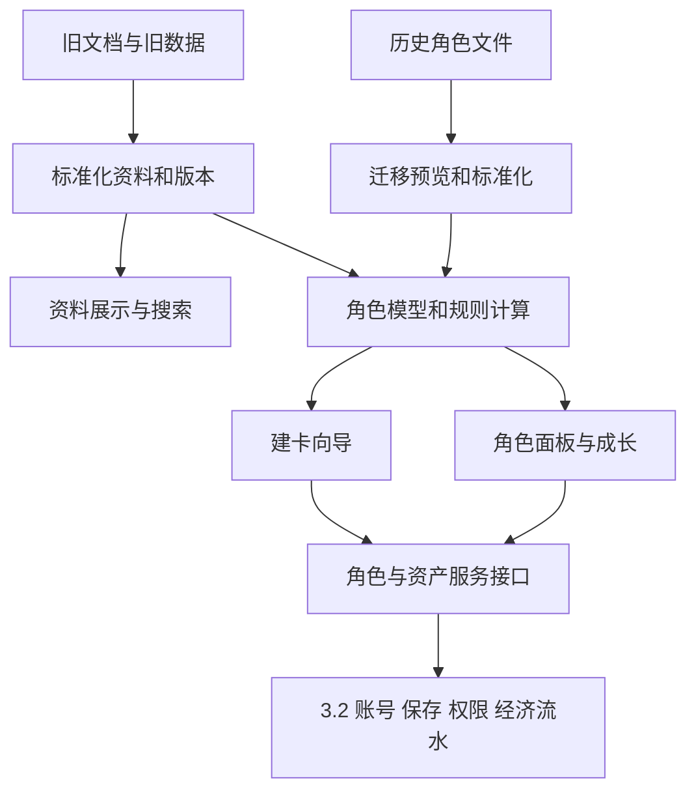
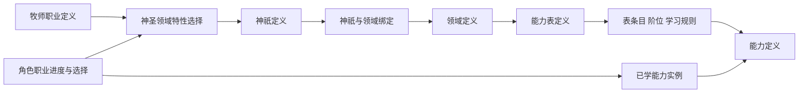
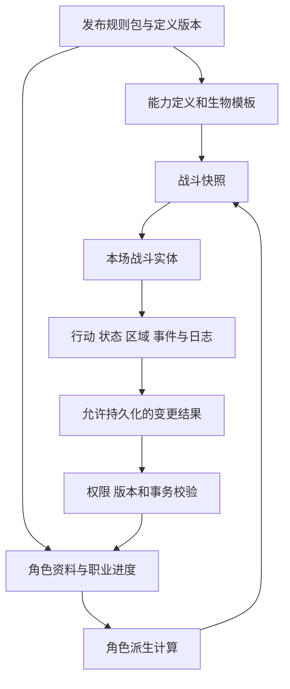

# 来源调查与迁移总计划

> 原阶段记录副本；来源：[来源调查与迁移总计划](https://chatgpt.com/space/page_62d93a992ee4819188aa80bf16e28057)，Page修订序号28。本次迁移的统一安排见[主计划](../01_计划与设计材料/Snode_一期迁移总体计划_协作审阅版_20261006.md)。

本计划落实《Snode 一期开发文档》第 3.1 节的三个任务：规则与资料库迁移、角色创建与规则计算、角色管理与导入导出。目标是让玩家在新平台完成资料查询、建卡、成长与角色维护，并通过第 3.2 节提供的账号和云端服务可靠保存。

编写日期：2026年10月2日；2026年10月6日实施计划v22。B0至B6设计候选及开工前准备已收敛，[开工确认与首批工程任务v1](开工确认与首批工程任务_20261006_v1.md)列E00至E07和分批D确认。首交付为真实公开资料查询／完整详情，随后完整云端角色接入；远端main后台SSH只读核实929cd8c，本地23项候选须保留。任务、review与真实实现／验收分开，签批未记录、业务代码未改；后续是明确范围的工程实施，不再追加架构阶段。

收尾发现旧仓库已有并行提交，结束HEAD为695508d（v1.0.8042移动端更新），开始时为cc8e34d。本轮读取的规则与角色模块哈希未变；新增移动端和其它生成页面变更不属于T06验收范围，来源清单分别登记。

内容区块清单已单独整理为[项目内容区块与迁移范围](来源区块清单_原阶段记录.md)。本次深查 1 基础资料、2 规则与世界观文档、3 查询展示，详细结论及新抽象写入 3.1.1；其他区块只调整必要的共用模型接口，不宣称完成其深入审查。

推进状态见[3.1执行表](https://chatgpt.com/space/page_8d2acb837bbc819196ddbbcc1ab5efe7)。T00至T07主要调查与代表验证、B0至B6接入和操作候选已归并到[迁移总体设计收敛与共享评审包v1](迁移总体设计收敛与共享评审包_20261006_v1.md)，本轮完成总体候选收敛，不重编号原任务。下一步优先共同评审B1／B2所需D项及相应正式Schema、字段／权限和保存约定，按用户安排再进入代码；不继续全面技能审查来延长迁移设计。

## 一期目标与任务边界

| 子任务 | 必须交付的能力 | 完成依据 |
| --- | --- | --- |
| 3.1.1 规则与资料库迁移 | 统一种族、职业、背景、技能、天赋、专长、进阶和物资资料；展示、搜索、筛选、详情 | 来源清单、标准化数据、映射表和内容验收 |
| 3.1.2 角色创建与规则计算 | 引导式建卡、条件选择、规则计算、完整校验、创建预览与保存衔接 | 完整建卡流程和规则测试 |
| 3.1.3 角色管理与导入导出 | 角色面板、属性与状态维护、成长、技能与装备管理、历史数据迁移和备份 | 操作验收、真实档案迁移和往返测试 |

3.2 负责账号、云端持久化、团和 DM 权限、商店交易及经济流水。3.1 提供角色模型、规则计算、资料查询、角色操作与导入导出，并与 3.2 协同定义保存和资产操作接口。

一期继续使用现有地图和沟通工具。独立地图与棋子引擎、自动战斗与检定、剧情编排、AI 地图或剧情生成、原生桌面端不纳入本计划；Owlbear 自动同步不作为默认交付。资料中的技能效果和召唤物数据需要完整展示，但本期不承诺自动执行全部战斗效果。旧工具的 AI 顾问、卡牌对战等辅助功能不因位于同一仓库而自动纳入迁移。

## 来源审查与迁移基础

2026 年 10 月 3 日的来源清单包含 18 个职业、30 个种族、42 个背景，能力索引共有 2791 个条目。索引包含职业能力、通用天赋、特殊专长和神圣领域，不能当成普通技能数量。旧版本记录的 2785 条已由本次基线替换，后续依据发布清单逐条核对。

需要处理的已确认问题：

- 资料存在多个表示：职业页 JSON、运行时数据 JS、页面说明、原始 DOCX 和 XLSX。部分公式和特殊选择只在运行时数据中完整。

- 起始装备的 equipment.json 只有 14 个职业；equipment_data.js 覆盖 18 个职业。守望者、谋士、召唤师、战舞者必须纳入核对。

- 本次能力索引有 343 组同名候选、两组跨职业重号旧 ID 和 54 个来源限定的旧 ID 别名。定义身份、表关系、来源映射与能力实例分别建模。

- items.json 有 576 条记录，没有稳定 ID，其中 31 条为完全重复记录；物资还分布在 items_data.js 和 equipment_catalog_data.js，需共同核对。

- 本次建卡页约 4555 行、面板页约 4501 行、panel_engine.js 约 8969 行。资料、规则、界面、存档和导出仍交叉依赖；本轮重点处理资料定义和内容查询的抽象。

- 旧存档按角色名称和槽位保存在 localStorage，不具备可直接作为云端身份的角色 ID。HP 和 FP 的当前值、上限及人工调整需要明确转换。

- 既有 CLI 建卡接口的 preflight 校验以及 character_io.js 的工作簿处理可作为抽取参考。

本次只读校验：技能索引 11 项通过、既有三数据源校验通过、牧师领域 smoke 校验通过。校验名单和关注字段不同，不能替代新模型的全字段及关系验证。当前索引有 1 条未标完整详情的“鲜明特点”；全局搜索另有两条当前技能目录未收录的记录，均纳入来源核对清单。

开始实施时重新生成清单并冻结来源版本。以上数量是审查基线，后续以核对后的清单为准。

## 框架设计职责与总体路线

重新核对后的结论是：新项目的工程基础已经建立，3.1 需要在现有 React、Fastify、TypeScript、pnpm workspace 和 PostgreSQL/Drizzle 上实现规则与角色业务。领域结构仍待共同确认；我们可以主导规则资料、角色规则和历史迁移的设计，涉及共享接口、存储、权限与资产的边界由双方一起约定。

| 本轮读取的位置 | 当前事实 | 对工作的影响 |
| --- | --- | --- |
| README 与开发说明 | 两组各自负责需要的前后端；先共同确认角色、规则、物品、版本和状态边界 | 3.1 包含页面、规则与对应 API，不能只提交前端 |
| packages/contracts/src/index.ts | 只有健康与就绪响应，角色规则契约待双方同意 | 共享类型需要设计，尚无可直接沿用的业务模型 |
| packages/db/src/schema.ts | 只有最小 users 身份表，尚无角色及资产业务结构 | 在共享约定后增加 Schema 与新迁移 |
| apps/api/src/app.ts | 只有 health 与 ready 路由 | 目录、角色预览、创建、更新和迁移 API 待实现 |
| apps/web/src/App.tsx | 基线首页与开发文档链接；本地23项候选改动另含角色管理预览 | 复用编辑／草稿核心，增加完整文档与云端适配；本地候选不等于远端已发布 |
| 根 package.json | 已有开发、构建和检查；test 主要运行 API，dev 显式监听现有包 | 新规则、目录及迁移模块需接入监听和验证 |

以上事实来自当前目标源码。下面是依据一期任务提出的责任分配建议，尚不表示双方已经确认所有具体字段或实现方式。

| 内容 | 建议责任与处理方式 |
| --- | --- |
| 工程基础 | 沿用现有结构；随业务补齐必要的监听、测试和路由接入，不另起技术栈 |
| 游戏领域基础 | 3.1 主导定义、能力获取、成长、实例、来源及规则版本设计，形成共用约定 |
| 共享业务边界 | 双方确认角色 ID、版本、DTO、保存命令、资产归属、权限、并发及事务；契约和数据库在现有共享包中协作 |
| 3.1 业务 | 资料库、规则计算、建卡、角色管理、导入导出及各自所需的前后端 |
| 3.2 业务 | 按一期分工建设账号、云端保存、团与 DM 权限、经济交易及权威资产服务 |
| 后续战斗 | 现在调查基础规则、审查机制并保留明确衔接；完整执行器、地图与 AI 不作为一期交付 |

仓库 README 要求“先确认角色和规则的数据格式，再分别开发”；开发说明明确角色、物品、规则版本与状态边界需要双方确认。packages/model、catalog、rules 是职责拆分建议，是否新增独立包应按实际共用关系决定。model 若独立，contracts 引用其公共类型表达 HTTP 契约；不会用新包绕过现有协作入口。[README](https://github.com/Usokyun/Snode/blob/929cd8c4ac48d8aa268608411c77e95753bd0655/README.md)、[开发说明](https://github.com/Usokyun/Snode/blob/929cd8c4ac48d8aa268608411c77e95753bd0655/docs/development.md)

基础战斗调查属于领域设计输入，需要先了解战斗区间、穿插、行动预算、反应、状态和结算时点。阈值系统按用户最新要求仅主持人人工裁决，不做算法、自动推进、插入队列或额外回合。建卡与成长的计算依据也要同步核对。凡影响一期自动计算的条件与公式必须及时确认；其他战斗片段可以先完整展示并记录支持状态，不能为了未来引擎把整个一期拖到全面战斗实现之后。

迁移设计以一期资料、建卡和角色管理为主，完成公共模型与服务边界后分批实现资料查询、云端记录、合法建卡、成长操作和历史迁移；保存与权限基础从首个云端批次接入3.2。基础战斗调查与C01已有内容保留为未来机制设计依据，完整职业战斗审查不再是迁移架构或一期交付门槛。未支持的战斗效果可以先完整展示，涉及当次建卡／成长的未决规则才阻塞该项自动提交。

最先形成三个可评审产物：基础战斗规则调查说明及具体疑点；规则资料与角色模型字段约定；与 3.2 的接口、资产和权限边界表。随后用少量规范数据验证一阶初始能力与风格、跨职业获取、牧师领域和召唤物。先实现一个资料查询到完整详情的流程，再实现一个建卡到角色面板的流程，验证关系正确后扩大覆盖。

本轮发现旧仓库已更新至 cc8e34d3007128d1c189ab7fb6508e59b9853870（v1.0.8041）。相对 4497283 的提交差异中，职业页/数据、技能索引和效果索引未见变更，角色导入、结构识别与交互有变化。既有资料调查基线继续保留；M0 必须复查新增导入模块及真实样例后再确定复用范围，不能沿用旧版测试结论证明新版本正确。

T02 结果见[第二轮调查报告](https://chatgpt.com/space/page_07d1277603508191a1935adce9d7a35d)：0动作消耗附赠，2、3动作需连续累计主要；固定资源和技能使用机会首次扣除，中断不返；反应次数、技能次数、锁定和响应资格分别处理。技能阶位决定精锐反制门槛，速攻改变作用窗口，反应不计第一行动。此处是规则与模型约定，尚未实现战斗程序。

## 共用角色模型与规则版本

共用角色数据在T06候选中统一称CharacterDocument（即此前CharacterData的领域文档），并以CharacterRecord封装服务修订与关系元数据。职业、领域、进阶和能力通过精确定义引用，不派生人物／职业程序子类。获取、来源、成长、关键属性、占栏与风格参与分别保存，后续战斗读取独立ActorSnapshot。字段与类型完整方案见[T06](T06_字段与接口候选_20261005.md)。

建议角色文档包含以下分区：

| 分区 | 建议内容 | 处理原则 |
| --- | --- | --- |
| 身份 | 服务封装持有characterId、拥有者和系统时间；领域文档持有显示名称等资料 | 服务权限不是上传文档中的可编辑字段 |
| 版本 | schemaVersion、RuleReleaseRef、characterRevision | 区分结构升级、规则变更和并发更新 |
| 建卡选择 | 种族、职业、背景、属性购点、特殊选择、起始能力与装备选择 | 保留用户选择，不只保存计算结果 |
| 成长 | 主职业、子职业、附赠职业、等级、经验、阶位解锁、已领取奖励 | 避免恢复存档时重复发奖励 |
| 属性与熟练 | 基础值、加成来源、熟练项、手工调整 | 有依据时计算；历史依据缺失时保留事实并标记 |
| 能力实例 | 实例 UID、定义 ID、来源、获取途径、所在栏位、免费、占栏、成长依据、选择项 | 定义与实例分开；免费与占栏独立 |
| 装备与库存衔接 | 角色保存约定的装备引用；数量、容器、物品实例与钱包从资产服务投影 | 3.2持有资产权威；角色或历史快照不覆盖库存余额 |
| 资源与状态 | 当前 HP 和 FP、上限、临时生命、护盾、状态记录 | 当前值和上限分别维护 |
| 人工调整 | 被调整字段、数值、原因及操作者记录 | 按约定权限处理，不被刷新页面覆盖 |
| 迁移信息 | 旧角色名、槽位、来源格式、迁移版本、待确认项、扩展字段 | 保存迁移依据和未识别内容 |

建议使用稳定且带来源范围的资料标识，并建立旧标识注册表。旧 ID 重号时不得依名称或数组顺序选择第一项。能力实例 UID 在正常保存与导出往返中保持稳定；复制角色时为实例生成独立身份或采用角色范围内的唯一约束。

规则版本采用明确版本号。历史角色保存其关联规则版本；规则更新后产生影响评估和迁移预览，不在读取时静默重算全部历史数据。允许保留原版本角色和明确的人工调整。

派生数值通过规则计算获得，界面只展示结果。保存时需要保留足以解释结果的选择、进度和加成来源；缓存计算结果不得成为另一套独立规则来源。

## 模块与依赖组织

已确认目标工程采用 pnpm workspace，前端为 React、Vite、TypeScript，API 为 Fastify、TypeScript，数据库为 PostgreSQL 与 Drizzle。项目要求 Node.js 24 和 pnpm 11.9.0。迁移沿用现有工程、构建方式与界面方向。

建议按照下表落位；标记“新增”的路径当前尚不存在。

| 模块位置 | 当前状态 | 3.1 迁移职责 |
| --- | --- | --- |
| packages/model | 建议新增 | 与 API 独立的定义、角色、实例、快照及受控 Schema |
| packages/contracts | 已有，只有健康及就绪响应 | HTTP 请求、响应、命令、预览和错误 DTO，引用 model |
| packages/catalog | 建议新增 | 规范资料、稳定 ID、来源映射、能力表、文档与发布索引 |
| packages/rules | 建议新增 | 角色派生、获得校验、成长、操作和明确机制解析 |
| packages/db | 已有最小 users 表 | 经共同确认增加版本、引用、角色及事务关系，生成新迁移 |
| apps/api/src/modules | 建议新增 | catalog、characters、imports 路由与业务服务 |
| apps/web/src/features | 建议新增 | 资料、建卡、角色与导入页面 |
| apps/web/src/components | 建议新增 | 文档块、完整能力和生物详情、条件及选择组件 |
| docs | 已有开发和设计文档 | 区块清单、来源与模型约定、迁移及验收记录 |

前端通过 /api 使用目录和服务数据。model 是共用领域基础，contracts 引用 model 描述传输接口；catalog 提供规范资料及查询；rules 通过定义和查询接口计算。未来战斗可以消费 model、rules 和发布快照，不依赖 React、Fastify 请求对象或永久角色的共享可变引用。历史文件读取和标准化转换分别适配。

资料模块输出带版本的定义和查询接口。规则模块接收角色、资料和操作，返回计算结果、校验问题或拟定变更，不依赖 DOM、弹窗、localStorage 或数据库。页面模块负责选择、提示和展示。历史迁移模块将旧格式转换成共用角色模型。存储适配层调用 3.2 提供的服务。

新项目的前后端已使用 TypeScript，因此新运行时模型和计算采用 TypeScript；资料创作保留 JSON、Markdown 与受控结构化块。Schema 与类型保持一个契约来源，实际 HTTP、文件和发布数据需要运行时及跨记录检查。已有 Python 文档提取工具可先作为离线输入适配保留，不成为生产应用的运行依赖。

新增 model、catalog、rules 沿用现有 ESM、workspace 依赖和 dist 导出方式，并按照依赖顺序构建。workspace 已包含 packages/*；根 dev 当前只监听 contracts、db、api、web，需要补齐新增包监听。根 test 目前只测试 @snode/api，应加入模型与目录校验、规则和迁移测试及必要页面流程测试。



## 3.1.1 规则与资料库迁移

具体模型与接口见 [3.1.1 总体设计与数据结构草案](资料与领域框架调查_原阶段记录.md)。该文档作为本节的细化草案，约定模块职责、稳定身份、版本、获取路径、领域、生物模板、完整正文和目录接口；尚未成为业务实现或冻结后的最终 Schema。

实施顺序明确为：总体框架草案 → 基础战斗逻辑调查与关键歧义确认 → 数据结构修订及代表内容验证 → 逐职业机制审查。稳定身份、版本、正文迁移和查询可以继续推进；行动、时间、事件与结算结构依据基础规则收敛，完整机制审查用于后续战斗接口定稿。

按用户本次说明，战斗设计手册的计算公式视为不可信。手册、旧原型和既有规则记录只作为候选与对照；未经明确确认的公式保留来源和问题，不进入自动计算。实际歧义在代表内容验证和职业审查中结合场景向用户确认。

用户已确认以《冒险者基础规则.xlsx》为现行基础规则主要来源。本轮完成 T00 主要来源登记和 T01 流程调查：玩家回合依附玩家区间，默认预算 1 主、1 附，按区间恢复，可主动放弃，无法行动者视为完成。阈值系统仅人工裁决，不再纳入自动实现；T02 至 T05 继续调查。详见[第一轮调查报告](https://chatgpt.com/space/page_16f95c2f11448191a7eb83f6f4c64c7c)。

### 区块 1 至 3 深入调查与设计结论

本节依据 2026 年 10 月 3 日对旧仓库 4497283（v1.0.8040）的只读调查，以及真机浏览器重新核实的新仓库 main 页面所示 929cd8c 编写。以下“现状”来自实际文件；“建议”属于新模型设计，尚未转为业务实现。

核心结论是重建共用资料模型、定义关系和查询视图，保留已确认的规则内容、原始依据及可用的提取算法。角色使用通用数据结构，每名角色只是一个实例。职业定义、领域定义和程序中的 TypeScript class 是不同概念；新增角色不创建新的职业，也不创建新的程序类。

### 调查得到的现状

| 调查对象 | 本轮观察 | 对迁移的影响 |
| --- | --- | --- |
| 基础范围 | 18 职业、30 种族、42 背景 | 作为来源清单基线；不写成固定枚举限制未来内容 |
| 能力目录 | 2791 条，343 组同名、2 组跨来源重号；54 个旧 ID 别名 | 独立定义 ID、来源映射及实例 UID 必须保留 |
| 全局搜索 | search-index.json 有 2793 条，其中使命必达、对策治疗的记录未在当前技能索引中找到 | 登记内容差异，核对原文与版本后决定；不能直接补造或删除 |
| 神圣领域 | 12 个神祇条目，9 个已有表，325 条表内能力；另 3 项标记锁定且没有表 | 神祇、领域、技能表和开放状态分开建模 |
| 效果资料 | 20 个 skill_effects 文件共 2466 条记录；其 effects 中 11685 项全部为字符串 | 可以保留效果正文，不能直接宣称是可执行战斗操作 |
| 召唤物资料 | 18 职业 JSON 范围内，42 个能力带有共 44 个单位表；另有 20 个契约生物 | 抽取共用生物模板与能力引用，保留升级版和原文 |
| 规则与世界观页面 | help.html 约 757 KB，含 289 个 h1 至 h4、195 个 img 和 17 个 script | 内容、图片与页面交互需要分离；计数不等于规则或章节数 |
| 建卡说明资料 | creation_flow_data.js 的职业工作表只有 14 个记录 | 文档内容与 18 职业运行数据共同核对，不能把该文档单独当成完整定义 |
| 战斗原型 | 已有通用 UnitInstance、单位卡和种子随机数；部分能力卡使用 op，部分行为仍写在 PveGame | 可参考实例与事件设计；仍需审核并适配，不能整套视为通用机制库 |

上述目录和搜索条目数属于不同表示，不要求标准化后机械保持相同数量。新清单必须列出每条原记录的映射、合并、保留问题或明确处理结论。同名不同效果分别保留，真正相同的记录合并时保留来源；两个未收录的搜索记录先进入差异清单。

只读验证结果：技能索引 11 项通过、既有三数据源校验通过、牧师领域 smoke 校验通过。验证范围不同，不能据此推断搜索、全文和战斗语义已经全部一致。当前索引仍有 1 个未标完整详情条目“鲜明特点”，需要核对实际字段和原文后判断。

### 定义 实例与运行状态的边界

| 概念 | 保存的内容 | 创建和变化方式 |
| --- | --- | --- |
| ClassDefinition 职业定义 | 职业名称、可选关键属性、成长轨道、选择规则和能力表引用 | 一条定义可被多个角色引用；新增职业主要新增定义数据 |
| CharacterDocument 角色领域文档 | 身份、属性选择、职业进度、已学能力、装备及历史调整 | 每个新角色创建数据实例，不创建 TypeScript 子类 |
| AbilityDefinition 能力定义 | 能力身份、内容引用、使用与效果语义、升级规则 | 角色和生物通过稳定 ID 引用 |
| LearnedAbility 已学能力实例 | UID、定义引用、获取记录、选择项、成长依据、占栏信息 | 两个角色拥有同一能力时仍有各自实例与选择 |
| AbilityList 与 Entry 能力表和条目 | 哪个职业或领域提供能力、阶位、学习条件、费用与授予规则 | 同一能力可在多张表出现，获得条件各自明确 |
| EntityTemplate 生物模板 | 怪物或召唤物的属性、资源、移动、感官、固有能力和变体 | 新生物模板主要增加定义数据 |
| DerivedActorSnapshot 战斗快照方向 | 某角色或模板在指定规则版本下的有效属性和能力 | 从持久资料计算和复制，附来源及版本 |
| CombatEntityState 战斗实体状态 | 本场实体 ID、位置、行动资源、当前状态、使用次数与临时效果 | 由战斗流程维护，与职业和永久角色身份分开 |

旧角色代码主要使用共用 state 对象，战斗原型也已有通用 UnitInstance；本轮没有发现“每名人物创建一个程序类”的既有实现。这项要求作为新模型约束落实。普通程序类仍可用于服务或通用运行对象，但不会为每个职业、领域或角色派生不同类。

角色的职业信息建议表示为 classAssignments 数组。每个 assignment 有自己的 ID、职业定义引用、等级、轨道角色和选择结果；“主职业”“子职业”“附赠职业”的数量和限制由规则包决定。领域、宗主和契约属于特性或选择引用，不通过拼接职业名称生成新的职业身份。

### 共用定义目录的最小范围

目录中的职业和能力是共用定义的一部分。为满足种族、物品和后续战斗的组合关系，建议同时约定下面的定义类型；它们的业务 ID 来自注册表，具体数值和权限仍按 Snode 规则确认。

| 定义类型 | 核心用途 | 主要引用 |
| --- | --- | --- |
| Stat 与 Resource 定义 | 基础属性、HP、FP、连击点等资源及单位 | 派生计算、费用和战斗资源池 |
| Tag 与 DomainAspect 定义 | 关键词、类别、领域属性等语义标识 | 目录筛选、条件、领域和能力 |
| DamageType 定义 | 伤害类型及与抗性或免疫的关系 | 伤害操作、武器、状态和生物模板 |
| Race 与 Background 定义 | 固有修正、初始资源和选择 | CharacterDocument 的选择与来源记录 |
| Class 与 Progression 定义 | 职业、成长轨道、奖励和阶位 | ClassProgression 和能力获取 |
| Feature 与 Choice 定义 | 专长、职业特性、选择及授予规则 | 角色选择、能力表和来源记录 |
| Ability 与 AbilityList 定义 | 正文和使用语义、各获取路径 | LearnedAbility 与模板固有能力 |
| Deity 与 Domain 定义 | 神祇、领域及开放的技能表 | 特性选择和表绑定 |
| Item 与 Recipe 定义 | 物品基础性质、图纸与制作关系 | 物品实例、初始装备和使用能力 |
| Status 与 Effect 定义 | 状态层数、触发、持续、修正及叠加规则 | 战斗中的效果实例 |
| EntityTemplate 定义 | 生物、召唤物与变体的属性和固有能力 | 各种战斗实体实例 |
| Document 与 RuleClause 定义 | 正文、图表、依据与引用 | 资料详情与已确认机制 |

物品定义与物品实例分别保存。属性、免疫、固有能力和资源修改通过有来源的修正或授予规则组合，不通过继承不同人物程序类实现。图纸应能明确引用制作产物和费用；其学习与栏位规则保留在获得路径上，不能从旧技能列表挪走后丢掉该语义。

StatusDefinition 描述可复用状态的触发、持续和叠加。EffectInstance 保存本次实例 ID、来源实体、目标、层数、到期依据和选择。多个实体获得同一状态时不共享可变层数。职业资源池也按定义和实例区分，5 点连击不是全体角色的固有字段。

标签、伤害类型、色彩学习标识和领域属性即使显示颜色或名称相似，也不自动互换。定义之间通过经过核对的关系连接。SourceReference 记录原文、位置、修订和摘要，支持每个结构化字段及机制追溯。

### 完整性检查的层次

结构检查验证字段、判别种类、单位和数据类型；关系检查验证引用、来源范围、表绑定、修订及选择池；语义检查验证费用与使用规则分离、增长依据、结算顺序和已支持范围；展示检查验证完整正文、单位变体、表格和链接。

每层都产生可定位的 Issue：来源位置、定义或实例 ID、问题字段、说明、依据和处理状态。统计总数不能代替字段和关系验证，自动 Schema 校验也不能替代规则语义核对。

### 职业 阶位与技能表的数据关系

ClassDefinition 引用 ProgressionTrackDefinition、ChoiceDefinition、FeatureDefinition 和一个或多个 AbilityListDefinition。成长轨道的等级事件、解锁和奖励采用有来源的规则记录，角色只保存进度和已确认的选择。

TierDefinition 使用稳定 ID、显示名称、排序和轨道引用，学习等级、费用及解锁条件由轨道或表条目关联，不固定七阶。用户已确认初始技能与初始天赋归入一阶；部分职业丢失阶位或风格属于旧数据问题，迁移按来源识别、补齐并验证。风格使用明确引用。起始授予与阶位分别记录，一阶能力不会全部自动授予；不能把未识别的缺字段记录一律补成一阶或默认风格。

能力定义与表条目分别记录。通常能力正文和战斗语义在 AbilityDefinition 中，阶位、学习技能点、前置条件和占栏策略在 AbilityListEntry 中。如果同名能力的实际效果不同，则是不同定义或明确的效果变体；如果效果完全相同、只有获得路径不同，可以引用同一定义。不会因为名字相同就合并。

学习费用和使用费用也必须分开。例如当前“召唤火元素”的学习费用包含 1 个红色标识，使用费用为 4 点疲劳值；这不是同一种资源。免费授予和是否占栏分别保存。表条目可以规定来源及授予方式，但实例记录实际取得的来源和已支付的费用。

成长依据必须明确指向职业进度、主职业、授予特性或其他经确认的上下文。当前“背刺”的文字明确引用游荡者职业等级，因此不能统一改成角色总等级。其他职业通过专长取得能力时，增长方式按照授予规则解析并记录；原文未明确的地方列为待裁决项。

升级效果使用可解释的条件和变更记录，避免对任意对象执行自由 patch。允许的变更字段、叠加顺序、冲突处理和来源都应有 Schema 与测试。

### 牧师神祇 神圣领域与新增技能表

当前领域资料将每个已开放神祇与一个表对应，名称键和 ID 在这 9 项内一一对应。但这只能说明当前数据关系，不能推出未来一个神祇永远只对应一张表。

建议拆成 DeityDefinition、DomainDefinition、AbilityListDefinition 与绑定关系。职业牧师的特性选择通过绑定获得领域与能力表。以后新增神祇、领域或表版本时，可以增加绑定和条目；共用牧师职业及角色 Schema 保持一致。

神祇和领域间允许表示多对多关系，但玩家当前究竟可以选几个、是否能切换、何时解锁，仍由已确认的规则约束，不因数据库支持而新增游戏权利。神祇资料中的 attr 如神圣、自然、火焰，是领域属性语义；它不是力量或感知等角色基础属性，需单独定义领域属性并核对其与伤害类型的关系。

火焰与锻造之神、死神、潮汐引力与崩坏之神当前没有开放技能表。保留其资料与状态，可以显示未开放说明；不会自动补成可学内容。未来发布新表时，应同时完成定义引用、条件、阶位和机制覆盖校验。



### 生物模板与后续战斗的衔接

现有 unit_tables 的 head、attrs、stats、abilities、notes 和 lines 可作为内容输入；契约生物已有属性值、抗性、特性和动作。这些资料值得保留，但仍有大量中文字符串、未识别动作和派生值，需转换为共用 EntityTemplate 和能力引用。

变形、召唤和契约都引用模板。模板记录属性与资源、移动与感官、免疫和抗性、固有能力、变体与明确的增长条件；施放能力记录召唤、变形、绑定等不同机制及其规则依据。一个模板被召唤多次时产生不同运行实例，控制者、归属和阵营是实例上下文。

玩家、NPC、怪物和召唤物可用共用战斗实体结构及组件。角色是否由玩家控制、是否有职业、与某实体是否敌对分别表示；不能把“怪物”直接当成必然敌对的程序分支。

旧战斗工厂给玩家默认 5 点连击上限、为怪物推定关键属性，体现了当前游荡者原型的范围。新模板中的这些内容要显式定义或按经确认规则计算，不能把原型默认值当成所有职业和生物的规则。



战斗实体 ID 与角色 ID、模板 ID 分开。运行状态从快照复制，包含位置、行动预算、效果实例、剩余次数和临时资源；战斗过程不会通过共享对象引用直接改写资料定义或永久角色数据。战后哪些变化允许写回、由谁确认、如何并发提交，是与 3.2 和后续战斗模块共同定义的变更接口。

本期完成快照和能力解析的模型约定、来源引用、机制覆盖标记及样例；完整先攻、地图、敌方 AI 和战斗执行器仍是后续任务。保留接口不代表已经完成可玩战斗。

### 可执行机制的表达与扩展边界

效果正文继续作为内容保存。可执行机制另用有 kind 或 op 判别字段的结构，按能力需要逐步覆盖 targeting、activationCosts、resolution、effects、triggers、modifiers 和 scaling，并关联其原文或规则条款。

表达式采用限定的运算与引用节点，描述常量、属性、职业等级、技能选择、加减乘除、范围取整以及骰子。确定性角色计算不执行随机掷骰；骰子由战斗运行时的指定随机数上下文生成并记录。使用者、目标、武器和授予进度是明确的求值上下文。

条件求值区分角色属性、职业进度、装备、历史认可与当前环境。击败过某生物、得到某神祇认可等条件需要来源证据或裁决记录；环境条件由本场上下文传入，资料显示和读取不会自行创建事实。快照保留基础数值及修正来源，战斗状态根据事件计算当前有效修正；环境或状态改变资源上限时，当前值如何变化也需明确规则，不能由模板转换时猜测。

动作和资源费用保留数量与种类。施展、持续及状态解除区分时间单位、回合和轮次、所属实体、触发事件、唯一性及叠加规则。射程保留距离度量和单位，区域保留形状参数。旧原型区分 grid、adjacent 和 combat 三类距离，不可仅凭“6米”统一替换为任意格数或欧氏距离。

“结算前”与“结算后”伤害、暴击、抗性和状态触发等顺序需要明确结构及样例。“背刺”附加伤害的结算位置不能被扁平化为一串普通伤害骰；含糊的“2动作”和其他未确认规则保留原文并标记。

| 变更 | 主要需要的工作 | 能否仅靠数据完成 |
| --- | --- | --- |
| 新角色实例 | 创建 CharacterDocument 及实例 ID | 使用既有模型即可 |
| 新技能使用既有机制 | 新定义、学习条目、正文、关系与样例 | 通过校验后主要为数据变更 |
| 新职业使用既有成长与选择类型 | 职业、成长轨道、能力表和选择定义 | 通过校验后主要为数据变更 |
| 新阶位 | TierDefinition、排序、解锁和条目关系 | 不修改固定七阶程序分支 |
| 新神圣领域表 | 领域、绑定、表条目和发布状态 | 不派生新的牧师程序类 |
| 新怪物或召唤物 | 模板、固有能力和增长条件 | 在已支持组件内主要为数据变更 |
| 新效果 新事件或新选择交互 | 新 Schema 分支、处理器、能力声明和测试 | 需要扩展程序；不能承诺任意新机制零代码 |
| 规则数值调整 | 新定义修订和规则包、影响评估 | 不覆盖旧角色或进行中的战斗版本 |

每个机制片段记录支持范围：可以展示、角色计算是否支持、战斗执行是否支持及对应测试。一个能力的学习校验已支持而战斗效果未实现，是允许的中间状态；界面应准确说明。未知操作保留内容，但自动执行应返回明确的不支持结果，不把它当成成功或悄悄跳过。

特殊机制使用经过审查的处理器注册，记录所需事件及资源，不按角色姓名或职业显示名加 if 分支。新增机制需要代码和验证；新增同类内容使用既有处理器。数据提交不携带任意 JavaScript 函数或新验证器代码。

### 区块 1 的具体迁移方法

第一步冻结原 DOCX、XLSX、JSON、JS 和页面版本与内容摘要；列出每项定义的来源位置和冲突。代码行为只作对照，规则冲突需人工确认。发布清单排除尚未启用的 future_classes_data，保留其草案资料而不自动开放。

第二步建立独立 ID 注册表和旧标识映射。旧引用按来源类别、来源 ID、旧 ID、所在表和版本解析；名称是辅助信息，不是唯一键。已有 54 个 legacy_ids 别名可以迁入映射。改名和重新排序不重生成身份。

第三步提取正文与已结构化字段，转换阶位、能力表、领域和生物模板。先保证内容及关系可追溯，再逐个建立可执行机制；不能把字符串 effects 全自动转换为已验证操作。源字段无法判定时保留 rawValue、来源和问题。

第四步用运行时 Schema 检查结构，用跨记录检查验证引用、绑定、版本、唯一键和开放状态；重复键在解析时就登记，不能在 JSON 反序列化后丢失了前值才检查。生成发布 manifest、只读目录、详情视图和查询索引。

第五步按样例审核和发布。发布后的修订不可直接覆盖；角色与战斗引用指定规则包。新内容通过草案、校验、审核、发布过程进入目录，历史实例仍可解析其旧版本。

### 区块 1 可复用内容与重做范围

| 来源 | 可以保留或适配 | 需要重做或核对 |
| --- | --- | --- |
| 职业 种族 背景与能力 JSON | 已确认正文、数值、升级说明、选择组和来源 | 统一身份、表关系、条件表达及版本；核对缺字段 |
| panel_data 与数据 JS | 装备组和特殊选择等候选事实、既有公式文字与历史行为 | 从全局变量抽出规范数据；公式须另行确认，不作为新运行时依赖 |
| skill_index 与 legacy_ids | 多候选、来源加 ID 的关联和旧别名思路 | 新稳定 ID 注册、发布版本、可追溯映射及全量引用校验 |
| skill_effects | 完整效果文字、动作费用和显示字段 | 文本与可执行操作分离；逐项语义审核 |
| unit_tables 与契约生物 | 模板正文、属性、动作和不同等级资料 | 模板身份、能力引用、派生值及可执行能力覆盖 |
| 文档提取工具 | DOCX 段落、字体标识、表格和续行提取算法 | 输入清单、标准化输出及来源追踪；去除固定职业分支 |
| 战斗原型基础模块 | 通用实例、受限表达式、随机数及距离算法的思路和样例 | 审核规则、增加通用上下文和状态接口；减少游荡者专用耦合 |

### 区块 2 文档内容与规则依据

规则说明、世界观、数据定义和可执行机制分别维护。世界观可以引用角色或地区资料，但叙事描述不会自动成为角色限制或战斗条件。规则文案的编辑修订与机械规则版本分别记录，文案更正不应无依据地迁移角色数值。

DocumentDefinition 和 RuleClause 采用稳定 ID、标题、正文块、内容修订、来源位置与关联定义。正文支持段落、列表、表格、图片说明、引用和交叉链接；逻辑关系按 clauseId 连接，页面目录序号和 HTML 标签 ID 只是显示与旧链接映射。

能力条件、伤害或成长规则可以引用具体条款，详情显示依据和适用版本。修改机械规则时同时登记条款和定义的影响；不能让旧文档说一个数值而执行器使用另一数值。

### 区块 2 的迁移与复用

原 DOCX、XLSX 和图片作为来源保留并记录摘要；从文件提取有顺序的正文块，核对表格合并、字体语义、图片、段落与单位表。旧 HTML 作为内容和布局对照，不将其脚本、整页 CSS 或 iframe 变成新文档正文。

创作内容可采用 Markdown 与受控结构化块组合；能力引用、规则引用、单位模板和复杂表格采用明确块类型。React 按允许的块渲染，保留原始依据与补缺说明。色彩技能点的字体颜色转换为语义标识，图文内容和引导文字分别处理。

建议首轮继续使用已有 Python 文档提取逻辑作为离线工具，增加来源清单和标准化适配；新应用运行时为 TypeScript。是否逐步替换提取工具，以维护和一致性验证为依据，不要求因为前端改用 TypeScript 就一次重写所有离线脚本。

文档输出按规则主题和世界观章节分块，目录和跨链接由数据生成。图片保留独立资产引用、说明和尺寸信息，按需加载。原文没有的数据、图片说明或规则关系进入人工补齐清单，不由程序补造。

验收按来源段落、表格、图片引用和跨链接核对，同时使用真实手机阅读和搜索场景。能够展示整个页面，不代表全文、表格或图片均已完整迁移。

### 区块 3 查询与展示的职责

查询和展示使用同一个发布规则包及规范目录。资料详情、建卡选择、角色面板和未来战斗技能说明共用定义解析及内容组件。目录页从 AbilityList 和 Entry 生成职业、领域、风格与阶位视图，不扫描 DOM 来决定定义身份或学习规则。

全文搜索建立在规范记录及文档块上，保留别名和旧链接映射。多个表引用同一能力时，可以展示一个定义结果和多种可获取路径；不同效果的同名定义分别展示并标注上下文。详情区分通用正文与所选表条目的学习条件、费用和阶位。

筛选用 classId、domainId、abilityListId、tierId、tagId 等语义字段，显示名称由定义给出。多关键词的 AND 以及标识筛选的 AND 或 OR 行为可以保留原交互语义；查询参数、排序、分页和规则版本是可测试数据，不依赖页面隐藏类。

学习可用性由角色计算模块返回允许、拒绝或需裁决的结果，资料页不能因某条记录在 HTML 中可见就允许学习。未开放领域显示状态，学习入口按规则处理。

### 区块 3 的实现与扩展

目录提供列表摘要 DTO，详情按 ID 和规则包取完整定义、文档与单位模板；首次打开资料页不加载旧 panel_data 的全部体积。查询初期使用可验证的名称、别名及正文匹配，后续按规模选择适合中文的检索实现。

建议接口包括 /api/catalog/definitions、/api/catalog/ability-lists、/api/catalog/domains、/api/catalog/search 和 /api/catalog/definitions/:id，并携带 rulesetVersion。具体名称可沿当前 /api/catalog 约定调整；这些接口尚未实现。

前端新建 CatalogBrowser、AbilityListView、DefinitionDetail、RuleDocumentView、EntityTemplateView 和可复用选择组件。新职业或领域主要添加资料及表绑定，视图从定义集合生成；新阶位按排序和关系展示，不增加对应 JSX 分支。内部类型和 ID 使用一致标识，中文名称作为显示内容，不要求翻译原规则。

检索和链接缓存包含规则包版本。旧 URL 或锚点通过 LegacyReference 解析；缺少来源的重号不能静默跳转到某一条。详情保留正文、升级选项、随机表和全部召唤物数据，不能只显示短描述或首个单位表。

### TypeScript 与运行时 Schema

新仓库已采用 TypeScript，角色模型、目录访问、规则计算、API 和 React 组件继续使用 TypeScript。资料创作可以保留 JSON、Markdown 和受控文档块；数据记录无需变成程序 class。

建议新建 packages/model，包含独立于 API 的领域类型、受控运行时 Schema、定义引用和值表达式；packages/contracts 专注 HTTP 请求、响应和错误 DTO 并引用这些模型。catalog、rules 及后续战斗共同依赖 model，不让战斗依赖网页或 Fastify 请求对象。后续战斗实现可独立为包，但本期先约定快照和机制接口。

普通定义 ID、职业 ID、阶位 ID 和资源 ID 来自注册表，不使用覆盖当前所有显示名称的 TypeScript 字面量联合。具有不同执行含义的 ValueExpr、RuleCondition、EffectSpec 和 ContentBlock 使用带 kind 的受控联合，新增机制时通过穷尽检查定位需要扩展的代码。[TypeScript 类型收窄与穷尽检查](https://www.typescriptlang.org/docs/handbook/2/narrowing.html#discriminated-unions)

类型和运行时 Schema 保持一个契约来源，派生另一表示并测试一致性。可以使用与 Fastify 验证配置兼容的 JSON Schema；受控联合和引用通过 Schema 及跨记录检查共同验证。[JSON Schema 组合](https://json-schema.org/understanding-json-schema/reference/combining)。Schema 由可信应用代码维护，用户提交的是符合 Schema 的数据，不提交新验证器；Fastify 的验证和序列化配置需要按其实际能力使用。[Fastify 验证说明](https://fastify.dev/docs/latest/Reference/Validation-and-Serialization/)

### 概念类型草案

以下是用于解释关系的 TypeScript 草案，不是已接入的实现。字段将结合规则细节与 API 契约进一步收敛；origin、growth、choiceState 等不得被任意客户端输入绕过业务校验。

```typescript
interface DefinitionRef { readonly id: string; readonly revision: number }
interface RuleReleaseRef { readonly id: string; readonly manifestHash: string }

type Recorded<T> =
  | { readonly state: "known"; readonly value: T; readonly evidenceRefs: readonly string[] }
  | { readonly state: "unrecorded" }
  | { readonly state: "unresolved"; readonly inputFactId: string; readonly issueRefs: readonly string[] };

interface ClassProgression {
  readonly uid: string;
  readonly role: "main" | "sub" | "gift";
  readonly baseClass: Recorded<DefinitionRef>;
  readonly level: Recorded<number>;
  readonly keyAttribute: Recorded<DefinitionRef>;
  readonly advancement: Recorded<DefinitionRef> | null;
  readonly chosenPathwayRefs: readonly DefinitionRef[];
}
```

上面的 unknown 表示尚待按选择定义收窄的草案位置，不是发布数据可随意携带未知对象。实际 Schema 必须按 choiceId 与选择类型验证字段、选项数量和引用。定义、表条目和实例分别有身份；规则包 manifest 约束可用的定义修订，不能只检查一个 ID 是否存在。

### 新仓库模块落位与数据库关系

| 位置 | 建议新增或调整职责 | 与现有模块的关系 |
| --- | --- | --- |
| packages/model | 通用定义、实例、快照、Schema 和受限表达式结构 | 新增；作为 catalog、rules、contracts 和未来战斗的基础 |
| packages/catalog | 规范资料、版本 manifest、旧引用映射、读取与索引 | 新增；不保存人物的可变战斗状态 |
| packages/rules | 派生值、获取校验、成长和已确认机制解析 | 新增；使用 model 与目录查询接口 |
| packages/contracts | 搜索、详情、预览、命令与错误 DTO | 扩展现有健康检查类型，引用 model |
| packages/db | 身份、定义修订、发布关系、引用与事务记录 | 扩展 Drizzle，数据库结构与 3.2 共同确定 |
| apps/api/src/modules/catalog | 目录、文档、列表、领域、版本查询 | 新增；沿用 Fastify 与 /api 前缀 |
| apps/web/src/features/catalog | 数据驱动浏览、搜索和完整详情 | 新增；沿用既有界面变量与页面方向 |
| apps/web/src/components | 文档块、单位模板、费用、条件与选择组件 | 新增；建卡、面板和战斗说明共用 |

初期可以用发布清单加规范文件作为唯一内容源；数据库保存引用和角色业务数据，不要求立即开发在线编辑器。若需要数据库中的目录查询或管理，建议按 definitions、definition_revisions、rule_packs、ability_lists、ability_list_entries、deity_domain_bindings、legacy_references 等逻辑关系建立受约束投影；具体物理表与索引在模型定稿后生成 Drizzle 迁移。

ID、类型、修订、状态和关联引用使用可检查字段或关系；复杂条件及内容块可放在经过 Schema 校验的 JSONB。文件源与数据库投影有明确发布方向，不允许形成两套各自编辑的权威定义。JSONB 不保留原始空白、键顺序或重复键，因此原始文件和逐字依据另外保留，不能仅凭 JSONB 重建原始文档。[PostgreSQL JSON 类型说明](https://www.postgresql.org/docs/current/datatype-json.html)

发布草案、发布状态、内容修订、规则包版本和本次战斗快照分别有含义。角色和进行中的战斗继续引用原版本；新增或重平衡通过新发布版本和迁移影响评估进入系统。旧定义可以弃用，仍应可解析历史引用。

### 扩展案例与验收矩阵

| 案例 | 必须验证的结果 | 检查位置 |
| --- | --- | --- |
| 两名角色选择相同职业 | 共用一个职业定义，人物进度与能力 UID 互不影响 | model 与角色 Schema |
| 增加一个使用现有机制的职业 | 新资料与表进入查询和选择，不新增职业程序子类 | manifest、目录、选择组件 |
| 增加第八阶 | 排序、过滤、解锁与条目读取正常，没有七阶上限程序假设 | tier 关系、规则与视图 |
| 新增牧师领域技能表 | 牧师定义可通过新绑定使用表，旧人物和旧版本仍能解析 | deity/domain/list 关系 |
| 同名能力在不同来源效果不同 | 分别查到正确定义，旧 ID 不误绑定 | 定义、旧引用和检索 |
| 同一定义被不同表提供 | 共享正文，阶位和获取费用按所选条目展示 | 列表 DTO 与详情 |
| 同一召唤模板出现两次 | 生物实例、归属与状态独立，模板不变 | EntityTemplate 与快照 |
| 不同等级的单位表 | 正确引用变体，详情能展示所有版本与原文 | 单位转换和完整详情 |
| 只有效果文字 | 可展示，并准确标明自动化范围；不当作执行成功 | 支持声明与机制解析 |
| 新机制尚无处理器 | 返回明确不支持，已有能力正常工作 | Schema、注册表和执行边界 |
| 规则发布新版本 | 旧角色与旧战斗不静默变化，迁移预览有差异和依据 | 版本和快照 |
| 原文 表格 图片和引用 | 保留顺序及对应关系，缺失项可定位 | 文档迁移与阅读测试 |
| 搜索两个漂移记录 | 每条有来源核对和处理结论，索引与目录同一版本 | 差异清单与索引构建 |

这些是后续实现必须通过的测试案例，本轮没有运行尚未存在的新模型、查询服务或战斗执行器。已有原型算法也需在新模型和规则版本下重新验证，不能以旧原型能运行代替这些验收。

### 区块 1 至 3 的实施顺序

1. 冻结源版本、区块清单和差异，先以《冒险者基础规则.xlsx》调查基础战斗流程与术语，关键歧义向用户确认；并推进资料 ID、角色与定义边界、领域关系，修复初始能力的一阶和风格信息，再验证 Schema 小样例。

2. 建立 model 与发布 manifest，先转换一个职业、一张领域表、一组同名能力及一个召唤物，检查引用和版本。

3. 将资料定义、获取条目、成长条件和内容文档分离，补齐来源映射；扩展到冻结清单的全部记录。

4. 建立读目录与完整详情 DTO、文档块和通用查询，随后开发 React 浏览和搜索页面。

5. 为角色、建卡和未来战斗约定解析上下文与快照；从少数已确认能力做机制样例，其他正文标记支持范围。

6. 补充扩展案例、字段级差异、旧引用和原文完整性检查，完成三块的验收记录后进入后续区块。

当前交付包括区块划分、资料深查、总体设计草案与执行路线，仍属于设计阶段。实施按小 PR 推进，每个 PR 记录资料来源、模型变化、迁移结果、支持范围和验证。共享角色、规则版本、状态与资产边界先形成可评审约定；基础规则调查和资料准备可以持续推进。新包布局是建议，不以包数量代替功能交付。

### 调研依据与本轮边界

区块清单：[项目内容区块与迁移范围](来源区块清单_原阶段记录.md)。旧来源目录为 D:/Download/scholar-agent-main，提交 4497283；重点文件为 职业页/数据/*.json、斯诺德跑团/skill_index.js、skill_effects_*.json、help.html、资料库/creation_flow_data.js、职业页/search-index.json、filter.js、scripts/gen_skill_index.py、文档提取与索引构建脚本。战斗接口参考 snode-combat/core/types.ts、cards.ts、unit.ts、combatant-factory.ts、expression.ts、geometry.ts 及少量能力和状态卡。

新仓库通过授权的真实 QQ 浏览器只读核对，[README](https://github.com/Usokyun/Snode/blob/929cd8c/README.md)、[共享类型](https://github.com/Usokyun/Snode/blob/929cd8c/packages/contracts/src/index.ts)、[数据库 Schema](https://github.com/Usokyun/Snode/blob/929cd8c/packages/db/src/schema.ts)仍与既有工程基线一致。官方技术说明用于核对 TypeScript 判别联合、JSON Schema、Fastify 验证和 PostgreSQL JSONB 的能力，不能替代 Snode 的游戏规则裁决。

本轮新增区块文档并更新迁移计划，完成只读调查和现有数据检查；没有改业务代码，也没有实施完整战斗系统或宣称全部技能已自动化。

## 3.1.2 角色创建与规则计算

### 规则能力与验证样例

建议抽取 computeCharacter、getCreationOptions、validateCreation、planLevelUp、planSkillLearning 和 applyCharacterCommand 等职责。名称可按实际代码规范调整。校验问题返回字段、规则依据、问题等级、说明及关联选项，供页面定位和服务端拒绝无效操作。

首批规则覆盖八项属性与购点、种族与体型加成、关键属性、职业与起始特性、熟练度、背景、起始装备和货币、HP 和 FP、防御与盾牌、基础移动力、负重、技能和天赋栏位、等级与阶位解锁、特殊专长及其约定选择。需要区分法师额外栏位、免费但占栏能力、复合授予能力等现有特殊语义。

以旧规则和已确认口径建立独立样例，记录输入选择、预期角色结果和预期错误。旧代码结果用于对照，不作为所有规则均正确的证明；发现矛盾时先登记。暂未自动实现的描述效果给出说明，不宣称已经完整验证。

### 向导与草稿

保留八个流程节点：职业、起始特性、种族、属性、熟练项、个性背景、装备、确认角色。步骤次序可在实际试用后调整，但必须覆盖所有必需选择。

每一步显示规则说明、当前选择及需要补填的内容。不同种族、职业和背景的条件选项按资料定义展示，包括龙种、可选体型、神祇、宗主、契约生物、专业、额外语言、背景戏法与装备分组。无效选择说明原因，并提供可返回的修改入口。

用户修改早期选择时，保留仍然有效的内容，列出失效选择及影响，重新计算草稿，不直接写正式角色资产。草稿自动保存与正式创建分开，保存失败保留草稿并允许重试。最终确认页展示属性、资源、熟练项、能力、装备和货币的来源。

提交创建时只接受约定的选择和自定义字段，服务端再次验证并生成正式角色、起始资产和规则版本。重复提交依靠幂等键避免生成重复角色或重复资产。

### 建卡验收

先用人类战士打通完整创建、保存、读取流程，再加入龙裔法师、可选体型种族、法师学徒、奇械师图纸、牧师神圣领域、召唤师契约和谋士多项熟练等分支；最后按清单覆盖全部 18 个职业、30 个种族和 42 个背景。

需要验证购点边界与必填项、无效或重复选择、切换职业和种族后的清理、种族加成顺序、护甲与盾牌、专业及容器、起始货币与装备、多次提交、保存失败、草稿恢复和手机操作。前后端对同一规则版本和输入应得出一致结果。

交付独立规则计算与校验、建卡选择定义、向导页面、草稿模型、创建预览与提交接口，以及规则和流程测试。

## 3.1.3 角色管理与导入导出

### 角色面板与状态维护

面板按角色身份、属性和熟练、资源状态、职业成长、能力、装备库存、背景和笔记组织。详细说明沿用统一资料组件，能力和物品操作精确定位实例 ID。

区分基础属性、来源加成、派生数值、当前资源和人工调整。HP、FP 的当前值与上限分别编辑；刷新和打开面板不产生扣点、加点或奖励。人工调整应显示原因并遵守 3.2 的权限约定。

操作完成后更新已确认版本；保存中、保存失败和版本冲突有明确提示。保留尚未提交的输入，不用旧整份角色快照覆盖服务器的新资产数据。

### 成长 能力与装备操作

主职业、子职业、附赠职业的等级及上限按确认规则处理。升级和阶位解锁先预览经验消耗、属性或熟练收益、栏位及专长选择，确认后由服务端一次提交。领取状态或收益来源需有稳定标识，重试、读取与导入不会再次发放。

能力操作覆盖学习、替换、移除及特殊授予。校验来源、前置条件、阶位、技能点、栏位、锁定限制与选择项。保存职业来源、获取途径、所在栏位、免费、占栏和成长依据；特殊专长授予其他职业能力时保留真实来源。复合授予和移除的联动影响应能预览，不能按名称误删另一实例。

装备操作覆盖装备和卸下、数量、容器、图纸及自定义物品。与 3.2 共用物品实例和资产操作接口；商店价格、交易扣款和流水由经济服务处理。角色面板可发起操作和展示结果，不能直接任意覆盖服务端资产。

### 历史导入与备份格式

约定支持三类入口：新版版本化 JSON、旧工具的备份或角色 JSON、已核对的 XLSX 模板。为旧工具提供导出后迁入新平台的流程；旧站 localStorage 不作为跨站自动可读取的前提。

旧备份含多个角色和槽位时，先展示角色与槽位列表。槽位作为历史版本或候选存档处理，不默认将全部槽位变为多个正式角色。同名角色以独立 ID 识别，冲突时提供新建副本、跳过或在授权范围内更新等明确选择。

JSON 导出保存结构版本、规则版本、角色选择、成长、能力实例、经授权的资产快照／引用、状态、人工调整和必要扩展字段。拥有者、权限、系统时间和修订号等服务端字段由导入接口重新核定，不信任文件中的身份声明。

XLSX 读取和角色标准化分开实现。保留工作表识别、共享和内联字符串、稀疏单元格、缓存公式、旧布局及 O/R 天赋列兼容，支持既有元数据 v1、v2、v3及无元数据路径；本轮只读代码确认writer已写v3。格式不支持、多个同等有效角色表、损坏元数据和同名候选应产生明确问题，不静默取第一项。

文件读取或生成存在失败时不得报告成功。新版 JSON 是完整备份格式；XLSX 的无损范围必须单独约定和测试。扩展元数据可以保存可恢复字段，但不能声称任意第三方软件重存、移除隐藏表之后仍然无损。

### 迁移流程与数据保留

导入流程为读取格式、保存原始依据、标准化、解析旧定义映射、校验和重算影响评估、展示预览与问题、用户确认、授权保存、导出或读取复核。

导入历史角色是状态迁移，不重放建卡、升级或学习操作。已存在的属性、专长奖励、货币与装备不重复发放。能够从创建快照和收益记录恢复来源的，转换为标准模型；无法判断某个属性是否已经包含奖励时，保留原有效值和问题标记，不猜测扣除或重新叠加。

未知能力、自定义说明、特殊选择、人工调整和扩展字段保留在约定区域。无法关联的内容显示原文和候选选择，不凭主职业推断来源；支持稍后确认。更改同一能力的栏位可保留实例身份，替换成另一能力则遵循明确的替换策略。

导入预算与资产采用受权限控制的历史迁移操作，不能绕过正常账号和资产校验。重复导入同一份文件时识别此前结果并提示；用户明确选择复制角色时走独立的复制流程。迁移失败不留下半个角色或部分资产。

### 角色与导入导出验收

必须覆盖编辑并重开、升级收益仅领取一次、技能扣点与栏位正确、跨职业授予、同名定义、锁定能力、装备与负重变化、当前资源与上限、人工调整、权限拒绝、保存失败及版本冲突。

迁移样例包括四份已只读审查的真实档案：甘九·顽石.xlsx、狐人术士 拉奇.xlsx、芙兰_角色档案.xlsx、基尼泰·梅.xlsx，并补充旧 JSON 和多槽位备份样例。不得将只验证“旧工具导出后被旧工具回读”当作新平台迁移完成。

验证连续三次新版导出导入后实例 ID、选择、来源、进度和人工调整保持稳定；XLSX 检查元数据重存、多工作表、重复关系、溢出能力、手改、删除与替换。确认导入时不重复奖励，来源未确定时保留问题且不丢内容。

交付角色面板、成长与能力操作、库存适配、导入预览与确认、新版 JSON 和约定 XLSX 导出、历史格式适配和回归样例。

## 与 3.2 的协作约定

| 共同约定 | 3.1 的交付 | 3.2 的交付 |
| --- | --- | --- |
| 角色身份与模型 | 字段定义、校验、页面适配 | 角色 ID、拥有者、持久化与授权 |
| 规则计算 | 规则数据、计算模块、操作预览和样例 | 保存前最终校验与版本检查 |
| 创建角色 | 建卡选择和预览 | 事务创建角色及起始资产 |
| 升级和学习 | 变更计划、收益与费用校验 | 幂等提交及必要历史记录 |
| 货币与库存 | 统一显示、装备和数量操作入口 | 资产权威写入、交易与流水 |
| 团与 DM | 可用操作入口及权限提示 | 权限判定与字段白名单 |
| 导入迁移 | 解析、映射、预览、保留原文 | 授权保存、去重和资产迁移记录 |
| 并发冲突 | 保留输入和展示差异 | revision 检查、冲突结果和当前数据 |

新增接口延续现有 /api 前缀，建议职责包括资料查询、创建预览、角色创建、角色读取、角色操作预览、角色操作提交、导入预览、导入提交和导出。可从 /api/catalog/classes、/api/catalog/races、/api/catalog/backgrounds、/api/catalog/abilities 和 /api/characters/preview 开始；这些是建议接口，目前代码中尚未实现。具体请求、响应和权限由双方确认后进入 packages/contracts。

数据库可先以角色身份、拥有者引用、结构版本、规则版本、revision、角色文档和时间字段建立最小模型，再按业务演进增加结构化表。角色文档内的灵活字段可以使用 JSONB，但货币和库存的权威存储应按共同约定的资产模型处理，避免两个数据来源互相覆盖。创建角色、起始资产、升级扣点与收益等跨对象变更需要事务和幂等记录。

角色变更请求携带 expectedRevision 和幂等键；返回新版本、变更结果及问题清单。重复幂等键不重复扣点或发资产。身份来自登录上下文。对字段的允许范围由服务端验证，不能以隐藏按钮代替授权。

若新仓库采用不同的资产存储方式，应在接口约定中明确谁拥有货币与库存字段。玩家保存笔记或属性时不携带旧资产覆盖值。并发冲突先保留用户输入、读取差异并提示处理；货币与物品不使用简单最后写入覆盖。

在 3.2 服务未完成时可以使用符合接口约定的内存或测试适配器推进 3.1。正式验收必须连接真实保存和权限服务，测试适配器不能算云同步完成。

## 实施顺序与里程碑

| 里程碑 | 工作范围 | 前置条件 | 完成产物 |
| --- | --- | --- | --- |
| M0 范围与基线 | 核对双方分工、旧新来源、共享字段和一期支持范围 | 可读取仓库与开发资料 | 职责表、来源清单、共同接口问题 |
| M1 基础规则与模型 | 基础战斗流程、角色成长依据、身份、版本、资料与实例关系 | M0 | 条款与问题清单、模型和规则边界草案 |
| M2 代表内容验证 | 战士、牧师领域、跨职业技能、召唤物、同名及新阶位样例 | 样例涉及的关键基础规则明确 | 小规模规范数据、引用校验与模型修订 |
| M3 资料库 3.1.1 | 全量资料与正文迁移、索引、查询、完整详情和旧链接 | 核心资料模型与来源已核对 | 版本化目录、资料页面和内容验收 |
| M4 最小角色闭环 | 一个角色的建卡选择、规则预览、创建保存、读取及面板 | 核心规则可用及保存接口或明确测试适配器 | 可体验的角色流程；真实云端另按 3.2 验收 |
| M5 建卡与管理覆盖 | 全职业种族背景、成长、能力、装备、资源与人工调整 | M4 | 完整 3.1.2 及 3.1.3 操作覆盖 |
| M6 历史数据迁移 | 新版 JSON、旧备份、槽位、XLSX、预览及往返 | 模型和核心操作稳定；可提前盘点格式 | 迁移适配器、真实样例与 UID 往返记录 |
| M7 联调与试用 | 账号、团与 DM 权限、资产、并发、手机和真实团试用 | M5、M6 与 3.2 服务可用 | 验收记录、维护说明和一期交付 |

M0 先明确双方职责、来源版本与共享边界；M1 调查现行基础规则并建立模型草案，M2 用代表资料和跨职业场景验证。稳定身份、引用与资料模型收敛后即可进入 M3，M4 打通一个角色闭环，M5 至 M7 完成覆盖、历史迁移和 3.2 联调。动作、时间和事件结构依据基础规则修订；完整战斗执行接口继续由职业机制审查验证，一期不等待全部战斗自动化。

按新仓库 README 的协作约定，旧仓库迁移与云同步经济两组任务都负责所需的前后端工作。3.1 因此同时实现资料与角色页面、规则包、对应 Fastify 接口和必要的数据库变更；3.2 实现账号、团权限、云端基础和经济交易。角色模型、创建事务、资产归属、幂等提交和并发行为共同确定，避免各自形成一套同名字段或规则。功能分支和 PR 对应 3.1.1、3.1.2、3.1.3 等任务，按开发说明由另一位开发者评审共享接口和迁移影响。

新仓库结构已经核实。后续估算依据模型确认、历史格式清单、规则缺口和两位开发者的实际投入时间展开。先完成契约与资料读取、独立规则、完整角色流程，再扩展全部分支和历史迁移；本计划不凭静态代码审查承诺完成日期。

## 测试与完成条件

测试分为数据核对、独立规则测试、迁移与往返测试、页面流程测试、服务联调和实际试用。所有规则样例固定输入和预期结果，失效测试需要说明是规则版本变化还是实现问题。

页面验收建议覆盖 360、390、1440 三个视口及确认的浏览器范围，重点检查长详情、选择框、输入、错误定位、草稿恢复和保存冲突。原生 Electron 不在新平台一期默认验收范围，旧桌面能力仅作为历史数据和行为参考。 用户于2026年10月6日确认iPhone Safari纳入一期正式验收，仿真视口不能单独代替真机文件／存储／交互证据。

输入中的说明、自定义名称和旧富文本应按明确规则展示，不能作为页面脚本执行。导入接口还要测试未知版本、错误类型、缺字段、重复 ID、超出约定体积、身份字段伪造和部分资产写入失败。

- [ ] 原开发文档 3.1 三个子任务逐项有对应交付物。

- [ ] 来源清单全部完成映射或记录明确的未迁移决定。

- [ ] 所有约定职业、种族、背景及特殊选择完成覆盖。

- [ ] 资料库、建卡与面板读取同一规则版本和资料定义。

- [ ] 计算、页面展示和保存职责分开，读取不会改变进度。

- [ ] 升级、学习、创建、导入重试均不重复发奖励或资产。

- [ ] 同名能力、跨职业授予、实例 UID 和选择项正确保留。

- [ ] 当前资源、上限和人工调整分别保存并能解释。

- [ ] 已约定的历史 JSON 和 XLSX 样例完成迁移与往返测试。

- [ ] 3.2 的真实账号、保存、权限和资产接口完成联调。

- [ ] 并发修改、失败重试和恢复流程有可验证结果。

- [ ] 手机和桌面浏览器可完成主要操作。

- [ ] 真实玩家和 DM 试用通过，剩余问题明确记录。

- [ ] 交付含模型、规则版本、迁移工具、测试、维护和用户说明。

## 启动前需要确认的事项

| 事项 | 当前状态 | 建议处理时点 |
| --- | --- | --- |
| 新仓库分支、技术栈、已有服务和规范 | 已通过真机浏览器核实 main 页面所示 929cd8c；业务功能仍为基础骨架 | M0 继续完成来源清单、模型及接口确认 |
| 一期进阶、附赠职业、图纸及全部特殊效果的自动化范围 | 原文尚未逐项细化 | M0 清单标注必须自动、仅展示、人工处理 |
| 旧仓库 v1.0.8041 的新增变化 | 本地 HEAD 已到 cc8e34d，资料与索引未见相对 4497283 的提交变化；角色导入及交互有变化，尚未深入复查 | M0 更新来源清单与复用评估 |
| 历史 JSON 和 XLSX 的具体支持版本 | 未冻结 | M0 收集样例，M6 按格式验收 |
| 玩家和 DM 可修改字段、人工调整范围 | 原文要求任务开展前确认 | 与 3.2 在 M0 共同约定 |
| 历史存档多槽位如何成为角色或历史版本 | 未确认 | M0 定义导入预览和选择方式 |
| 历史有效数值与当前规则不一致时的处理 | 未确认 | 先保留历史事实和差异，再确认迁移策略 |
| 规则冲突、缺详情及资产单位口径 | 有审查清单，待逐项核对 | M1 至 M3 完成登记和确认 |
| 权威保存、资产归属和并发版本策略 | 与 3.2 协同定义 | M0 定义，M4 与 M7 验证 |

实施前先冻结上述业务口径。技术栈和工程目录已核实；角色、资产、权限和历史迁移规则继续按待确认清单推进。后续代码以本计划对应的共用模型和接口实现，并与 docs/development.md、docs/design.md 和飞书任务同步。

## 依据与后续核对

任务范围依据用户提供的《Snode 一期开发文档》3.1、2.2 和 2.3；接口协作依据其 3.2。来源代码审查涉及旧仓库的职业页数据、角色创建页、panel_data.js、panel_engine.js、chargen_cli_api.js、character_io.js、character_import_ui.js 及相关数据和回归脚本。

来源 DOCX：D:/WeChat/xwechat_files/wxid_4cs9gq9dxt4k22_5416/msg/file/2026-10/Snode 一期开发文档.docx。旧仓库本地目录：D:/Download/scholar-agent-main。目标仓库：[Usokyun/Snode](https://github.com/Usokyun/Snode)。

2026 年 10 月 3 日再次通过用户真机 QQ 浏览器读取目标私有仓库，main 页面所示仍为 929cd8c；本轮固定读取对应提交的 README、docs/development.md、根 package.json、App.tsx、API 构建函数、contracts 与 db Schema。该次复核支持下述框架及职责结论；界面方向等其他文件沿用上一轮读取结果，不能将其说成本次重新审查。

2026年10月5日复核：远端main仍只有工程基础，API仅health／ready、正式contracts仅健康／就绪响应、db仅users。本机未提交候选已增加角色管理界面和编辑／草稿／快照／冲突协议，根测试命令也包含其候选检查，不能再概括为本机只有首页或只有API测试。这些不是已发布云端角色服务；登录、完整资料、规则建卡、团授权与经济仍待实现或联调。

新页面沿用 docs/design.md 的墨色、暖白、旧金和已有 CSS 变量；业务页面使用清晰的信息区和表单，复用完整详情组件。首页保留现有展示，新增资料、建卡与角色管理页面及真实导航。

建议首批 PR 顺序：双方共同确认共用资料、角色及资产边界；最小领域类型、运行时校验和代表内容；规范目录与查询；完整资料 React 页面；角色规则预览与最小建卡保存闭环；成长和能力装备操作；历史导入与往返；权限及经济联调。新增包、契约和数据库变更在各自 PR 中说明依赖与影响，按对应 3.1 任务编号记录验证；飞书仍是双方任务进度的主要记录。

证据：[README](https://github.com/Usokyun/Snode/blob/929cd8c4ac48d8aa268608411c77e95753bd0655/README.md)、[开发说明](https://github.com/Usokyun/Snode/blob/929cd8c4ac48d8aa268608411c77e95753bd0655/docs/development.md)、[界面方向](https://github.com/Usokyun/Snode/blob/929cd8c4ac48d8aa268608411c77e95753bd0655/docs/design.md)、[API 现状](https://github.com/Usokyun/Snode/blob/929cd8c4ac48d8aa268608411c77e95753bd0655/apps/api/src/app.ts)、[共用类型](https://github.com/Usokyun/Snode/blob/929cd8c4ac48d8aa268608411c77e95753bd0655/packages/contracts/src/index.ts)、[数据库现状](https://github.com/Usokyun/Snode/blob/929cd8c4ac48d8aa268608411c77e95753bd0655/packages/db/src/schema.ts)。

本轮是通过浏览器进行的源码静态审查，未克隆新仓库、安装依赖、执行其构建或测试，也未修改新旧仓库代码。既有 GitHub 连接的 404 不代表浏览器不可访问；实际登录态已验证可读。

## T06最新字段与共享边界

[T06完整候选方案](T06_字段与接口候选_20261005.md)于2026年10月5日形成，涵盖身份与版本、资料正文、职业进度、能力获取、数值收益、资产引用、管理投影、候选接口及共同事务。现有角色管理候选核心通过CharacterDocumentAdapter接入完整文档，不根据浏览器投影设计生产角色表；现有编辑与草稿协议有复用价值。

用户确认一期同一角色只属于其时间线中的一个团，不支持跨线复用；服务校验唯一关联及权限。角色保存不能覆盖钱包／库存权威，初始物资及含资产的操作与3.2协同提交。新接口经共同评审后再加入现有contracts，Drizzle新增迁移仍沿共同入口。

T06原类型与管理接口衔接通过文档检查；后续[T07](https://chatgpt.com/space/page_0f31efad73648191a93884a336df0531)真实资料暴露并补充progression-grant，13个来源区块全文、36个正反例及27项独立详情入口检查通过。样例不是全量规则发布、完整合法建卡或生产服务验收。F60已确认15级自动授予并占槽，满槽提示玩家替换一项或放弃新技能；放弃永久禁学已确认，候选区分原能力遗忘与未拥有能力的放弃记录，仅费用未定；当前按用户范围修正转向迁移接入、交付与操作流程设计；逐技能战斗审查后续再继续，T08代码实施仍延后，3.2评审事项继续追踪。

## 设计优先的当前路线

总体与[B6交付门槛](B6_联调试用与一期验收契约_20261006_v1.md)设计已齐，[开工确认与首批工程任务v1](开工确认与首批工程任务_20261006_v1.md)是当前开工入口。先确认公开资料所需D项、进入代码范围和既有候选隔离安排，再执行E00至E06；E07按B2合同随后接入。当前只有任务准备，未改业务、提PR、派发消息或部署；共享确认与实际验收继续如实记录。

既有[C01-b斗争风格](C01_战士斗争机制审查_20261005.md)18项及20条升级和F64至F76答复保留；连同起始四项为22／119，剩97，战斗草案v0.2仍未完稿。用户已纠正工作范围，本轮转向迁移接入／交付设计；这些审读与问卷是后续战斗开发案例，不再把下一批狂攻17项排作当前任务。
