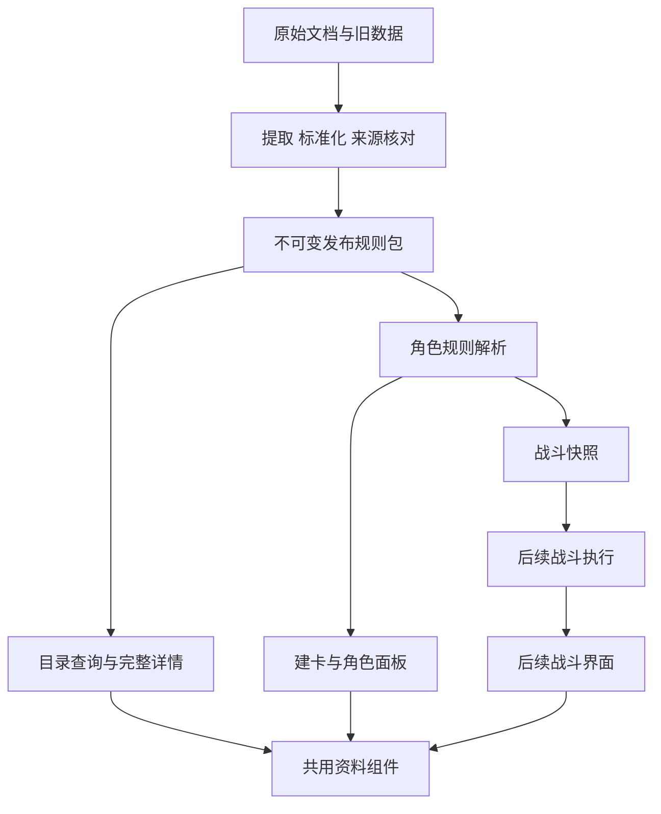
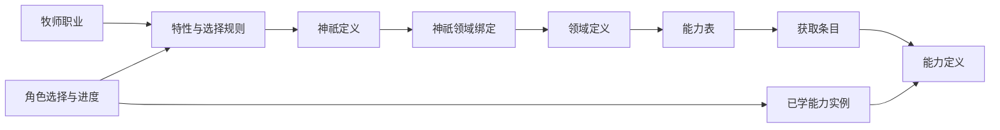

# 资料与领域框架调查

> 原阶段记录副本；来源：[资料与领域框架调查](https://chatgpt.com/space/page_852e22f7d6648191bfc15f55a81661f1)，Page修订序号30。本次迁移的统一安排见[主计划](../01_计划与设计材料/Snode_一期迁移总体计划_协作审阅版_20261006.md)。

本草案细化[一期迁移实施计划](来源调查与迁移总计划_原阶段记录.md)中的 3.1.1，约定资料库、规则依据、定义关系和查询展示的共同结构。目标是让资料迁移、建卡、角色面板和后续战斗使用同一份有版本、有来源的数据，避免按职业或人物重复编写模型。

编写日期：2026年10月3日；2026年10月6日补充B1／B2具体契约。领域T07原候选仍v0.2.2，类型／样例未改；[B1资料库与B2角色保存契约评审v1](B1_B2_优先契约评审_20261006_v1.md)从57项类型声明推导99项Schema定义，角色31个顶层字段闭合，191项结构例与局部关系反例核对通过。目录原样例38项严格载荷差异通过独立评审投影处理，原文／标记保留；其他kind先完整阅读，不假装可计算。生产运行接入、目录／系统／资产全引用与权限仍待共同实现，代码未改。

迁移总体设计先明确身份、引用、版本、完整正文及职责，再依据T01至T05基础规则与T07代表样例收敛角色获取、成长和服务操作。完整职业战斗机制与执行器在后续开发扩展，不要求迁移前全部审查。目录内战斗设计手册的公式按用户说明不可信；原型或候选记录不自动变为已确认规则。

## 一期范围与交付边界

| 工作 | 3.1.1 的交付 | 后续衔接 |
| --- | --- | --- |
| 资料迁移 | 职业、种族、背景、能力、领域、进阶、物品及关联内容的规范定义 | 建卡和面板通过稳定引用读取 |
| 文档迁移 | 完整规则、世界观、图文表格、来源和旧链接映射 | 规则计算及技能详情可引用依据 |
| 查询展示 | 浏览、搜索、筛选、完整详情和生物模板详情 | 同一内容组件用于学习页与已学能力详情 |
| 规则表达 | 已核对的条件、费用、成长关系及机制片段；未确认部分保留正文 | 角色计算与战斗分别声明支持范围 |
| 角色与战斗 | 约定定义引用、获取记录、解析上下文和快照边界 | 角色持久实例由 3.1.2、3.1.3 与 3.2 落实；战斗执行器后续建设 |

3.1.1 不负责建设完整战斗系统。其验收重点是资料内容和关系正确、扩展方式明确、读取结果一致，以及未确认机制不会被误当成可执行规则。账号、权限、资产事务和云端保存与 3.2 共同约定，不在资料目录中建立第二套权威库存或货币。

## 事实基线与规则依据

本轮只读抽样确认：战士 JSON 有 119 条能力，牧师通用 JSON 有 70 条，游荡者有 82 条，召唤师有 47 条；这些是资料记录数，不是战斗机制数。战士初始能力带“一阶”，牧师通用初始能力没有 tier 字段。领域资料同时含 pantheon 与 domains，包含起始专长等条目，召唤物单位表中另有固有技能和动作。 用户进一步确认：初始技能与初始天赋归入一阶；部分职业缺少阶位或风格是旧程序与数据的遗漏。迁移需要依据已确认规则和原文补齐，不能把这些遗漏解释成合法的无阶位或无风格。

上轮全量基线为 18 职业、30 种族、42 背景、2791 条能力索引、9 张已公布领域表。本文沿用这些已记录的调查结果，本轮没有重新统计全部索引与效果。抽样读取的职业 JSON、领域资料及技能索引没有显示未提交变更；其他正在修改的角色功能不作为本轮设计的新事实。

| 依据类别 | 处理方法 |
| --- | --- |
| 用户明确确认的规则 | 保存解释、原问题、来源、适用范围和更正；与主表或主持原答直接不同须登记并核对，用户自述可能错误时不能直接当作已确认覆盖。复核明确的规则另保存确认依据 |
| 冒险者基础规则.xlsx | 用户已于 2026 年 10 月 3 日确认以此文件为现行基础规则的主要来源；歧义逐项确认 |
| 原始技能、职业、种族及规则正文 | 作为内容与语义候选来源；提取不等于规则已确认，冲突需登记 |
| 战斗设计手册中的公式 | 保留来源及原文，标为待确认，不能直接进入计算 |
| 当前网页、索引、运行代码和战斗原型 | 用于交叉对照、历史兼容和发现差异；不能自动覆盖原文或用户裁决 |
| 本文建议与构造样例 | 属于设计方案与验证场景，不是新增游戏规则 |

SourceReference 记录来源文件、内容摘要、仓库提交和定位信息。RuleDecision 记录问题、候选解释、确认答复及被替代关系。每个需要裁决的字段或机制引用具体问题，不能用一条“资料已审核”覆盖整个职业的所有计算公式。

## 与现有工程及双方分工的关系

本轮核对新仓库：远端main仍是929cd8c工程基础；D:/Download/Snode本地codex/character-management-implementation0有角色管理候选核心及首个界面切片，正式contracts仍仅健康／就绪类型，db仍仅users。T06接入其CharacterDocumentAdapter，完整领域模型由3.1收敛；共享接口和数据库与3.2评审，不复制另一套角色或资产权威。

下列 model、catalog、rules 是职责拆分建议，不代表必须先创建三个新包或重建工程。中立领域类型若独立为包，contracts 引用它表达 HTTP 契约。完整战斗执行器仍为后续工作；基础规则调查先约束模型与当前角色计算，全面机制审查和一期资料、角色交付可以并行。整体责任与里程碑见[迁移总计划](来源调查与迁移总计划_原阶段记录.md)。

## 模块职责与依赖

| 模块 | 建议职责 | 依赖边界 |
| --- | --- | --- |
| packages/model | 定义引用、实例引用、内容块、基础表达式与运行时结构校验 | 不依赖 React、Fastify、数据库和浏览器 |
| packages/catalog | 规范资料、发布清单、旧引用映射、读取与查询索引 | 使用 model；不修改角色或战斗状态 |
| packages/rules | 获得校验、角色派生、成长解析和确认过的规则 | 使用 model 与只读目录接口；不弹窗、不保存数据 |
| packages/contracts | HTTP 请求、响应和错误结构 | 引用 model；不承担角色计算 |
| apps/api | 目录 API、查询、版本选择与服务编排 | 调用目录及规则模块，身份与权限接入 3.2 |
| apps/web | 浏览、详情、选择和问题提示 | 读取 API；使用同一套完整内容组件 |
| packages/db | 发布登记及后续角色引用、事务关系 | 与 3.2 协同；不复制一套独立可编辑规则 |
| 后续 combat 包 | 行动、事件、状态实例与战斗结算 | 消费定义和快照；不依赖网页组件或 HTTP 请求对象 |



资料定义由校验后的发布包提供。查询索引是可重建产物，不能作为正文或规则权威来源。资料页面、学习面板、主职业技能树和已学能力详情通过同一个定义解析器读取，避免各自维护简化版技能数据库。

新增包时需要同步新仓库 workspace 依赖、构建顺序、开发监听和测试入口。上轮看到的开发脚本仅显式监听现有包，测试入口主要运行 API 测试；新增 model、catalog、rules 的检查必须进入共同门禁。实施时重新核对最新仓库后修改，不把上轮脚本视为永久不变。

## 身份与版本

| 标识或版本 | 含义 | 约束 |
| --- | --- | --- |
| definitionId | 某一项职业、能力、模板等的稳定身份 | 改名、排序和数值调整不重建身份 |
| definitionRevision | 同一定义的一次不可变修订 | 发布后修改产生新修订 |
| RuleReleaseRef（早期称rulesetVersion） | 发布引用id＋manifestHash | 明确锁定定义、文档和资源修订；数据库登记ID与HTTP参数编码另行约定 |
| schemaVersion | 数据结构版本 | 结构升级与游戏规则调整分别迁移 |
| instanceId 或 UID | 某名角色、已学能力、物品或本场单位的实例身份 | 同一定义的多个实例互不共享可变状态 |
| characterRevision | 服务端并发更新版本 | 不参与资料定义的身份判断 |

规则包清单必须选择且仅选择每个 definitionId 的一个修订，并列出内容、资源和索引摘要。所有引用解析到该包的闭包内；缺失或修订不一致时返回明确问题。历史角色和进行中的战斗继续引用其规则包，不能在读取时悄悄替换为最新版。

```typescript
interface DefinitionRef { readonly id: string; readonly revision: number }
interface RuleReleaseRef { readonly id: string; readonly manifestHash: string }

type Recorded<T> =
  | { readonly state: "known"; readonly value: T; readonly evidenceRefs: readonly string[] }
  | { readonly state: "unrecorded" }
  | { readonly state: "unresolved"; readonly inputFactId: string; readonly issueRefs: readonly string[] };

interface ClassProgression {
  readonly uid: string;
  readonly role: "main" | "sub" | "gift";
  readonly baseClass: Recorded<DefinitionRef>;
  readonly level: Recorded<number>;
  readonly keyAttribute: Recorded<DefinitionRef>;
  readonly advancement: Recorded<DefinitionRef> | null;
  readonly chosenPathwayRefs: readonly DefinitionRef[];
}
```

以上是身份骨架，不是完整 Schema。实现时为各个 kind 建立受控结构；普通职业、阶位、资源、标签的业务 ID 来自注册表，不把当前所有中文名称写成固定枚举。新执行含义则需要扩展受控类型和处理器。别名可参与搜索，不能充当唯一键。

旧引用映射至少包含来源系统、来源文件或表、来源版本、旧 ID 和必要的旧上下文。仅凭名称或裸旧 ID 出现多候选时，返回 ambiguous；找不到时返回 unresolved 并保留原记录。不能自动选第一项，也不能把无法识别的技能丢弃。

## 资料定义与关系

| 定义组 | 内容 | 关系约定 |
| --- | --- | --- |
| 职业 种族 背景 | 说明、修正、熟练、成长和选择 | 引用规则、能力授予和起始装备，不内嵌整套人物状态 |
| 成长轨道 阶位 | 等级事件、解锁、奖励和显示顺序 | 等级与阶位分别表示，不固定七阶或固定等级上限 |
| 风格 | 能力表中的风格分组与规则引用 | 使用稳定 ID，归属与顺序明确；不从名称推导机械效果 |
| 能力 能力表 条目 | 技能、天赋、主动或被动效果，以及获取路径 | 能力定义保存共用语义；条目保存学习上下文 |
| 特性与选择 | 职业特性、专长选择、选择池和授予规则 | 特性可以组合能力和选择，避免重复存储同一效果 |
| 神祇 领域 绑定 | 神祇资料、领域资料、能力表和开放范围 | 允许结构表达多种绑定；实际选择数量由确认规则限定 |
| 物品 图纸 制作规则 | 装备性质、产物、材料、时间和费用 | 学习图纸与使用制作能力分别记录，保留原获得语义 |
| 生物模板与变体 | 生物属性、移动、感官、能力、不同等级版本 | 固有技能与动作引用能力定义，召唤与变形引用模板 |
| 状态与基础注册项 | 状态、属性、资源、伤害类型、标签及单位 | 标签、领域属性和学习标识分别定义，不因同色同名自动合并 |
| 文档与规则条款 | 世界观、规则正文、图表和依据 | 定义可以引用条款；叙事不会自动成为可执行条件 |

AbilityDefinition 统一表达角色与生物拥有的能力，包括技能、天赋、专长中的效果部分、种族能力和固有动作。FeatureDefinition 表达特性或授予组合：它可以引用能力、选择和奖励。一个专长若只有一个被动效果，可以直接引用能力；若同时授予跨职业技能和选择，则用特性组合这些内容。同一效果只维护一次，避免双重生效。

职业定义引用能力表、成长轨道和选择定义。角色只保存所选职业定义、进度与选择记录。新增人物始终创建通用角色实例；新增职业主要增加定义及关系，使用已有机制时不新增人物或职业专用 TypeScript 子类。

### 各类定义的最小业务字段

| 定义 | 除公共身份与来源外的建议字段 |
| --- | --- |
| ClassDefinition | 可选关键属性、熟练与初始修正引用、成长轨道、能力表、特性、选择与起始授予规则 |
| RaceDefinition | 属性修正、体型、移动、感官、固有能力和种族选择；未解析字段保留原文 |
| BackgroundDefinition | 熟练、语言或工具选择、能力授予、起始物资和叙事内容 |
| ProgressionTrackDefinition | 等级节点、阶位解锁、奖励与选择规则；节点按稳定 ID 标识 |
| TierDefinition | 显示名称和顺序；解锁由轨道或表关联，初始授予条目归入一阶；当前反制阶位按实际学习来源条目解析，召唤及未标注能力另存来源与裁定 |
| StyleDefinition | 风格身份、名称、来源及分组说明，由能力表引用 |
| ChoiceDefinition | 选择池、候选引用、选择数量与约束；动态范围使用已确认规则，缺失则保留问题 |
| FeatureDefinition | 能力或资源授予规则、选择引用、获得与持续生效条件 |
| AbilityDefinition | 分类与标签、正文、可共享效果及其来源变体、施展方式与适用窗口、升级关系、关联模板及图纸引用 |
| DomainBinding | 神祇、领域、适用模式和可用条件；领域自身引用能力表与起始特性 |
| ItemDefinition | 类别、装备位置、数量单位、重量、价格、性质、使用能力及容器规则引用 |
| RecipeDefinition | 产物、材料、制作时间、费用和条件；缺乏结构化依据时保留完整正文 |
| EntityTemplate | 属性与派生依据、资源、体型、移动、感官、抗性免疫、固有能力及变体 |
| StatusDefinition | 状态内容和已确认机制片段；叠加、持续和解除的未知部分显式登记 |

这些字段描述应有的信息位置，不承诺各来源已经具有完整结构化数据。公共类型确定后，各类别 Schema 通过代表内容逐项验证；不会为兼容未解析正文而把核心字段统统改成任意字典。

最新结构建议：PublicEventBatch与DeathSaveWindowState沿用已记录主持答复；AbilityListEntry保留源职业和条目阶位，已学能力实例指向实际获取条目，反制与职业属性在该上下文解析，不按名称合并来源；SummonOrigin保存具体召唤能力获取记录和阶位。ReactionNode、ReactionPayment与第一行动的施展方式窗口分别记录。CheckBonus分开基础武器熟练、额外武器熟练和属性豁免加值；DamageComponent分别记录来源范围与结算时点；ColorDieState属于游玩场次的单颗D8顺序替换。未知规则保留裁定引用，不补成0或一阶。

## 能力定义与获取路径

能力定义保存正文、关键词、使用语义、效果和升级关系。AbilityListEntry保存来源职业、阶位、学习条件、费用、授予与栏位政策；反制精锐按已学实例的来源阶位解析，不强制放入共享定义。当前效果归一化明确采用法师冻结之触的触发、伤害及升级条款，旋风主动摆脱DC12；取得来源与阶位仍独立保留。召唤宝石兽的成长及持续差异保留候选来源版本，并登记待定片段。原始正文不覆盖，规范效果通过带来源的修订映射追溯；其他同名差异逐项审查。

```typescript
interface AbilityEntry {
  readonly ability: DefinitionRef;
  readonly sourceList: DefinitionRef;
  readonly sourceClass: DefinitionRef | null;
  readonly tier: Recorded<DefinitionRef>;
  readonly styles: readonly DefinitionRef[];
  readonly acquisitionRule: DefinitionRef;
  readonly sameNameGroup: string;
}

interface ClassDefinition {
  readonly keyAttributeChoices: readonly DefinitionRef[];
  readonly progressionRule: DefinitionRef;
  readonly abilityLists: readonly DefinitionRef[];
  readonly initialGrants: readonly DefinitionRef[];
  readonly choices: readonly DefinitionRef[];
  readonly advancementCandidates: readonly DefinitionRef[];
  readonly compatibleMainClasses: SemanticFragment<readonly DefinitionRef[]>;
}
```

route 表达获取方式，起始授予通过职业或特性的授予规则明确触发。用户已确认的初始技能与初始天赋条目必须归入一阶；历史记录缺少 tier 时按来源识别并修复，不把任意缺字段记录统一填为一阶。一阶还包含后续可学习能力，不能因此全部自动授予。风格通过条目的 styleRefs 关联，按原文和已核对资料补齐；不能统一填成“通用”或第一个风格。未解析与经确认无风格分别表示，完整性校验检查应有字段是否遗漏。

学习技能点是可消费余额，施展疲劳值另记；现行色彩标识是本场学习条件，其消耗／替代边界仍待F49补充，并与D8色彩骰区别。颜色保留语义ID与展示值。F49确认奇械师尚未更新，旧彩色技能点费用按来源版本保存，不擅自转成当前资格。免费授予、是否占栏与栏位归属独立；角色获取记录保存实际授予、支付及裁决，可选合法费用组合不只累成一个数字。

成长规则声明所用职业进度，来源与放置不能自动决定成长等级。战技／魔法专家按原文改随主职业，镜子大师经F57确认也随本人主职业；颜色和对立禁令仍检查。F54开阶共享不改变成长等级，F58进阶保留基础职业成长与同一进度等级。未明示的“角色等级”继续保留原文，不统一算主副之和。

### 跨职业获得能力

```typescript
interface LearnedAbility {
  readonly uid: string;
  readonly entry: Recorded<DefinitionRef>;
  readonly acquisitionId: string;
  readonly placement: { readonly kind: "class-list"; readonly progressionId: string }
    | { readonly kind: "character" };
  readonly growth: ResolutionBinding;
  readonly keyAttribute: ResolutionBinding;
  readonly slot: SlotBinding;
  readonly styleParticipation:
    | { readonly kind: "participates"; readonly progressionId: string }
    | { readonly kind: "excluded"; readonly policy: DefinitionRef }
    | { readonly kind: "pending"; readonly issueRefs: readonly string[] };
  readonly useStatus: "active" | "condition-locked" | "pending";
  readonly issueRefs: readonly string[];
}

interface AcquisitionRecord {
  readonly uid: string;
  readonly route: "initial-feature" | "initial-choice" | "learn"
    | "feat-grant" | "background-grant" | "battle-experience"
    | "mirror" | "progression-grant" | "manual";
  readonly rule: DefinitionRef;
  readonly acquiredDefinition: Recorded<DefinitionRef>;
  readonly selectedEntry: DefinitionRef | null;
  readonly grantorRecordId: string | null;
  readonly paymentIds: readonly string[];
  readonly choiceRecordIds: readonly string[];
  readonly operationId: string;
  readonly acquisitionOrder: Recorded<number>;
}
```

永久禁学历史区分两种情况：permanently-forgotten保存原能力UID与条目；permanently-declined-grant保存尚未拥有的declinedEntry及grantRule，不创建虚构持有实例。两者按sameNameGroup拦截同名跨来源再学习，并记录operationId和证据。F60满槽选择应与禁学历史共同保存，生产事务另行实现。

这是与CharacterDocument衔接的最小类型片段；完整结构以T07候选及[迁移总体设计收敛与共享评审包v1](迁移总体设计收敛与共享评审包_20261006_v1.md)为依据，角色选择、属性、进度、获取、资源、装备引用与迁移事实分开保存。ChoiceRecord.value按选择定义验证，HTTP新选择通过ChoiceSubmission携带内容；不能把任意unknown当成已验证输入。InstanceId作用域及DefinitionRef目标kind须经关系校验。

构造场景：一名战士通过特殊专长取得另一职业技能。角色仍引用战士职业；已学能力引用目标技能，取得记录引用该专长和所选条目，成长绑定引用该专长实际允许的依据。是否额外建立职业进度、是否免费、是否占栏、用哪个等级升级，均由规则决定。这个场景验证结构，不假设具体专长已经允许某种成长方式。

F59确认同一角色不能另学同名技能，正式遗忘跨来源也禁止再习得，且不返还技能点。建议用同名规则组检查学习和遗忘历史；准确来源、目录阶位及获取UID仍分别保存。资料库保留同名不同来源条目，历史导入中的重复记录保留待核而非直接合并。明文“已有则强化”作用于原实例；职业专精／机制的重复授予仍需具体政策。

## 神祇与神圣领域



建议使用 DeityDefinition、DomainDefinition 和 DomainBinding 分别记录神祇、领域及绑定。DomainBinding 保存引用、适用规则模式和可用条件，领域引用能力表与起始特性。未来一神多领域、多个神祇共享领域、不同模式使用不同表都能在结构中表达；玩家实际上可以选择多少项仍由游戏规则确认。

当前 pantheon 的 attr 是领域相关属性，不是力量、敏捷等基础属性字段。locked、official 与资料发布状态含义不同：未开放表不能学习，特定模式资料不因 official 为 false 就被直接删除。规则包与查询明确适用模式，详情可以说明未开放或模式限制，选择与学习仍由规则校验。

当前火焰与锻造之神、死神、潮汐引力与崩坏之神没有开放表。保留神祇说明与可用状态，不能补造表条目。新增领域表时新增资料、绑定和发布版本，既有牧师职业及人物实例继续使用统一结构。

## 生物模板与实例

EntityTemplate 包含体型与类别、基础或固定属性、资源、移动、感官、抗性免疫、固有能力、说明和变体。旧单位表中固定 AC、HP、攻击加值等数字先保留其原始含义与证据，不能未经确认改写成由某属性推导的公式。模板属性与派生结果可以分别标注，避免导入时二次计算。

旧单位表的 abilities 转成具有独立稳定身份的能力定义，再由模板引用。单位内部同名动作不会被误识别成新的职业可学技能，也不会仅因与人物技能同名而合并。所有表、变体、升级续行、随机表和尾部说明必须保留；详情不能只显示第一个召唤物或第一张表。

| 对象 | 保存内容 | 与其他对象的关系 |
| --- | --- | --- |
| EntityTemplate | 不可变生物资料与固有能力 | 被召唤、契约、变形等规则引用 |
| EntityVariant | 模板修订内的明确变体与适用条件 | 等级、选项或场景选择确定，不能默认取最高版本 |
| CombatSnapshot | 已解析属性、能力、选择、来源和规则包 | 从人物或模板生成，记录解析上下文 |
| CombatEntityState | 本场 ID、归属、位置、资源、状态与计数 | 从快照创建独立状态，后续战斗维护 |

两个同模板召唤物具有两个本场实体 ID，召唤来源、控制者、当前 HP 和状态独立。玩家、NPC、怪物和召唤物使用共用战斗实体结构；是否敌对、由谁控制、是否具有职业分别表示。变形后的属性替换、装备处理、生命值和恢复方式是待确认机制，不能仅凭“变形”关键词决定。

人物保存的数据与战斗状态通过快照和明确的变更结果衔接。战斗过程不能共享可变对象直接改写模板或永久角色。哪些资源和状态可以写回、由谁确认、如何避免重复提交，后续与 3.2 的权限和事务接口共同落实。

## 正文与结构化字段

DocumentDefinition 和 ContentBlock 保存有顺序的正文、标题、列表、表格、图片、引用及专用资料块。能力正文中的随机表、图纸材料与单位数据有明确对应关系；世界观正文按阅读结构迁移。中文名称和正文无需翻译，内部 ID 与字段名称采用一致的工程约定。

建议的内容块包括 paragraph、heading、list、table、image、definitionLink、entityTemplate 和 rawExcerpt。每个块有稳定块 ID 和来源引用；表格保持行列与脚注，图片引用带摘要的资源。rawExcerpt 用于尚未结构化的原文，不作为可执行代码或机制。

原始来源作为不可变依据保存，规范内容块作为展示与引用入口。提取器记录每个原始片段被哪一块覆盖，未覆盖内容按原顺序回退展示；只有核对结构化展示完整替代原文后才能去重。这样既能防止漏掉召唤物动作，也能避免把整段原文重复附在已经完整展示的内容后。

结构化字段和原文分别记录证据。简单数值能够被提取，仍不意味着它的作用、单位或公式已确认。未知、缺失、明确无消耗和数值零必须区分；不能把“-”、空字符串和无法解析的值统一变成 0。公式文字保留在对应来源片段中，不执行任意字符串。

## 基础战斗逻辑调查

本轮已完成 T00 主要来源登记与 T01 基础流程调查，并取得用户对回合边界、预算和结束条件的确认。下面保留原表定位及结构影响，自动阈值方案已按最新口径撤回。完整基础规则仍由 T02 至 T04 继续调查，T01 完成不表示全部数值或状态已经确认。

用户已确认以 [冒险者基础规则.xlsx](../03_规则原件/冒险者基础规则.xlsx) 为现行基础规则的主要来源，原文明确条款按此整理，未定义或互相冲突的部分逐项询问。当前文件 SHA256 为 23A8386D1FECFA72606E736F0B3997B7643638F703490033A5E8F5F0EEF3ECB9。旧版规则书仅作历史对照，help.html 和编排记录核对是否漏抄，战斗设计手册与原型不能替代原表。

| 原表定位 | 已读取的内容 | 对结构的初步影响 |
| --- | --- | --- |
| 战斗规则 B6、B10、K55 | 先攻决定战斗区间，同区间玩家可穿插各自行动 | 不能只建一个严格逐人行动的回合指针；需要表示区间与每名角色剩余行动 |
| 战斗规则 K65、K69 与用户最新答复 | 原表有阈值描述，用户明确当前仅由主持人裁决 | 不设计阈值数值、自动推进、触发队列或额外回合；保留人工口径说明 |
| 战斗规则 K52 | 反应可在自身或他人回合使用，有每场战斗总次数限制 | 反应预算与主要或附赠动作、技能自身使用次数分别表示 |
| 其他规则 H39 | 额外支付反应涉及能力锁定，多人反应按后发先置结算 | 次数、能力锁定与反应结算顺序需要独立结构 |
| 其他规则 N15 | 斜向移动距离与触及或近战的相邻判定有区别 | 移动距离和目标相邻条件分别建模 |
| 检定规则 B2、H8，异常状态规则 B2:E67，关键词规则 B2:C118 | 检定、状态与关键词有独立规则来源 | 通用规则先调查，职业能力再声明使用、扩展或例外 |

上述影响是架构推论，具体实现仍需完整条款与案例验证。此时不要把旧原型的回合指针、默认行动数量、优势骰数、固定次数或距离算法当作引擎基础。

| 调查内容 | 必须明确的问题 |
| --- | --- |
| 战斗生命周期与时间 | 战斗开始与结束、轮次、战斗区间、个人回合的边界和公共结算 |
| 行动与资源 | 主要、附赠、反应及其他动作的数量、换用、恢复、消耗和锁定 |
| 玩家与敌方调度 | 区间内穿插、NPC 固定区间、动作预算与行动组、控制者与友方单位；阈值人工裁决不自动实现 |
| 一次行动的结算 | 选择目标、条件、费用、检定、结果、反应、效果及行动结束的先后与失败处理 |
| 检定与战斗数值 | 攻击、豁免、对抗、优势劣势、重掷、暴击、伤害、治疗及取整 |
| 状态与生存 | 层数、持续、触发、解除、免疫、护盾、临时生命、濒死及死亡 |
| 空间与装备 | 距离、相邻、移动、区域、视线、掩体、武器、弹药与物品交互 |
| 规则模式与例外 | PVE 与 PVP、人工裁决、环境事实，以及技能如何明确覆盖基础规则 |

基础规则调查的产物应为：来源与条款清单、术语表、可理解的战斗流程图、一次行动及反应的结算说明、通用规则与职业例外的关系、待确认问题及固定输入输出案例。先检查正常攻击、区间内两名玩家穿插、反应改变结果、主动放弃、无法行动、持续状态和濒死等基础场景，再引入复杂职业技能。

本轮 T01 已明确：玩家回合随所属玩家区间开始，所有玩家行动完成、放弃或无法行动时结束，不等待敌方普通行动；玩家与普通敌人默认 1 主、1 附，模板和技能可增加，区间再次开始恢复。阈值由主持人人工决定，不做具体实现。后续调查动作换用与双动作、反应和优先级、边界先攻及状态结算；相关条款先读完整，歧义再给具体场景确认。

建议将已整理的基础规则作为独立 CombatRulesDefinition 或带来源的 RuleClause 集合，由规则包引用；职业能力引用基础机制并记录例外。当前先确定这一职责，具体结构根据基础调查定稿。正文与稳定 ID 工作可以继续，ActionSpec、DurationSpec 与事件顺序在关键基础规则明确前不冻结。

本轮事实与问答见[第一轮调查报告](https://chatgpt.com/space/page_16f95c2f11448191a7eb83f6f4c64c7c)。旧原型的逐单位调度及个人回合状态触发不能直接迁移为已确认规则；数值预算、明确事件与角色实例分别建模，具体实现尚待后续样例。

T02调查与主持人首批答复继续保留来源，最新用户补充见[校核记录](https://chatgpt.com/space/page_bd352f7770c4819190ec2c16190e4aeb)。火球术已付第一主后，在首次支付的自身回合结束前可转换简化并射出；目标仍在完成时确定。反制阶位当前按学源条目；不同技能来源的施法关键属性也要绑定对应职业。只在自己回合使用的免费主动效果仍计第一行动，允许回合外释放的效果不计；急速冲锋普通附赠与反应两方式的具体归类留一个用例。反应先于豁免的互斥选择，与技能自身冷却和精锐／速攻资格分别检查。

## 规则语义与机制支持

机制按片段建模，能力可以同时包含已经确认的部分和需要人工处理的部分。资料迁移先完整展示，角色计算只执行被确认且受支持的获得或派生规则，战斗自动化只执行被确认且通过对应验证的机制。使用受限表达式和受控条件，避免按职业名称进入不同函数分支。

```typescript
type SemanticFragment<T> =
  | { readonly state: "confirmed"; readonly value: T; readonly evidenceRefs: readonly string[] }
  | { readonly state: "pending"; readonly rawContentRef: DefinitionRef; readonly issueRefs: readonly string[] };

// 规则确认与程序支持分开；T06只完成类型候选，不填supported。
interface AutomationCoverage {
  readonly fragmentId: string;
  readonly consumer: "catalog" | "characterRules" | "combat";
  readonly status: "planned" | "supported" | "manual" | "unsupported";
  readonly implementationVersion?: string;
  readonly verificationCaseIds: readonly string[];
}

type ConditionResult =
  | { readonly result: "satisfied" }
  | { readonly result: "unsatisfied"; readonly reasonCodes: readonly string[] }
  | { readonly result: "unknown"; readonly issueIds: readonly string[] };
```

规则确认与程序支持是两个维度。一个机制可以已确认但尚无处理器，也可以只有候选解释。支持范围关联具体程序版本和验证案例，不写死为永远正确的 supported 布尔值。自动执行依赖的任一必要片段未确认或不受支持时，应返回问题；不能扣费并跳过未知效果后宣称完成。

| 语义组 | 现在保留的结构方向 | 审查后决定的细节 |
| --- | --- | --- |
| 费用与行动 | 资源 ID、行动类别、数量表达、次数限制和恢复事件 | 动作之间的换算、扣费时点、失败返还、免费动作限制 |
| 目标与空间 | 目标类别、关系条件、距离单位、形状和环境引用 | 距离度量、视线、朝向、高度、边界与地图换算 |
| 检定与数值 | 属性及等级上下文、公式引用、骰子表达、结果条件 | 命中、优势、豁免、对抗、暴击及取整公式 |
| 伤害与治疗 | 伤害类型、资源变化、修正来源和处理阶段 | 抗性、减伤、护盾、临时生命、治疗限制和结算顺序 |
| 状态与持续 | 状态引用、来源、层数、时间单位、到期锚点和解除条件 | 叠加、覆盖、刷新、免疫和回合或轮次结算 |
| 触发与反应 | 事件、条件、受影响对象和有限次数 | 同时触发顺序、反应窗口、取消及触发链停止条件 |
| 召唤与变形 | 模板及变体引用、归属、控制与持续关系 | 行动共享、控制数量、独立回合及属性替换 |
| 非战斗与人工事实 | 历史记录、环境事实、裁决引用和人工交互 | 外部信息如何提供、失效及人工确认 |

ValueExpr、RuleCondition、EffectSpec、TriggerSpec、TargetingSpec 和 DurationSpec 是建议的语义分组，v0.1 不冻结全部分支。先用确定的少量表达能力验证，后续新机制扩展 Schema、处理器及案例。表达式区分使用者、目标、武器、职业进度、技能选择和获取上下文；角色派生计算保持确定性，随机骰子交给后续战斗的随机数上下文并记录结果。

F19对计算模型的新增约束：抗性授予、护盾池、护甲池、临时生命与生命分别记录，结算顺序为抗性→护盾→护甲→临时生命→生命。护甲使用每挡1点原伤害的资源消耗倍率，不让倍率改变护甲层之外的余伤。规则条款决定可阻挡类型，不能用单一全局护甲常量覆盖不同来源。

建议MitigationPool增加来源引用、剩余量、类型适用条件与armorConsumptionFactor；ResistanceGrant单独记录抗性适用组、来源及依附护甲的失效条件。MitigationStep保存进入伤害、挡住的原伤害、资源消耗、剩余伤害、未取整值、取整后值、取整方向及条款引用。F19D的取整阶段在护甲之后、临时生命之前，保留精确中间量；D例数字已由用户更正为4.5，取整5后再扣3点临时生命，生命18；护甲本身的小数政策仍保留问题。规则核算不等同引擎实现已验证。以上为字段建议，具体Schema在T04及代表样例后收敛。

### T04对资源状态与生存结构的补充

角色冒险中的当前生命、疲劳、库存、跨场能力次数、创伤与持续状态应保留实际变更；战斗开始／结束只处理有明确范围的预算和效果，不还原开战快照。界面是否显示战斗记录与角色是否正在经历战斗是不同状态。

ResourceState保存当前量、有效上限及负值／小数政策引用；EffectInstance保存独立施加ID、来源实体、已学能力UID、目标、层数／量、到期和解除条款，StatusView只负责聚合展示。TemporalAnchor保存所属实体、事件边界和游戏时间，UsageScope区分本场、自身回合、游玩场次、休息及滚动24小时。

SurvivalState保存濒死、稳定、死亡等阶段和DeathSaveProgress，不能仅按HP大于0筛选存活。控制状态提供细粒度的行动、反应、移动与感官约束；麻痹与瘫痪分开，永久创伤来源不能被移除暂时状态抹去。RecoveryProgress保存创伤回复的原值、修正值和实际增加量，等待F37选择进度政策。

### T04生存与唤醒字段的最新约束

单次减免后伤害超过最大HP用于不屈资格，不直接设为死亡；负生命即死条件是伤害导致HP≤−当前最大HP。已为负HP时，后续进入生命层的伤害保持HP，只按每次固定死亡标记+1。这两种分支需要保存事件前HP，不能一律先减血再比较阈值；HP恰0仍沿已给0受4到−4的例子单独处理。

DamageLedger分别保存进入生命层的伤害量、HP实际变化、死亡标记变化及原因。负血受伤HP变化0仍是伤害，不可据HP不变判成未受到伤害。死亡骰的自然1死亡+2、20生命+2与受伤固定死亡+1、稳定固定生命+1各有独立事件来源；稳定替骰不产生自然骰面事件。

每个SleepEffectInstance保存本次昏睡的累计伤害量、暂用门槛25和主持人覆盖事实，累计≥25唤醒；不把阈值扩展到魅惑／全部控制，不把生命流失一律当伤害。下一次独立昏睡重新建立该次计数，是针对状态期间累计的实现建议。公共批次仍遵F02，不用任意串行顺序构造非线性伤害结果。

SpatialQuery分别给出相邻、射程、路径成本、碰撞、可停留、视线与掩体；MovementProcess保留轨迹／跃迁、剩余额度及移动原因，区域保存位置、形状与高度政策。规则或地图事实不足时返回问题，T04未明确的计算不填固定公式。详见[T04报告](https://chatgpt.com/space/page_272730c03d908191814939407d76f82a)。

持续时间区分个人回合、公共轮次和分钟／小时等游戏时间，另分现实计时。锚点记录所属实体及开始／结束边界，不能默认全部按施展者turnSerial或网页计时器到期。游戏轮次与分钟换算、未写期限的状态、来源刷新及清除范围见F29至F31。资源上限变化与当前值也独立；环境事实不足返回unknown，不自动创造角色经历或主持人裁定。

条件与效果采用带 kind 的受控联合，业务 ID 使用注册表引用。TypeScript 的判别联合与穷尽检查有助于发现新增机制遗漏的处理分支；运行时结构校验另行覆盖外部 JSON。[TypeScript 官方说明](https://www.typescriptlang.org/docs/handbook/2/narrowing.html#discriminated-unions)

运行时 Schema 应作为字段约定的主来源，TypeScript 类型通过生成或同源推导保持一致。实现前用小样验证与现有工具的集成，避免手工维护三份不一致的字段定义。Schema 验证类型与结构，关系校验和规则审核另行进行。[JSON Schema 组合结构](https://json-schema.org/understanding-json-schema/reference/combining)

## 查询与展示接口

API 和本地规则模块共用目录读取约定。浏览时先选择明确的发布规则包；只有首次进入目录时可以按约定选当前默认发布版本。历史角色相关详情必须带该角色的版本。数据切换版本后重建选择上下文，不能把上一版本的条目引用带入下一版本。

| 建议接口 | 输入重点 | 输出重点 |
| --- | --- | --- |
| GET /api/catalog/releases | 可用模式和版本筛选 | 发布版本、适用范围及摘要 |
| GET /api/catalog/search | rulesetVersion、关键词、类别、来源表、阶位和分页 | 定义结果、获取路径摘要和固定排序 |
| GET /api/catalog/definitions/:id | rulesetVersion、可选 entryId | 完整正文、引用、获取上下文和问题 |
| GET /api/catalog/lists/:id | rulesetVersion、筛选与分页 | 有序条目、阶位、费用与可用状态 |
| GET /api/catalog/documents/:id | rulesetVersion、条款或块定位 | 有序正文、图片与引用 |
| POST /api/catalog/legacy/resolve | 来源系统、版本、表、旧 ID 和辅助名称 | resolved、ambiguous 或 unresolved 及候选原因 |

这些是接口草案，实际路径和 DTO 与新仓库协作约定一起冻结。资料接口不接受“学习”或“修改角色”操作；后续角色服务获取定义并进行服务端校验。筛选中的 ID、分页游标和引用由 API Schema 校验；目录关系与业务语义由目录及规则模块校验。[Fastify 官方验证与序列化说明](https://fastify.dev/docs/latest/Reference/Validation-and-Serialization/)

DefinitionDetail 返回能力正文、升级、随机表、图纸、全部单位模板和来源引用。entryId 存在时附加对应表的学习条件、费用、阶位和授予规则；没有 entryId 时展示全部获取路径或明确提示选择。entryId 与能力、规则包不匹配时返回错误，不静默套用另一条目的费用。

同一定义出现在多张表时，搜索可以返回一个定义并列出多条获取路径；同名不同效果的定义分别返回，显示职业、领域或模板上下文。全文索引从规范内容生成，包含升级和单位动作；旧 URL 通过旧引用映射解析。

缓存和分页绑定规则包、索引修订及查询条件；规则包不同不能混用结果。缺失历史版本、缺引用、未开放、来源歧义和需裁决分别返回稳定问题代码。尚未支持战斗自动化不影响资料完整阅读和已经确认的角色计算。

前端建议共用 CatalogBrowser、AbilityListView、DefinitionDetail、RuleDocumentView、EntityTemplateView。页面根据定义和表条目生成导航，不通过扫描 DOM 推断资料身份；新增职业或阶位不新增对应专用 JSX 分支。

## 发布与存储

建议一期以版本控制中的规范 JSON、文档块及资源作为资料编辑来源，经构建生成不可变发布包。API 读取发布产物，数据库按需要登记规则版本和角色引用。后续建设资料编辑后台时再明确新的编辑权威，不能同时允许 JSON 文件与数据库各自修改同一规则。

```text
packages/model/src/
  references/        身份与引用
  definitions/       各类定义及关系
  content/           正文块与来源
  semantics/         受控规则片段
  instances/         角色衔接与快照结构

packages/catalog/
  data/              规范资料及稳定 ID 注册
  content/           文档块
  assets/            关联图片与资源
  manifests/         版本清单
  legacy/            旧引用映射
  src/               读取 查询 解析与校验

scripts/catalog/     提取 转换 差异报告与构建
docs/               设计 规则问题和机制审查记录
发布产物目录          由构建生成并按版本归档，位置实施时确定
```

这些是建议目录，不代表已经创建。原始 DOCX 等依据按来源清单归档，现有提取工具能复用的部分继续作为离线工具；新应用和共用接口使用 TypeScript。发布产物完整包含清单所引用的正文和图片，不能依赖开发者本机的绝对路径。

发布流程为提取、标准化、来源差异检查、结构校验、关系校验、语义审核、完整展示检查、构建和发布。草案可以保留冲突与候选规则，但发布内容不得有断开的必要引用。可阅读且待确认的战斗片段允许进入资料包，支持标记必须准确；已经承诺自动计算的角色规则不能带未处理的关键歧义。

定义修订发布后不可覆盖；数值更新生成新修订与新清单，文案修订也保留版本，但通过影响说明区分是否需要角色规则迁移。旧规则包继续可解析，索引可重建但不能指向不同内容。角色选择的版本升级需要差异预览与明确变更，进行中的战斗保持原快照版本。

## 代表内容验证

截至2026年10月5日，[T07](https://chatgpt.com/space/page_0f31efad73648191a93884a336df0531)已完成明确选择的13个真实来源区块与5个构造角色场景。v0.2.2候选包含升级授予与永久放弃授予记录；引用、全文、同名来源、跨职业绑定和召唤单位六能力通过样例检查。该包标记sampleOnly，尚不是全量规则发布包、运行时Schema或完整合规建卡结果。

| 样本 | 来源性质 | 本轮验证结论 |
| --- | --- | --- |
| 战士初始四能力 | 原始战士DOCX body[87/89/91/93]及旧ID | 一阶与初始授予独立，原风格保留，初始免栏但不确定风格顺序；正文与升级尾句核验通过 |
| 战士／牧师盾牌格挡 | 两职业DOCX，旧w-starting-skill-3／pr-skill-10 | 一阶与二阶来源条目分别保留；同名禁重复获取由角色规则处理 |
| 知识领域起始三能力与神学教士 | 原始领域DOCX及当前领域JSON | 初始一阶；启迪／先见／授业从源表恢复；受限额外槽与首级待定分开；全文核验通过 |
| 公正领域审判 | 原始领域DOCX body[35] | 原圣骑士文字保留，确认后的成长绑定以规范修订指向牧师 |
| 魔法专家取得魔法飞弹 | 真规则＋构造主游荡者8／子法师3场景 | 来源、子列表、主8级成长、子关键属性、免栏与风格排除分开；不是全套合法建卡验收 |
| 隐形仆役15级授予新技能 | 召唤师DOCX body[450/452]＋构造实例 | 新增progression-grant与父技能实例关联；F60确认15级自动获得并占槽，满槽由玩家选替换一项或放弃新技能；两种放弃均按同名组永久禁学；未答费用不自动执行 |
| 隐形战仆模板与两个实例 | DOCX body[454]＋构造实例 | 单位头部及六个固有能力全文可显示，各实例当前状态独立 |
| 新职业、新领域与十阶 | 纯结构扩展样例 | 可添加定义与关系；不代表游戏新内容或机制已实现 |

这些样本说明当前边界具有表达方向，尚不能证明完整 Schema 已覆盖所有职业。下一轮把样本转换成小规模规范 JSON，执行结构、引用、版本和完整内容检查。战斗预期结果必须等规则确认后再填写，避免用旧原型公式构造一组自证正确的测试。

## 后续机制审查与验收

具体执行编号、状态、交付物和依赖统一记录在 [3.1 分步执行计划表](https://chatgpt.com/space/page_8d2acb837bbc819196ddbbcc1ab5efe7)；本节描述机制审查与设计关系，任务完成情况以执行表中的验证记录为准。

总体草案之后先调查基础战斗逻辑，形成战斗流程、术语与结算时点说明及问题清单；修订语义结构后，再用上述样本形成 v0.2，随后从战士开始逐职业审查。每个职业覆盖初始、各阶技能、天赋、专长和升级变化，同时补查领域、种族、物品与召唤物固有能力。机制按语义和执行时点归类，不能用关键词次数统计。

| 审查记录字段 | 用途 |
| --- | --- |
| 定义与来源片段 | 定位职业、表、能力、升级和原文 |
| 获取规则与成长依据 | 校验学习、授予、栏位及跨职业成长 |
| 使用流程与条件 | 分解消耗、目标、检定、效果及先后时点 |
| 机制与依赖 | 标记复用、新机制、状态、装备、模板和环境依赖 |
| 规则问题 | 保存冲突、候选解释与需要用户裁决的具体例子 |
| 实现与验证 | 分别记录展示、角色计算、战斗执行支持及测试案例 |

先完成基础规则调查与关键歧义确认，职业审查再按战士、牧师通用、游荡者、法师代表机制推进，并扩展召唤、变形、区域、控制、制造等职业和领域。职业技能用于发现对基础规则的扩展和例外，不能反过来用单个职业定义全游戏行动模型。完整覆盖后再冻结战斗核心执行接口。

| 步骤 | 交付物 | 完成条件与现状 |
| --- | --- | --- |
| A 总体设计 | 本v0.2.2候选及T06字段／接口方案 | 代表样例类型检查通过；接入／交付及操作／最小契约v1已形成，总体候选交叉收敛已完成；B1／B2完整字段与DTO候选已补；191结构例及5关系反例通过；各批正式ABI／生产边界待共同确认 |
| A1 基础规则调查 | T01至T05来源、答复及未定问题 | 主要确认已归录；F50等边界保留，不伪造自动执行 |
| B 代表内容验证 | [T07规范样例、来源与详情验证](https://chatgpt.com/space/page_0f31efad73648191a93884a336df0531) | 本轮所选13区块与5场景完成；36例、27项入口检查及9张截图核验通过 |
| C 机制盘点 | 逐职业能力与升级覆盖记录 | 后续战斗开发工作；已读C01-a／b共22／119，保留覆盖清单，不作为迁移完成门槛 |
| D 基础实现与迁移 | T08起落实model、catalog、查询和详情 | 代码由用户指定延后到总体设计完成，当前共享评审材料已齐，按批次依赖共同确认后再安排代码 |
| E 角色与战斗衔接 | 通用获取解析、快照与服务事务 | 类型方向已定，迁移保存与资产服务先落实；完整战斗仅预留独立快照方向 |

基础战斗调查先于战斗语义结构定稿、代表能力执行验证和职业机制审查。身份、版本与定义关系的资料工作可以继续推进。步骤 C 与 D 在相应基础规则明确后并行；影响当前建卡、成长和校验的规则及时确认，其余战斗片段保留原文和支持范围，正文阅读与目录查询可以先迁移；事件、行动和时间结构保持可修订，完成全范围审查后再冻结执行接口。

验收至少覆盖：稳定 ID 不因改名改变；增加阶位不触发七阶上限；初始技能与初始天赋归入一阶且应有风格不丢失；跨职业获取保住来源和 UID；同名能力不误绑定；全部召唤物与动作可阅读；空值不被改成零；历史版本不静默升级；未确认公式不会执行；条件事实不足返回问题；查询与详情引用同一包。新机制出现时应能定位需要扩展的 Schema 与处理器，已有内容继续正常读取。

## 待确认项与资料依据

T01至T05调查材料与T05十五题答复已归录，F54／F59补确认完成；F50由用户指定待奇械师新表。T04其它应用边界及召唤宝石兽待定、T05附赠容量、标识消耗／替代、风格删除和重复机制等继续登记，见[审查](T05_审查依据摘要_20261004.md)。尚未覆盖片段不自动执行，独立通用结构可继续评审。 F60已确认隐形仆役15级自动授予召唤隐形战仆并占槽，满槽提示替换一个现有技能或放弃新技能；放弃涉及同名永久禁学已确认，仅费用未明确；知识领域神学教士首级受限槽沿用F47待定。详情与资料身份可继续实现，角色自动操作保持pending，见[T07](https://chatgpt.com/space/page_0f31efad73648191a93884a336df0531)及累计问卷。

旧项目依据为 D:/Download/scholar-agent-main 下的 职业页/数据/战士.json、牧师.json、游荡者.json、召唤师.json、牧师·神圣领域.json、classes.json、races.json、backgrounds.json，以及上轮已核对的 skill_index、skill_effects、unit_tables 和资料文档。职业页/AGENTS.md 的完整性约定要求保留升级续行、单位动作、随机表和原文回退，本草案沿用这些内容保护要求。

目标工程本轮通过后台Git SSH和本机只读核对，[远端main](https://github.com/Usokyun/Snode/tree/929cd8c4ac48d8aa268608411c77e95753bd0655)仍为工程基础；本机候选代码未提交状态与哈希单独登记。原开发文档3.1／3.2范围沿用。T06只创建设计文档及临时类型草案，未改业务源码、未发布正式契约或实施战斗引擎；页面源码已回读，视觉预览不冒称已核验。

## T05对建卡与成长结构的约束

2026年10月4日，[T05审查](T05_审查依据摘要_20261004.md)已完成资料调查并归录F45至F49的部分答复。下列是T06评审输入，尚未实现Schema；已明确结论与尚余应用边界分别登记，不把旧计算当裁定。

| 维度 | 必须分开保存的内容 |
| --- | --- |
| 职业 | 基础职业定义与职业进度实例；主、副、附赠；未知等级；领域绑定；进阶继承原基础职业、进度UID与等级 |
| 获取 | 目录条目、UID、途径、授予者、选择与来源版本；免费费用与是否占栏；同名技能学习限制及获取顺序 |
| 解析 | 成长进度、关键属性绑定、放置列表、原风格与是否确定职业顺位；不得互相反推 |
| 开阶和容量 | 主职业实际开阶，所有子职业与通用树同步读取；每阶天赋角色共用；基础槽、受限额外槽及专业池 |
| 属性和熟练 | 永久基础、临时增益、允许突破的加成、资格与数值；普通初始熟练遵守上限，奥秘选一个子项；临时属性不能满足前置 |
| 资源与操作 | XP费用、技能点、本场色彩资格、领取记录；已领取升级HP的历史，首级HP另按永久体质变化；完整操作预览、原子提交与幂等 |
| 限制与历史 | 获取时条件、持续条件、叙事证据、互斥、依赖、锁定原因、正式遗忘记录与角色内跨来源同名禁学 |

战技／魔法专家的源条目仍属所选职业、最多三阶，免费获得两项与必需机制，可放主／副列表且成长随主职业。F52确认这些技能及法师学徒戏法免栏；学徒仍限至多两项一阶，成长政策不由免栏改变。F57确认镜子大师也随本人主职业，但色彩与对立禁令不豁免；不推广到所有获取途径。

法师奥法学者与智慧领域神学教士分别授予仅限法术／戏法、法术／神术的额外槽，用共同受限槽机制表达，不翻倍职业升级槽。F53每阶天赋全角色共用；F54领域与所属职业同步开阶，所有子职业继承主已开阶。牧师与领域共享四种风格的原条款仍保留。

学习资源分技能点余额、本场标识及D8色彩骰。F49标识在下一次游玩开始到期，旧重复颜色算例撤回；F50明确等待新奇械师表，不猜额外费用。F51已确认主／副的五种储存容量，附赠计数及标识消耗／替代仍待定。未明示“角色等级”不统一为主副总和或最高等级。

资料定义、完整内容查询和来源整理可继续规划；涉及未定规则的自动创建、升级、正式删除需待答复或明确DM裁定。后续战斗消费解析后的快照，不依赖前端DOM或全局state。

## T05首批答复对生命成长与版本的约束

来源为2026年10月4日用户F45至F49答复，原句与校核保存在[T05审查](T05_审查依据摘要_20261004.md)及本地T05_用户答复校核_20261004_v11.json；不是主持人新附件，也不是本次实现结果。

F45确认继续32点建卡费用表。F46明确本题普通初始熟练不突破上限，奥秘给予一个子项选择；不能将普通初始加成与写明允许突破的例外混为同一政策。

F47子职业1级不发HP/FP，仍办熟练、初始专长和起始选择，后续升级才发升级量。F52所列授予免费免栏，F59禁止另学同名技能；重复职业专精／机制如何合并继续保留边界，不推断附赠首级0。

F48确认永久体质只改变主职业首级生命收益，已领取升级HP保持；临时体质不改变最大HP，明文最大HP效果独立处理。建议将首级计算依据与已领取的升级增益分开持久化，单次增益包含职业进度ID、领取等级、实际HP增量、规则版本及幂等领取标识。若采用逐级解释，也保存当时参与计算的永久体质依据；字段名称与最小存储形式留给T06评审。

最大HP的解释应使用“按已确认政策解析的首级收益＋已领取升级HP合计＋其他有效的明确HP加成”，不能把当前体质乘所有等级。例：最大HP48的7级战士永久体质14→16变49；只有同等临时体质增加且没有独立最大HP效果则仍为48。将未来新升级按当时永久体质结算是暂用解释，不能标成用户本次逐字答复；这项HP政策也不自动推广到疲劳首级关键属性。

导入缺升级历史时，保留原最大生命数值与来源，标记历史未确认。只有足够依据才转换为可重算模型，不从当前体质伪造历次增益。已领取收益与未提交的升级选择分开，不能通过关闭、重开界面重复领取。

F49确认无红蓝蓝重复标识，原算例撤回；奇械师旧费用保存来源与版本，不去重后当新规则，也不整体废除战斗资料。标识到下一次游玩开始前有效，消耗／替代尚待补；F50已按用户指示延后等新表，不再记为未填写。

## T05后续答复对共享规则的约束

2026年10月4日用户F50至F59及F54／F59补确认已归录，[审查报告](T05_审查依据摘要_20261004.md)和本地T05_用户答复校核_20261004_v12.json保留原句及覆盖关系。以下是T06评审输入，尚未编写Schema或业务实现。

### 开阶与成长分别解析

主职业保存实际开启的阶位集合及付费／授予事实，所有子职业继承这一集合；通用树仍跟主职业，所选牧师领域跟所属职业同步。不能根据子职业升级给主职业新增未开的阶，也不能额外用子职业等级门槛否定继承开启。主开六阶、子牧师1级时，子也开六阶，但其职业等级仍1；能力成长依绑定，学能力自身前置、颜色、栏位条件照常检查。

此政策是F54补确认对原升级表按子自身等级自动开的覆盖。子职业等级上限仍沿用原等级与快速兼职规则；主开八／九阶可以被子继承，并不产生子18／20级。公正领域的两处圣骑士成长词按牧师解析，修订映射要定位原body[35、37]，不全文替换其它引用。

### 学习顺序与获取途径

风格原分组保存在目录条目；职业顺位按有效学习先后形成，获取记录需保存顺序及是否影响顺位。建卡起始不影响，战斗心得影响，跨职业获取其它职业能力不影响；普通通用树也不影响，其战斗心得子授予按例外处理。先防护1项再斗争2项仍是防护第一，不按数量排序。

F52原题五项授予免费且免栏，仍可有阶位和原风格；不将所有一阶或所有grant都设为同一免栏政策。战斗心得追加起始等未单列途径另保留边界。F53每阶天赋池按角色＋阶位共用，默认5，加明文额外槽；免栏记录不占池。

### 进阶与技能点容量

职业进度保留基础职业ID、同一UID和等级，附加已完成进阶引用及展示名。斗士7级仍是战士7级，升级／成长用战士规则，不新增职业数量、不重新起级或重发首级。一份职业进度完成一项进阶；三条由玩家任选的是途径信息，完成时仍检查实际条件。

不含附赠的已确认容量为“1＋有无子职业＋主是否进阶＋子是否进阶”，五个原例依次为1、2、2、3、4。主、副各自进阶分别加1；附赠职业的计数及同名附赠仍保留主规则C4与待定边界，不因未提及就自动删掉。

### 来源身份与同名限制

镜子大师绑定本人主职业成长，前置／额外豁免不含色彩标识，对立学派仍禁止获取。目录来源、阶位和正文不合并；主成长绑定不自动改变目录来源或关键属性绑定。

技能同名查重和永久遗忘禁令作用于同一角色，跨职业来源也不能绕过；正式遗忘不返还技能点。建议目录提供可追溯的同名规则组，获取实例继续用UID和准确来源操作，历史禁学记录保存规则组与来源版本。禁止重复学习不意味着资料库只保留一个同名定义；原文“已经拥有则强化”表达已有实例增强，不产生第二个同名技能。职业专精／机制的重复授予策略不由此一刀切推断。

兼职兼容保留方向，按原表判读，不要求双向成立；W7字样没有具体更正，保留原证据。F50按用户要求等待奇械师新版学习表，不自行选择费用解释。剩余标识、附赠、风格删除、重复专精等应用边界继续登记，通用结构评审可以按明确的关系推进。

## T06字段与共享接口候选

2026年10月5日，[T06完整方案](T06_字段与接口候选_20261005.md)已形成v0.2.0设计候选：44项核心字段说明、14项候选接口、7项协作评审事项，以及独立模型／传输／适配器类型检查。通用CharacterDocument是此前CharacterData的统一候选结构名，并非另建第二套角色模型。

本轮重新通过后台Git SSH确认main仍为929cd8c4ac48d8aa268608411c77e95753bd0655。本机目标仓库已有未提交的角色管理候选核心，ManagementView是编辑投影，CharacterDocumentAdapter提供通用文档接入口；不能把本机投影存储当生产角色表，也不覆盖这些候选改动。

用户已确认一期同一角色在所属时间线只关联一个团、不跨时间线复用。所有者、时间线和团关联由服务维护并校验，普通角色编辑只能改受权注册字段。钱包、库存与交易流水仍由3.2权威服务负责，角色引用资产或读取投影。

候选字段区分定义修订、规则发布包、文档schema、角色实例和服务revision；未知与0分开；职业进度保留基础职业和进阶；能力保存获取、来源、成长、关键属性、占栏和风格参与；主已开阶派生给子职业；HP增长保留历史；正式遗忘记录同名禁学；单位模板和战斗快照独立。

模型候选无HTTP、catalog、UI或数据库导入，接口候选引用模型；T06与现有私有ManagementView和命令头的编译衔接通过。T07补升级授予途径后，真实资料和构造实例通过严格类型、来源全文与详情预览检查。运行时Schema、完整资料、生产权限事务及真实角色闭环仍未实现；正式公共ABI与数据库迁移待双方评审。

## 逐职业审查与战斗设计的衔接

[战斗草案v0.2](https://chatgpt.com/space/page_e1e24020127c819183083300c31b28e5)保留对象、流程与机制审查依据，完整覆盖属于未来战斗设计的完成条件。迁移一期通过[迁移接入与交付边界v1](迁移接入与交付边界_20261006_v1.md)接入资料、完整角色文档、保存与资产权威，不依赖完整战斗执行器。人物和职业仍用通用数据表达，不建立程序子类。

[C01-a](C01_战士起始机制审查_20261005.md)确认两项设计需求：猛击12级额外力量附加是替换为两次，不能在原一次上再加两次；武器专精是六选一且仅所选武器类别生效，需同时保存选择与装备条件。F63与补例确认猛击额外部分不乘暴击，先合并再经过抗性与防御，不要求先造成生命损失。候选角色结构维持v0.2.2，生产运行时与战斗执行器不实现。

C01-b修订影响：[斗争风格](C01_战士斗争机制审查_20261005.md)证明需要攻击段／根行动区分、后付条件成本、阈值奖励凭据、捕获与实时变量、成对效果及当前收益转移。源角色失去收益与自己获得保持数值的收益是同一个操作的两侧；永久收益战后是否恢复须DM记录，不直接改角色成长和资产。风格顺序参与和数量贡献使用两类规则解析视图，沿用现有获取／来源／风格元数据，不把初始excluded顺序误用为excluded数量。角色持久候选维持v0.2.2，战斗草案v0.2，生产Schema与程序未实现。
