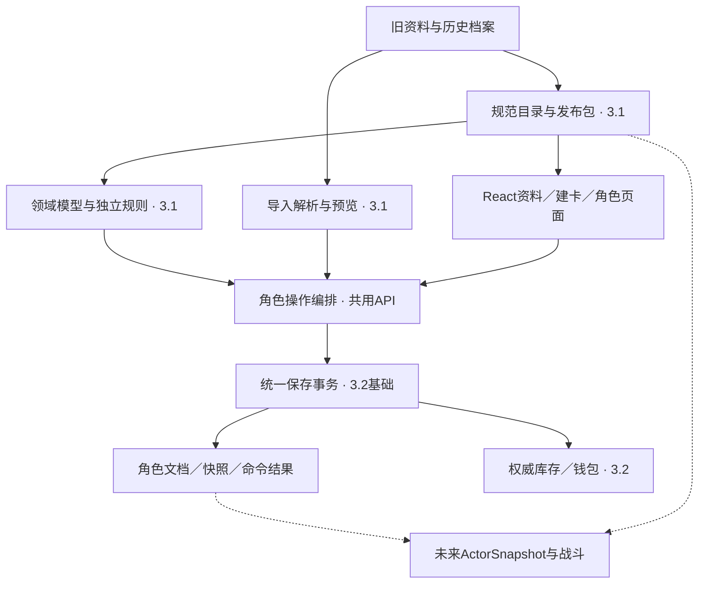

# 迁移接入与交付边界_20261006_v1

> 打包阅读副本。原始材料：[迁移接入与交付边界_20261006_v1.json](../01_计划与设计材料/迁移接入与交付边界_20261006_v1.json)。原JSON字节保持不变；正文中的已打包链接改为相对路径。

# 接入方案与设计状态

日期：2026年10月6日；版本：v1，接入与交付边界候选。所属：[一期迁移总计划](来源调查与迁移总计划_原阶段记录.md)。角色领域继续以[T07修订后的v0.2.2](https://chatgpt.com/space/page_0f31efad73648191a93884a336df0531)为候选依据，不另建第二套角色模型。

建议沿用目标仓库的React／Fastify／TypeScript和PostgreSQL，抽取资料、领域结构及独立规则，通过现有角色编辑核心的适配器接入云端角色与资产服务。3.1负责迁移业务所需的前后端，3.2提供账号、权限、持久化和资产基础；共享契约及跨对象事务共同评审。

本轮完成接入方案与分批验收设计。技术建议仍需双方共同评审，不表示公共契约、数据库和生产服务已经实现。完整职业战斗审查与执行器不作为迁移架构定稿或一期交付的前置条件；C01已有22／119条审读及原始答复保留，当前不继续C01-c。代码实施仍按用户要求延后。

## 已确认的产品边界

| 事项 | 结论 | 接入影响 |
| --- | --- | --- |
| 资料访问 | 用户已确认：已发布规则公开浏览和搜索 | 无需登录即可查看；发布后台、未发布资料和角色隐私仍按各自权限处理 |
| 云端首轮范围 | 用户已确认：正式记录与历史先接云；未保存草稿留本机 | 跨设备能读取正式版本；跨设备恢复未保存草稿后续再做 |
| 团与时间线 | 已有用户确认：一期不跨线复用；同线单团 | 由服务端关系约束检查，不信任上传JSON中的团／拥有者声明 |
| 开发阶段 | 用户要求总体设计完成后再编码 | 本轮只有设计文档与证据记录；不创建业务包、接口、SQL或迁移文件 |
| 待核对导入 | 用户确认：未知技能来源仍可保存为待核对角色，随后补全 | 原文、数值与UID保留；受影响学习／成长先阻止自动执行；建卡未完成草稿仍留本机 |
| 未入团正式角色 | 用户确认可先保存，由本人管理；首次入团后绑定时间线与团 | 服务owner必需，未绑定元数据可空；绑定后不可跨线重绑或借清关联复用 |
| 起始资产归属 | 用户确认每个角色独立钱包和库存，起始资产归新角色 | 账号只授权访问，不共享不同角色余额／库存 |
| 未入团资产范围 | 用户确认仅持有与配装，暂不开放市场交易或跨角色转移 | 先保存资产，交易资格待实际入团及服务授权，不在创建时转移到旧角色 |

## 当前接入基线

本轮读取的是D:/Download/Snode的本地副本，HEAD为929cd8c4ac48d8aa268608411c77e95753bd0655，分支codex/character-management-implementation0，含23项既存未提交候选改动。本轮没有重新验证远端最新main，不能把这些本地候选称为远端已发布功能。

| 已存在 | 可沿用 | 尚缺 |
| --- | --- | --- |
| 工程基础 | apps/web、apps/api、packages/contracts、packages/db及现有构建检查入口 | 游戏业务模型、生产路由和数据库关系 |
| 角色编辑候选 | ManagementView v1、命令头、编辑状态机、输入保留、草稿恢复、冲突与历史预览 | 完整CharacterDocument适配、真实身份与权限、HTTP服务、云端正式保存 |
| 本机持久化 | IndexedDB的当前记录／快照／幂等及草稿版本保护，可作为行为参考 | 本机记录不能作为生产角色表；云端事务与权限还未实现 |
| 正式contracts和db | 共享协作入口已存在 | contracts仍以health／ready为主；db只有最小users表 |
| 旧仓库和既有调查 | 原文、稳定ID映射方向、已核验规则、导入逻辑参考、T06／T07样例 | 全量规范目录、React业务页面、正式Schema和真实迁移联调 |

依据为目标仓库[README](../04_目标项目参考/README.md)、[开发说明](../04_目标项目参考/docs/development.md)、[管理核心说明](../04_目标项目参考/docs/proposals/character-management/README.md)、[候选契约](../04_目标项目参考/docs/proposals/character-management/contracts.ts)和[适配器](../04_目标项目参考/docs/proposals/character-management/adapter.ts)。这些是只读审查位置，本轮不改变它们。

## 模块落位与职责

下表中的model、catalog、rules及迁移工具位置是建议新增目录，尚未创建。沿用此前model命名，不再引入另一套domain包；可以按实际复用关系合并文件，包的数量不是交付标准。

| 模块／位置 | 责任 | 内容与边界 |
| --- | --- | --- |
| packages/model（建议新增） | 3.1主导、3.2共同评审 | 精确定义引用、CharacterDocument、能力UID、获取与成长事实、运行时结构校验；无React、HTTP、数据库或浏览器依赖 |
| packages/catalog（建议新增） | 3.1 | 完整正文、规范资料、不可变发布清单、旧ID映射、目录读取与索引；依赖model；不写角色和资产 |
| packages/rules（建议新增） | 3.1 | 建卡、学习、成长、派生值及操作计划；只实现已确认的一期规则；依赖model及只读目录接口；不存盘、不弹窗、不调用钱包 |
| packages/contracts（已有） | 共同评审；3.1提供领域语义，3.2核对服务边界 | 请求、响应、ManagementView、命令回执、错误与分页协议；引用model的公共类型；不包含界面状态或规则执行 |
| apps/web（已有） | 3.1负责迁移页面；3.2负责账号、团与经济页面 | 资料、建卡、成长、角色管理、导入预览；复用现有角色编辑核心；读契约与投影；客户端预览不授权写入 |
| apps/api（已有） | 按业务分工共同接入 | 3.1实现目录、规则预览及角色操作编排；3.2提供身份、权限、保存和资产基础；服务端校验规则，统一事务入口；不建立第二套角色服务 |
| packages/db（已有） | 双方共同评审Schema与迁移；3.2主导保存及资产基础 | 角色记录、快照、命令记录、授权关系、库存与流水；角色灵活内容建议JSONB；权限与资产另有权威关系 |
| scripts/catalog、迁移适配模块（建议位置） | 3.1 | 资料提取、差异、旧档案解析、映射和迁移预览；用共同model与规则；解析文件不会直接写库 |
| 未来战斗模块（本轮只保留接口方向） | 后续战斗开发 | 从已保存角色及资料生成独立ActorSnapshot，后续处理行动和效果；不参与一期保存链；不得修改角色文档或资产作为临时战斗状态 |

3.1可以在apps/api实现其目录、预览、学习和成长编排，也可以提交这些功能所需的数据库变更；涉及共享结构时由双方评审。3.2提供保存、身份和资产基础，并不意味着迁移组只写前端。一次角色操作最终只有一个服务端提交入口，不让前端先写角色、再调用另一接口补写资产。

## 角色数据与服务存储

建议采用“关系元数据＋JSONB领域文档”的存储方式，符合当前角色选择与获取记录较灵活的情况；钱包、库存及授权关系使用独立权威模型。具体物理表、索引和字段名称由共享评审确定，本节不是SQL迁移。

| 数据 | 建议内容 | 权威与读写限制 |
| --- | --- | --- |
| 角色服务记录CharacterRecord | characterId、ownerUserId、时间线／团关系、lifecycle、recordRevision、schemaVersion、rulesetReleaseId、完整document | 身份、权限、系统时间和修订号由服务设置；领域文档不自行授予团权限 |
| CharacterDocument | 建卡选择、职业进度、来源与获取记录、能力UID、成长事实、资源、人工调整、资料引用及迁移信息 | 保存角色事实；ManagementView只是投影，不能替代全文；装备引用不拥有库存余额 |
| 不可变历史快照 | 角色ID、修订、文档结构／资料版本、完整文档、关联命令、操作者、原因和时间 | 正式提交后生成；既有快照不改写，恢复作为新命令产生新修订 |
| 命令结果记录 | 经验证主体＋commandId、目标角色、规范化请求指纹、结果及提交关联 | 同键同请求返回同结果；同键不同请求拒绝；创建也保留已创建的角色ID |
| 库存与钱包 | 物品实例、数量、归属、资产修订、装备关系和经济流水 | 由3.2提供权威数据；角色文档只保留约定引用，旧快照不可覆盖它 |
| 本机草稿 | 账户／角色／编辑会话／草稿身份、baseRevision、draftVersion、原始输入、在途命令和冲突基线 | 允许无效输入；不作为正式版本；本轮不提供云草稿与跨设备合并 |
| 资料发布登记 | 发布ID、清单哈希、兼容结构版本、发布状态及不可变产物位置 | 规范资料经构建发布；索引可重建，不反向成为正文或规则权威 |

文档结构版本、资料发布版本、角色修订、ManagementView版本和本机draftVersion分别承担兼容、规则绑定、并发、界面协议及草稿排序，不能共用一个version。定义引用精确到id＋revision，发布清单固定它们的对应关系；读取时找不到旧版本必须返回问题，不能悄悄改查latest。

资料原文与用户／DM更正作为不同证据保留。初始能力、跨职业获取、同名变体、牧师领域和新增阶位都由数据关系表达，不把职业或人物编写成新的程序class。历史来源不足时保留原事实和问题，不默认阶位、风格或生命成长。

角色记录可保存不等于合法建卡。是否缺少必需选择、引用未识别或规则未支持，应有独立的校验结果／问题状态；不能将现有lifecycle=active解释为“已合法”。正式建卡命令必须完成其支持范围内的规则校验。

## 接入已有角色管理核心

继续使用CharacterDocumentAdapter的三个责任：validateDocument验证完整输入；toManagementView在服务元数据和授权策略下生成只读投影；applyRegisteredEdits将已授权的登记操作不可变地应用到领域文档。领域名称统一为CharacterDocument，适配器注释中的CharacterData视为此前称呼，不再建立第二份全量结构。

| 现有约定 | 接入方式 | 必须保持的行为 |
| --- | --- | --- |
| ManagementView.profile | displayName和story映射到完整角色资料区 | 显示值不是拥有者或权限；字符预算属于软件限制，不是游戏规则 |
| numericFields／fieldRef | 以共同字段注册表映射领域字段、显示策略和编辑策略 | 0、null、未提供与无效原始输入区分；不能自动填0或截断数值 |
| 候选hp.current／fp.current等 | 现有演示还有hp.temporary、shield.manual、exhaustion.manual；仅作为候选字段核对 | 正式字段需明确是否派生／可手调／带来源；聚合护盾和层数不能直接覆盖结构化来源池 |
| UpdateManagementCommand | 保留commandId、characterId、expectedRevision、submittedDraftVersion和edits | 服务端重新核验字段白名单；禁止任意JSON路径写入 |
| CommitReceipt | 原commandId及submittedDraftVersion必须原样关联，返回最新授权ManagementView | 不能用另一次保存或旧会话回执覆盖当前输入 |
| EditorIdentity／contextKey | 继续用于隔离账户和前端异步操作 | 不作为服务端身份；账号切换后旧请求结果不得进入新账户页面 |
| CharacterService端口 | 正式读／写／历史接HTTP适配器；草稿retain／discard等先保持账户隔离的本机适配器 | 保持页面状态机；增加按原commandId核实未知结果的服务能力，不宣称现有端口已全部支持 |
| 草稿恢复 | 复用会话身份、版本条件写、在途检查点、复制确认和清除墓碑 | 首次发送保存前先保留检查点；无法保留应阻止发送；迟到草稿写入不得复活已清除草稿 |

当前已实现的资料／数值／历史编辑可以优先接入。成长、装备和结构化状态仍待新的规则操作与投影，不能因为现有页面有分区标题就视为这些功能已经完成。匿名本机create产生的预览记录不得直接冒充云端合法角色；需要明确新建向导、未完成记录及正式创建的转换流程。

账户切换、登出、权限丢失要隔离本机草稿与缓存，重新检查恢复资格。保留用户输入的恢复功能不能暴露另一账户资料，也不能绕过服务端字段权限。

## 命令、预览与保存事务

HTTP路径延续/api前缀，T06列出的目录、角色管理、规则操作、历史及命令核实路径继续作为候选，不因本轮写成文档就成为正式ABI。先冻结请求、响应、权限和失败语义，再由接口评审确定路由命名。

预览输出变更前后差异、费用、授予、选择缺口及规则依据。服务端提交时按绑定发布包和当前记录重新校验并计算；不信任客户端上传的最终生命上限、学习结果或资产计划，也不能将一次旧预览结果直接视为授权。

| 操作族 | 3.1提供 | 统一服务负责 | 事务要求 |
| --- | --- | --- | --- |
| 管理编辑 | 已登记资料／数值字段的含义和文档适配 | 核验拥有者／DM权限、记录修订、领域约束 | 更新文档＋快照＋审计＋回执 |
| 建卡 | 完整选择、规则校验、起始能力与物资计划 | 核验账号和一次性创建、分配身份、创建起始资产 | 角色＋授予记录＋起始资产＋回执一起提交 |
| 升级／学习／替换／授予 | 费用、前置、UID、栏位、成长和永久禁学计划 | 复核当前版本与权限，防止重复领取 | 资源扣除、能力与成长变化、快照和回执原子提交 |
| 装备／卸下／消耗 | 装备条件、派生变化与操作预览 | 核验当前库存归属／数量／资产修订并应用可信计划 | 角色装备引用与权威物品关系一致提交 |
| 导入提交 | 解析、来源映射、未识别项与迁移预览 | 核验身份、迁移授权、去重和历史资产方案 | 角色与允许迁入的资产一起成功或回滚 |
| 恢复历史 | 差异预览与领域兼容检查 | 当前权限与引用有效性、资产重新核验 | 产生新修订；原历史不变；钱包、库存和团权限不回滚 |
| 规则版本迁移／人工裁定 | 版本差异、影响与操作依据 | 裁定角色范围、操作者权限和留痕 | 明确命令提交；不在读取或刷新时自动变更 |

推荐提交顺序：验证登录和对象权限，校验请求结构与命令关联，查询已存在的命令结果；对新命令读取并锁定或条件更新当前角色，检查expectedRevision及相关资产版本，重做规则验证，最后在同一数据库事务保存当前记录、快照、审计、命令结果及涉及的资产变化。重复已完成命令应先识别幂等结果，不能因当前revision已增加误报为新的冲突；读取结果仍须符合当前访问权限。

同一命令的重复请求包括并发请求只能成功应用一次。幂等记录必须有明确保留期限或可查询的长期提交关联；客户端超过约定核实时限不得自动换新commandId重新扣点或授予。

保存响应超时与“确定未提交”不同。结果未知时保留原命令，通过核实接口查结果；前端继续编辑的新输入仍是新草稿。版本冲突返回受授权的新版本和可定位差异；服务不可达、领域不合法、权限拒绝与冲突分别显示，不能都归为“保存失败后重试整份角色”。

## 资产、历史和导入的边界

库存和钱包只有3.2的权威数据源。3.1可以发起配装、消费、起始物资和迁移操作，但提交的是意图及经服务复核的规则计划，不能从角色页面或导入文件任意写入资产余额。

一期推荐同一PostgreSQL中的统一事务，不先采用两个数据库或前端串行调用。3.2资产组件应允许在调用方事务内应用计划，或由同一服务端编排入口包裹。如果实际基础无法提供共同事务，该操作暂不能按完整云端功能验收，需另行设计可恢复的执行与对账状态，不能以角色先保存成功掩盖资产失败。

快照用于角色历史及恢复依据，不回滚已交易物品或货币。恢复旧装备引用前，要检查当前仍拥有该实例、槽位可用及引用兼容；需要玩家补选时保留预览，不凭历史快照重新发物品。归档与删除是否允许、在团角色如何处置、跨对象历史保留期限由3.2共同确认，未确认操作不默认开放。

旧JSON／XLSX中的资产是历史迁移依据，不是写入授权。没有资产迁移权限时仍能解析和展示，但不能报告整份角色已完整迁入；确认提交需说明阻塞项与可保留的未处理内容。已导入奖励和物资不重放建卡、升级或学习流程。

新版JSON导出以版本化领域文档和允许导出的资产快照／引用为边界；服务身份字段供诊断或关联，不作为导入时恢复权限的依据。XLSX只保证约定模板及保留元数据情况下的恢复范围，任意第三方改写不作无损承诺。正常保存及往返保持技能和天赋实例UID，复制为新角色另有身份策略；同名和跨职业能力按精确来源匹配。

## 公开资料与规则版本接入

公开接口只返回已发布的规范目录、正文、关联资源和可公开来源说明；未发布编辑稿、角色档案及含私人角色数据的原始输入不能因为属于“资料文件”就公开。首个查询切片可以不依赖登录上线评审。

规范JSON／内容块与资源是一期资料编辑来源，经结构、引用和全文覆盖检查后构建不可变发布包。产物可以先由应用部署文件提供，后续迁到对象存储；数据库只登记发布清单与引用，不形成第二个可编辑规则来源。发布产物的位置和缓存方案由实现时确定。

角色绑定特定release，资料库可选择当前公开版本，角色能力详情必须解析该角色的精确版本。资料页面、学习面板、主职业树和已学能力详情使用同一正文组件及定义解析器；召唤物、随机表、升级、图纸等关联内容要继续展开可读，不能退化成摘要。

“可查阅”“可用于一期建卡／成长计算”“可自动执行战斗”是不同支持范围。未实现战斗效果仍能完整展示，若某条规则影响当次建卡或学习合法性且尚不明确，则阻止该项自动提交或走授权人工裁定，不用猜测公式，也不阻止其他已确认内容。

新增职业、神圣领域、阶位及同名来源条目一般通过新增定义与关系扩展；新的执行含义才需要增加受控规则分支及实现。只公开原文不表示已支持自动计算，规则包更新也不默默升级旧角色。

## 分批交付与验收

B0至B6是对已有M0至M7、T00至T15的交付分组，不重编号，也不自动开始工程实现。本轮仅确定分组；各批实现需等总体设计收敛并按用户安排开展。未具备3.2服务时可用明确标识的测试适配器推进，但不能验收为云端完成。

| 批次／关联任务 | 产物 | 前置及验收重点 |
| --- | --- | --- |
| B0 共同契约与适配边界（T06、T07） | 最小公共字段／命令／权限／资产责任表、CharacterDocumentAdapter映射、代表样例与异常响应 | 依赖已有调查与共同评审材料；共同评审最小契约；0/null/缺字段含义明确；每个写命令有权限、版本、事务和幂等要求；候选类型不直接当生产协议；设计收敛及后续实现的起点；不需要全职业战斗审查 |
| B1 第一条公开资料流程（T08） | 一个发布包切片、公开目录API、搜索筛选、完整详情和关联单位详情 | 依赖B0；未登录可查；资料页、学习入口和能力详情读取相同精确引用；正文、升级表及召唤物数据完整；错误版本不回退latest；首个切片验收不等于全部资料完成 |
| B2 云端正式角色记录接入（T10、T14） | 真实登录／授权、完整文档保存、管理投影读取、显式提交、历史与命令核实；本机草稿适配 | 依赖B0；真实数据库重开可读；跨设备可读已保存记录；重复命令不重复写；冲突保留输入；响应丢失核实原命令；无权用户不能读写；保存通道验收不等于合法建卡；测试或经授权导入的待核对记录明确标识；未完成新建向导仍是本机草稿；云草稿不在首轮 |
| B3 最小合法建卡闭环（T10） | 一个代表角色的选择、规则预览、服务复核、创建、起始资产与面板 | 依赖B1、B2；必需选择齐全、前后端用同版本规则；创建和资产一起提交或回滚；奖励仅发一次；保存失败保留输入；仅声明已验证组合；不能将一个职业通过当作全部职业可建卡 |
| B4 成长和角色操作闭环（T12、T14） | 升级、学习、授予／放弃、装备、当前资源、人工状态、历史恢复命令 | 依赖B3；跨职业来源与UID不丢；同名变体不混；栏位与永久禁学正确；费用和收益不重放；装备检查当前归属；恢复不回滚钱包；一期手动维护状态；不自动执行攻击、回合、反应和战斗效果 |
| B5 一期资料及建卡管理覆盖、历史迁移（T09、T11、T12、T13） | 全部公布资料与建卡分支、完整管理功能；新版JSON、旧存档及约定XLSX的预览／导入／导出 | 依赖B1、B3、B4；按来源清单逐项覆盖；真实档案迁移；未知内容保留；多槽位与多表不误选；技能和天赋UID往返；不重复奖励或资产；可按分支并行交付；不要求把所有技能转成战斗执行代码 |
| B6 3.2完整联调与一期交付（T14、T15） | 团／DM及经济接口完整联调、移动端与真实团试用、范围说明和维护手册 | 依赖B2、B4、B5；单线单团约束、授权、并发、失败恢复和资产一致性通过；360/390/1440视口及真实团流程验收；剩余人工事项可定位；身份、保存、基本资产依赖必须在B2/B3先接；B6不是到最后才开始接3.2 |

B0按所需接口分项评审，不要求公开查询先等待团转移、云草稿或全部角色操作协议。B1与B2在各自最小契约确定后可分别推进；B3第一次把规则建卡、正式记录和资产贯通。全量资料转换、建卡分支和旧格式盘点可分批并行准备。完整导入适配在核心保存与角色操作稳定后推进，符合目标仓库现有候选说明中的优先顺序。

不能将接口Mock通过、浏览器本机保存、一个角色建卡成功或T07样例通过宣称为整个3.1完成。最终交付需对3.1.1、3.1.2、3.1.3的公开范围逐项覆盖，同时与3.2真实保存、权限及资产服务联调。全部技能的战斗执行编码不列入本期验收门槛。

## 接入验收场景

这些是后续实现必须验证的场景，本轮没有执行生产API、数据库或页面验收。

| 编号 | 场景 | 应有结果 |
| --- | --- | --- |
| A01 | 未登录搜索技能并查看召唤物；同请求尝试读私有角色 | 公开全文及关联单位可读；角色接口按权限拒绝 |
| A02 | 读取旧release的跨职业同名技能 | 来源、阶位、成长绑定及UID正确；不得改取主职业或latest |
| A03 | 负HP、0、null、无效数值草稿保存／恢复 | 原始输入保留；正式保存按字段规则处理；无效值不静默变0 |
| A04 | 保存响应丢失后重试同commandId；并发发送两次 | 只产生一次正式变更／扣点／奖励；可核实原结果 |
| A05 | 同commandId更换payload | 拒绝，不套用旧回执；后续命令必须有自己的身份 |
| A06 | 两设备同时编辑，第一台提交后第二台保存 | 第二台得到冲突，保留输入和原基线，不覆盖新版本 |
| A07 | 建卡或升级最后一步资产写入失败 | 整个操作回滚；不留下半个角色、重复能力或部分资产 |
| A08 | 卖出武器后恢复装备它的旧快照 | 保留当前资产权威，提示引用失效或补选；不重新获得武器 |
| A09 | 登出／换号／DM权限丢失后迟到的加载和保存响应 | 不进入另一账户页面；新请求重新授权，草稿不可越权恢复 |
| A10 | 旧文件含伪造owner／campaign、未知技能及重复导入 | 服务重新核定身份／关系；未知内容保留；不重复发奖励和资产 |
| A11 | 新领域、新阶位、同名新来源进入目录 | 已有角色及旧版本可读；数据驱动扩展；未支持的计算明确提示 |
| A12 | 正式角色跨设备重开，但原设备有未保存草稿 | 其他设备读正式版本；本机草稿仍是本机草稿，不报告已同步 |
| A13 | 首次合法建卡、成长学习、装备和导出各完整走一遍 | 选择、UID、规则版本、历史和资产关系可相互核对；各批支持范围明确 |

与现有候选编辑／草稿回归衔接，实施时补充独立规则、真实数据库事务及真实档案往返验证；选择针对新增行为的检查，不用重复自证同一投影逻辑。

## 待共同评审的具体决定

产品选项与技术评审分开记录。资料公开、正式记录先接云、同线单团、暂不编码及允许保存待核对导入角色已经由用户确认；下面七项仍是给双方开发评审的技术建议，不表示已获另一开发者同意。

| 编号 | 当前建议 | 完成评审需要落实 |
| --- | --- | --- |
| S01 公共契约 | 采用CharacterDocument＋ManagementView v1；保留现有命令头，fieldRef受注册表限制 | 最小运行时Schema、字段映射／可编辑策略、命令结果和错误格式；结构版本兼容规则 |
| S02 身份与权限 | 接3.2 verified identity及对象／字段权限 | 拥有者、同团DM及未授权者操作矩阵；账号变化／权限失效的接口行为 |
| S03 存储与保存 | 关系元数据＋JSONB；当前文档、快照、审计、命令结果同事务 | Schema关系、expectedRevision检查、幂等唯一性／保留、未知结果核实；恢复历史政策 |
| S04 资产 | 3.2权威库存／钱包；同库事务承接3.1可信计划 | 创建、装备、消耗及历史迁移的原子边界；资产版本与冲突；禁止快照回滚余额 |
| S05 云草稿 | 首轮暂不交付；本机账户隔离与恢复先落实 | 首轮检查点和身份切换验收；后续云草稿的预算／期限／合并另行评审 |
| S06 团生命周期 | 一期单线单团，禁止跨线复用 | 未入团可先保存已获用户确认；服务owner、首绑时间线固定和唯一团关系；转团、团关闭与归档删除授权／流程另定 |
| S07 发布与裁定 | 角色固定发布包；升级专门预览与提交 | 旧版本保留、兼容声明、发布权限，以及人工裁定来源／范围／审计 |

本轮没有向其他开发者、飞书或DM发送消息。现有共享评审要求来自目标仓库的README与开发说明；本方案是已经整理好的评审材料。资料内容未定项与规则问卷继续保留，只有影响当前自动操作的未决项才阻塞该项。

## 总体设计收敛与下一步

迁移设计完成的门槛是：三个子任务有明确交付、共同领域模型可承载代表资料、页面操作有输入输出及失败流程、服务／资产权威明确、最小契约可共同评审、各批有可核验范围。它不要求先完成所有职业的战斗机制和完整战斗引擎。

范围、基础规则、领域代表验证、接入／交付和操作层已完成交叉收敛，见[迁移总体设计收敛与共享评审包v1](迁移总体设计收敛与共享评审包_20261006_v1.md)。它归并12项技术建议、最小Schema示例和各批门槛；完整文档／正文Schema、关系、字段／权限及跨资产事务在所需批次共同确认。候选已可评审，尚未成为生产实现或自动授权开工。

本轮[迁移总体设计收敛与共享评审包v1](迁移总体设计收敛与共享评审包_20261006_v1.md)完成总体候选收敛。下一步优先评审B1／B2所需决定，随后按确认范围形成工程任务；不再等待全职业技能审查。用户当前仍只做设计，代码不自动开始，云草稿／转团等后续范围不阻塞公开目录。

## 依据与本轮验证范围

本方案结合[T06字段／接口候选](T06_字段与接口候选_20261005.md)、[T07资料验证](https://chatgpt.com/space/page_0f31efad73648191a93884a336df0531)、[现有总体结构](资料与领域框架调查_原阶段记录.md)，以及本轮目标仓库静态审查和用户的两项产品确认。T07所选36例与27项入口检查是既有阶段记录，本轮没有重复运行或将其扩展为生产验收。

本轮核对模块责任、写操作的权限／事务／幂等、分批依赖、三个一期子任务覆盖、既有管理核心兼容及延期战斗范围，并检查文档回读和只读源码基线。业务代码、规则原件、目标仓库和既有问卷不修改；页面原生预览未提供，回读校验不等于视觉渲染验收。

本地镜像：[迁移接入与交付边界_20261006_v1.json](../01_计划与设计材料/迁移接入与交付边界_20261006_v1.json)，包括本文、结构化边界／交付表、决策状态及审查证据。
